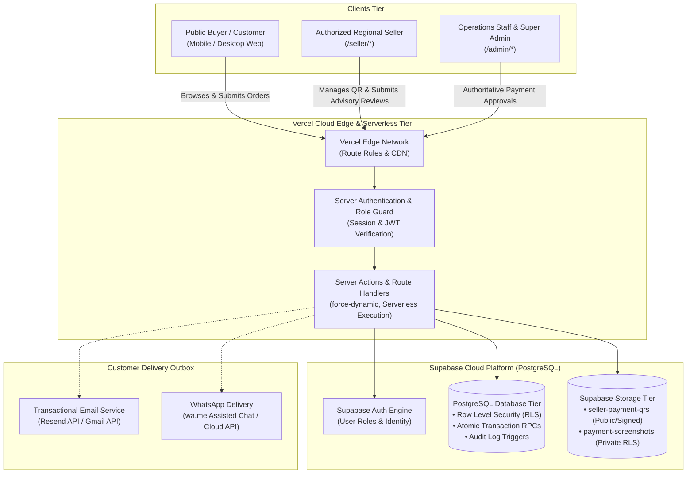
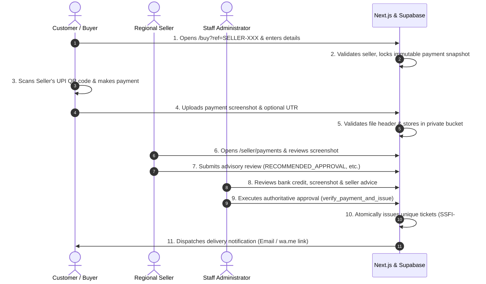
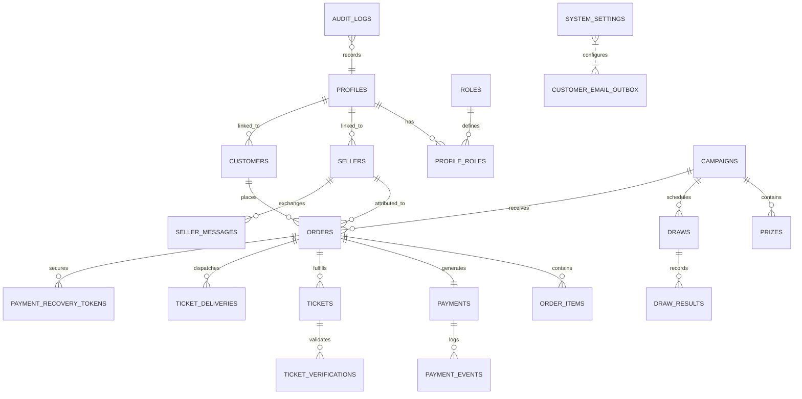

# SSFI Lucky Draw Management System

A production-grade, secure, and verifiable fundraising ticket reservation and payment management web application built for the **Senthang Students Fellowship India (SSFI)**.

The system coordinates transparent lucky draw operations across an authorized regional network of sellers, enforces customer payment proof verification via personal UPI QR codes, enables seller advisory reviews, maintains authoritative administrative verification, and issues cryptographically verifiable digital tickets with automated outbox delivery.

---

## Table of Contents

1. [Project Overview](#1-project-overview)
2. [Project Objectives](#2-project-objectives)
3. [Key Features](#3-key-features)
4. [Technology Stack](#4-technology-stack)
5. [Final System Architecture](#5-final-system-architecture)
6. [User Roles and Permissions](#6-user-roles-and-permissions)
7. [System Workflow](#7-system-workflow)
8. [Ticket Issuance and Verification](#8-ticket-issuance-and-verification)
9. [Payment Workflow](#9-payment-workflow)
10. [Database Architecture](#10-database-architecture)
11. [Security and Access Control](#11-security-and-access-control)
12. [Project Structure](#12-project-structure)
13. [Installation](#13-installation)
14. [Environment Configuration](#14-environment-configuration)
15. [Local Development](#15-local-development)
16. [Database Migration Instructions](#16-database-migration-instructions)
17. [Testing](#17-testing)
18. [Deployment](#18-deployment)
19. [Preview and Production Environments](#19-preview-and-production-environments)
20. [Troubleshooting](#20-troubleshooting)
21. [Terms and Conditions](#21-terms-and-conditions)
22. [Project Limitations](#22-project-limitations)
23. [Contribution Guidelines](#23-contribution-guidelines)
24. [License](#24-license)

---

## 1. Project Overview

The **SSFI Lucky Draw Management System** provides an end-to-end digital portal supporting the annual educational and student fellowship fundraising initiatives of Senthang Students Fellowship India.

Operating under a decentralized financial model, the application allows authorized regional sellers to accept payments directly into their designated personal UPI accounts, while preserving complete centralized auditability, tamper-proof payment destination snapshots, and strict administrative authority over ticket generation.

- **Production URL:** [https://ssfiticket.vercel.app](https://ssfiticket.vercel.app)
- **Framework:** Next.js 16 (App Router) with React 19 and TypeScript 5
- **Backend & Database:** Supabase (PostgreSQL 15+ with Row Level Security and Atomic Transaction RPCs)
- **Deployment Platform:** Vercel Cloud Platform with Edge Network and Serverless Execution
- **Primary Target Audience:** SSFI community members, student patrons, regional sellers, and executive administrators

---

## 2. Project Objectives

- **Empower Distributed Student Sales:** Enable accredited regional student representatives across India to mobilize fundraising within their respective localities.
- **Eliminate Misdirected Payments:** Bind every order directly to an immutable snapshot of the seller's verified UPI payment destination.
- **Enforce Fraud Prevention:** Require mandatory customer payment screenshot uploads validated by both the attributed seller (advisory) and staff administrators (authoritative).
- **Ensure Absolute Public Trust:** Provide instant, public QR code ticket verification with draw serial number validation.
- **Guarantee Zero Ticket Duplication:** Utilize sequential PostgreSQL transaction locks to guarantee strictly unique, sequentially allocated ticket numbers.
- **Ensure High-Concurrency Mobile Stability:** Guarantee fast, error-resilient browsing across Android, iOS, and desktop viewports.

---

## 3. Key Features

- **Public Landing Page & Countdown:** Official campaign countdown timer operating in Indian Standard Time (IST, UTC+05:30), celebration prize breakdown, and authorized regional seller directory.
- **Seller Referral Purchase Flow (`/buy?ref=SELLER-XXX`):** Fast, mobile-optimized customer order form with real-time campaign schedule enforcement and seller quota validation.
- **Decentralized Seller UPI Management (`/seller/payment-settings`):** Personal QR upload with image signature verification, UPI ID, account name, and active toggle.
- **Mandatory Payment Proof Upload:** File signature validation (JPEG, PNG, WebP) with private, encrypted storage in Supabase Storage buckets.
- **Seller Advisory Review Interface (`/seller/payments`):** Regional sellers inspect transaction screenshots via short-lived signed URLs and record advisory recommendations (`Recommend Approval`, `Recommend Rejection`, `Needs Review`).
- **Admin Verification Command Center (`/admin/payments`):** Operations managers verify bank credits and execute atomic ticket issuance.
- **Digital Ticket Issuance & Delivery Outbox:** Automated generation of digital ticket certificates with verifiable QR codes, transactional email outbox dispatch, and assisted WhatsApp Click-to-Chat (`wa.me`) transmission.
- **Public Verification Portal (`/verify/[ticketNumber]`):** Instant ticket validation for draw auditors and ticket holders.
- **Operational Data Export:** Real-time Excel (`.xlsx`) and PDF export of order ledgers, seller performance metrics, and audit logs.

---

## 4. Technology Stack

| Layer | Technology | Description |
| :--- | :--- | :--- |
| **Runtime & Framework** | Next.js 16.4.3 (App Router) | React Server Components, Server Actions, Turbopack build engine |
| **Frontend UI** | React 19.3.0 | Modern declarative components with responsive Tailwind CSS |
| **Language** | TypeScript 5.0 | Strict type-safety across client, server, and database schemas |
| **Styling** | Tailwind CSS 4 | SSFI custom color palette and responsive utility classes |
| **Database & Auth** | Supabase (PostgreSQL 15+) | Row Level Security (RLS), atomic RPC stored procedures, triggers |
| **Object Storage** | Supabase Storage | Encrypted private buckets (`payment-screenshots`) & public buckets (`seller-payment-qrs`) |
| **Icons & Media** | Lucide React | High-performance SVG icons |
| **Document Generation**| ExcelJS, jsPDF, QRCode | Serverless export of ledgers, PDFs, and ticket verification QR codes |
| **Validation** | Zod 4 | Runtime schema validation for forms, APIs, and file signatures |
| **Testing** | Node.js Test Runner & Playwright | 23 native unit/integration test suites (310 assertions) and mobile emulation |

---

## 5. Final System Architecture



For complete technical specifications, see [System Architecture Documentation](docs/architecture/system-architecture.md) and [Architecture Overview](docs/ARCHITECTURE.md).

---

## 6. User Roles and Permissions

The system implements strict Role-Based Access Control (RBAC) enforced through Supabase Row-Level Security and Next.js server-side route guards:

| Permission / Capability | Public Buyer | Seller | Staff / Admin | Super Admin |
| :--- | :---: | :---: | :---: | :---: |
| Browse Campaign & Seller Directory | :white_check_mark: | :white_check_mark: | :white_check_mark: | :white_check_mark: |
| Place Order via Referral Code (`/buy`) | :white_check_mark: | :white_check_mark: | :white_check_mark: | :white_check_mark: |
| Upload Payment Screenshot Proof | :white_check_mark: | :white_check_mark: | :white_check_mark: | :white_check_mark: |
| Verify Ticket Publicly (`/verify/*`) | :white_check_mark: | :white_check_mark: | :white_check_mark: | :white_check_mark: |
| Manage Personal UPI QR & Toggle Active | :x: | :white_check_mark: | :white_check_mark: | :white_check_mark: |
| Inspect Attributed Payment Proofs | :x: | :white_check_mark: | :white_check_mark: | :white_check_mark: |
| Submit Advisory Review Recommendation | :x: | :white_check_mark: | :white_check_mark: | :white_check_mark: |
| Authoritative Payment Approval | :x: | :x: | :white_check_mark: | :white_check_mark: |
| Trigger Ticket Generation (`issue_tickets`) | :x: | :x: | :white_check_mark: | :white_check_mark: |
| Export Campaign Ledgers (Excel / PDF) | :x: | :x: | :white_check_mark: | :white_check_mark: |
| Manage System Campaign Quota & Schedule | :x: | :x: | :x: | :white_check_mark: |
| Assign Roles & Manage User Accounts | :x: | :x: | :x: | :white_check_mark: |

For comprehensive role separation details, see [Authentication and Authorization Documentation](docs/authentication-and-authorization.md).

---

## 7. System Workflow



---

## 8. Ticket Issuance and Verification

### 8.1 Sequential Ticket Numbering
- **Format:** All official tickets follow the strict format `SSFI-######` (e.g., `SSFI-000001` through `SSFI-999999`).
- **Atomic Generation:** Ticket numbers are generated within a serializable PostgreSQL database transaction driven by `ssfi_ticket_number_sequence` inside the `issue_tickets(p_order_id)` stored procedure.
- **Uniqueness Guarantee:** Strict database-level uniqueness prevents any duplicate ticket numbers. (Note: Standard PostgreSQL sequences allocate numbers monotonically and atomically, but are not guaranteed to be gapless if transactions abort or reissues occur).

### 8.2 Authoritative Live Verification
- **Public Route:** Any participant or draw official can verify a ticket at:
  ```
  https://ssfiticket.vercel.app/verify/[ticketNumber]
  ```
- **Live Database Inspection:** Verification executes an authoritative, real-time database query against Supabase. It does **not** rely on static offline cryptographic proofs.
- **Verification States:**
  1. `ISSUED` / `ACTIVE`: Valid, confirmed ticket eligible for the draw.
  2. `VOID`: Annulled or refunded ticket, ineligible for prizes.
  3. `Pending` / `Not Found`: Unregistered ticket number or unapproved reservation.
- **Embedded QR Code:** Each ticket certificate contains a direct verification QR code encoding the authoritative URL.

For complete verification specifications, see [Ticket Verification Documentation](docs/ticket-verification.md).

---

## 9. Payment Workflow

The application operates a decentralized UPI payment workflow designed specifically for distributed student organizations:

1. **Seller Setup:** Authorized sellers configure their personal UPI ID, account holder name, and payment QR image via `/seller/payment-settings`.
2. **Order Creation & Snapshot Locking:** When a buyer selects a seller on `/buy?ref=SELLER-XXX`, the database trigger `protect_order_payment_snapshot` captures an immutable snapshot of the seller's payment details.
3. **Mandatory Payment Proof Upload:** The customer must upload a payment screenshot. Files undergo strict magic byte validation (`FF D8 FF` for JPEG, `89 50 4E 47` for PNG, `52 49 46 46` for WebP) and are stored in the private `payment-screenshots` bucket.
4. **Seller Advisory Review:** Regional sellers inspect transaction screenshots on `/seller/payments` and submit advisory recommendations (`RECOMMENDED_APPROVAL`, `RECOMMENDED_REJECTION`, `FLAGGED_DISCREPANCY`). Sellers **cannot** approve payments or issue tickets.
5. **Authoritative Staff Verification:** Operations staff inspect bank statements and advisory notes on `/admin/payments`, then execute `verify_payment_and_issue` to confirm payment and issue tickets.

For detailed workflow diagrams, see [Payment Workflow Documentation](docs/payment-workflow.md).

---

## 10. Database Architecture

The application schema comprises 21 relational tables created across 17 sequential schema migrations in Supabase PostgreSQL, enforcing foreign keys, check constraints, and Row Level Security:



For full entity definitions, schema columns, triggers, functions, and RLS policies, see [Database Architecture Documentation](docs/DATABASE.md).

---

## 11. Security and Access Control

- **Row Level Security (RLS):** Enabled across all 17 tables. Anonymous public requests cannot read private financial or customer data. Sellers cannot access peer seller orders or customer screenshots outside their referral scope.
- **Server Actions with Anti-CSRF:** All state-changing operations run through Next.js Server Actions with origin verification.
- **MIME & Magic Byte Validation:** Uploaded QR codes and screenshots are validated by magic byte headers in server memory, preventing file spoofing and malicious payload execution.
- **Zero Client Secret Exposure:** The `SUPABASE_SERVICE_ROLE_KEY` is strictly confined to server-side execution.
- **Audit Logging:** Every administrative verification, seller review, quota change, and role assignment is logged in `audit_logs` with actor ID, IP address, and timestamp.

---

## 12. Project Structure

```text
├── src/
│   ├── app/                          # Next.js 16 App Router Routes
│   │   ├── (public)/                 # Public homepage & terms
│   │   ├── admin/                    # Protected Administrator Workspace
│   │   │   ├── campaign-settings/    # Campaign quota & schedule settings
│   │   │   ├── customers/            # Customer directory & order lookups
│   │   │   ├── orders/               # Order ledger & manual overrides
│   │   │   ├── payments/             # Authoritative payment verification
│   │   │   ├── sellers/              # Seller allocation & status management
│   │   │   └── tickets/              # Ticket ledger & verification audit
│   │   ├── api/                      # Protected Route Handlers (cron, export)
│   │   ├── buy/                      # Public referral purchase workflow
│   │   │   └── order/[orderId]/      # Step 2: Payment submission & status
│   │   ├── login/                    # Multi-role authentication entrypoint
│   │   ├── seller/                   # Protected Seller Workspace
│   │   │   ├── payment-settings/     # Seller UPI QR configuration
│   │   │   ├── payments/             # Seller payment screenshot review
│   │   │   └── orders/               # Attributed orders & sales tracking
│   │   ├── verify/[ticketNumber]/    # Public digital ticket verification
│   │   ├── error.tsx                 # Root resilient error boundary
│   │   └── layout.tsx                # Root layout & font configuration
│   ├── components/                   # Modular React UI components
│   ├── lib/                          # Core business utilities & helpers
│   │   ├── auth/                     # Server auth & role checking
│   │   ├── config/                   # Environment & feature flags
│   │   ├── date/                     # Indian Standard Time (IST) formatting
│   │   ├── payment/                  # QR verification & UPI formatting
│   │   ├── supabase/                 # Client, Server, and Admin Supabase SDKs
│   │   └── validation/               # Zod schemas for contacts & referrals
│   └── server/                       # Next.js Server Actions
│       └── actions/                  # publicOrder, sellerReview, operations
├── supabase/
│   ├── migrations/                   # 17 Sequential schema migration files
│   └── release-candidates/           # Consolidated deployment rollouts
├── tests/                            # 23 Unit & Integration test suites (310 tests)
├── docs/                             # Engineering & architectural documentation
├── next.config.ts                    # Next.js engine configuration
├── package.json                      # Project dependencies & scripts
└── tsconfig.json                     # TypeScript strict configuration
```

---

## 13. Installation

1. **Clone the repository:**
   ```bash
   git clone https://github.com/rose1996iv/ssfi-lucky-draw.git
   cd "Lucky Draw"
   ```

2. **Install project dependencies:**
   ```bash
   npm install
   ```

3. **Configure local environment variables:**
   ```bash
   cp .env.example .env.local
   ```
   Edit `.env.local` with your development Supabase credentials.

---

## 14. Environment Configuration

All required environment variables are documented with safe descriptions in [.env.example](.env.example):

- `NEXT_PUBLIC_SUPABASE_URL`: Supabase project URL.
- `NEXT_PUBLIC_SUPABASE_PUBLISHABLE_KEY`: Public anon key for browser authentication.
- `SUPABASE_SERVICE_ROLE_KEY`: Private server-only key for administrative operations.
- `NEXT_PUBLIC_APP_URL` / `APP_BASE_URL`: Base application URL.
- `CRON_SECRET`: Bearer token for automated schedule transitions.
- `NEXT_PUBLIC_MOCK_PAYMENTS`: Set to `false` in production.
- `RESEND_API_KEY`: Key for customer transactional ticket emails.

> [!WARNING]
> Never commit `.env.local` or disclose the `SUPABASE_SERVICE_ROLE_KEY` in source control or client code.

---

## 15. Local Development

Run the Next.js local development server:

```bash
npm run dev
```

Open [http://localhost:3000](http://localhost:3000) in your browser.

Key quality assurance scripts:
- `npm run typecheck`: Runs strict TypeScript type-checking (`tsc --noEmit`).
- `npm run lint`: Executes ESLint analysis.
- `npm run build`: Tests the production Turbopack build.

---

## 16. Database Migration Instructions

Database migrations are maintained in `supabase/migrations/` and consolidated in:
```
supabase/release-candidates/production-rollout-consolidated.sql
```

To apply migrations manually:
1. Open the Supabase Dashboard for your target project.
2. Navigate to **SQL Editor**.
3. Load and execute `supabase/release-candidates/production-rollout-consolidated.sql`.
4. Verify the required tables, triggers, and storage buckets (`seller-payment-qrs`, `payment-screenshots`) are present.

---

## 17. Testing

The project maintains 23 automated test suites covering 310 unit and integration assertions:

```bash
npm test
```

Key verified test suites:
- `tests/referral.test.ts`: Referral parsing and validation.
- `tests/publicOrder.test.ts`: Order limits, campaign scheduling, and snapshot locking.
- `tests/sellerPaymentQrAndReview.test.ts`: Magic byte image validation and advisory reviews.
- `tests/paymentSubmission.test.ts`: Mandatory screenshot validation.
- `tests/roleRouting.test.ts`: Access control and role redirection.

---

## 18. Deployment

The application is deployed on Vercel with automatic CI/CD integration:

- **Preview Deployment:** Triggered on pull requests or via `npx vercel`.
- **Production Deployment:** Deployed to [https://ssfiticket.vercel.app](https://ssfiticket.vercel.app) via `npx vercel --prod` upon verified release approval.

For complete release procedures, see [Deployment Documentation](docs/DEPLOYMENT.md).

---

## 19. Preview and Production Environments

To ensure zero cross-environment contamination, Preview and Production environments are physically segregated:

| Attribute | Production Environment | Preview Environment |
| :--- | :--- | :--- |
| **Vercel Target** | Production (`ssfiticket.vercel.app`) | Preview Branch Deployments |
| **Supabase Project** | `fohpqheglxhfdecadhzw` | `jiyuiydzsfydjklosvvq` |
| **Database Data** | Live SSFI Fundraising Data | Simulated Test Data |
| **Email Delivery** | Live Customer Dispatch | Simulated / Dry-Run Guarded |
| **Payment Mode** | Live Decentralized UPI (`MOCK=false`) | Mock / Test Enabled |

---

## 20. Troubleshooting

### Why does a seller display "Payment QR Unavailable"?
The seller account exists, but the seller has not uploaded or activated their payment QR (`is_qr_active = false`). The buyer must select another seller from the official directory.

### Why did a mobile browser show "Try Again"?
The application implements resilient error recovery in `src/app/error.tsx`. If network connectivity drops or a stale deployment cache is encountered, clicking **"Try Again"** safely resumes the session without duplicating orders or payments.

### How are timezones handled?
All campaign start and end dates are strictly evaluated in Indian Standard Time (`Asia/Kolkata`, UTC+05:30), ensuring synchronized countdowns regardless of local client timezones.

---

## 21. Terms and Conditions

### 21.1 Official Campaign Prizes
The SSFI Lucky Draw features five guaranteed celebration prizes:
1. **1st Prize:** ₹10,000 Cash Giveaway
2. **2nd Prize:** ₹8,000 Cash Celebration
3. **3rd Prize:** Induction Cooker Giveaway
4. **4th Prize:** Ukulele Celebration
5. **5th Prize:** Mini Soundbox Celebration

### 21.2 Draw Date and Supervision
- **Confirmed Draw Date:** **19 December 2026**
- **Methodology:** Fair, transparent, public drawing supervised by the **SSFI Executive Committee**.
- **Broadcast:** Streamed live across official SSFI YouTube and Facebook channels.

### 21.3 Ticket Conditions
- All ticket sales are final and non-refundable.
- Tickets are tied to the verified customer name and phone number provided at purchase.
- Winning tickets must be claimed within 30 days of the official drawing.

---

## 22. Project Limitations

- **Manual UPI Verification:** Under the decentralized UPI model, bank settlements must be manually confirmed by staff administrators; automated bank webhook callbacks are not supported by personal UPI accounts.
- **Public Verification Connectivity:** Ticket verification on `/verify/[ticketNumber]` requires active internet access to query the live Supabase database.
- **Quota Allocation:** Ticket sales are constrained by total campaign capacity and individual seller quota limits configured by the Super Admin.

---

## 23. Contribution Guidelines

1. **Branching Strategy:** Create all feature branches from `main`:
   ```bash
   git checkout -b feature/your-feature-name
   ```
2. **Code Standards:** Maintain strict TypeScript compliance, Tailwind styling standards, and complete test coverage.
3. **Pre-commit Verification:**
   ```bash
   npm run typecheck
   npm run lint
   npm test
   npm run build
   ```
4. **Pull Requests:** Submit a pull request describing the change, testing steps, and security implications. Never push directly to `main` or production deployment targets.

---

## 24. License

This project is proprietary software developed for and owned by the **Senthang Students Fellowship India (SSFI)**. All rights reserved.

---

**Maintained by Senthang Students Fellowship India (SSFI)** &bull; Dedicated to education, unity, and student fellowship.
