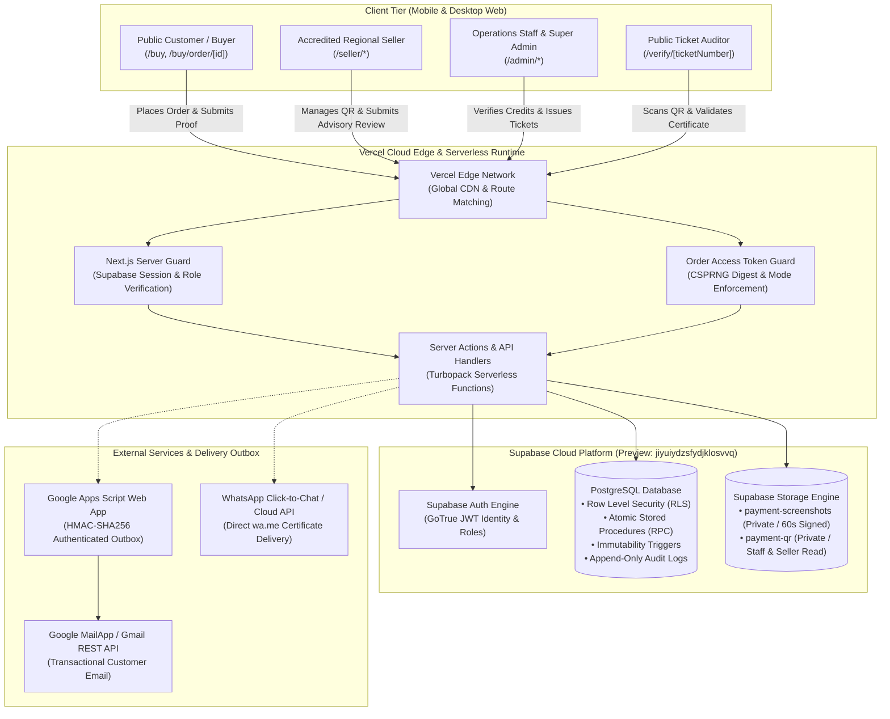
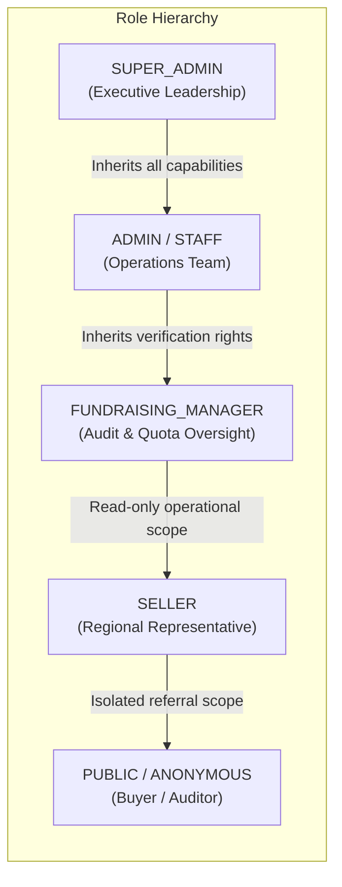
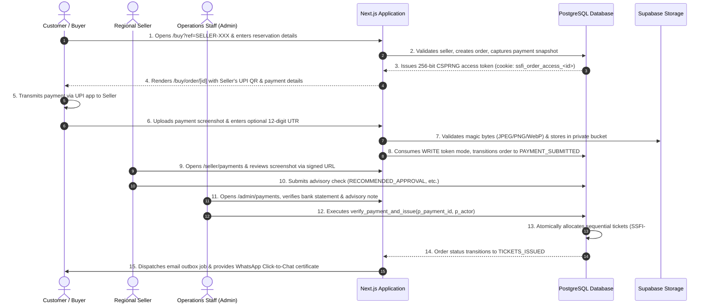
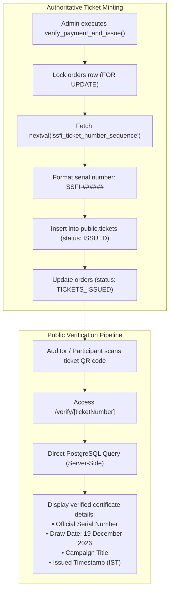
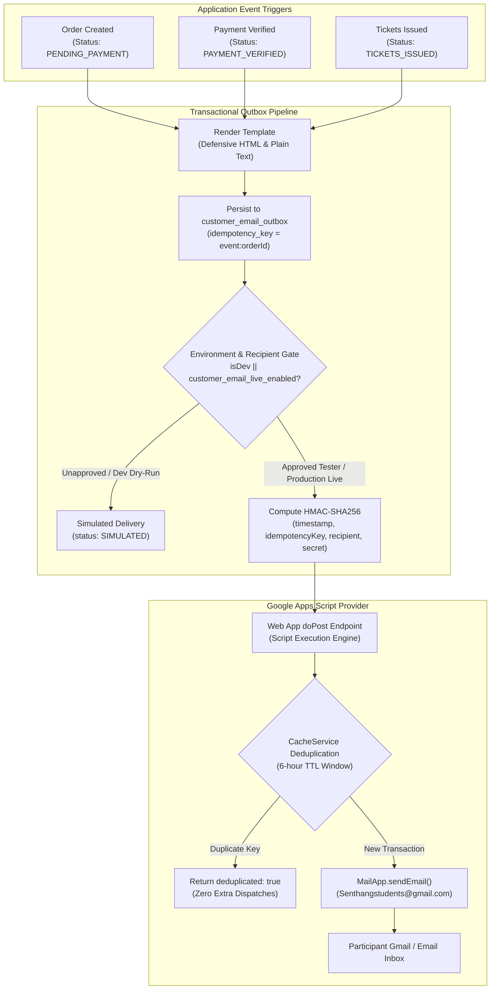
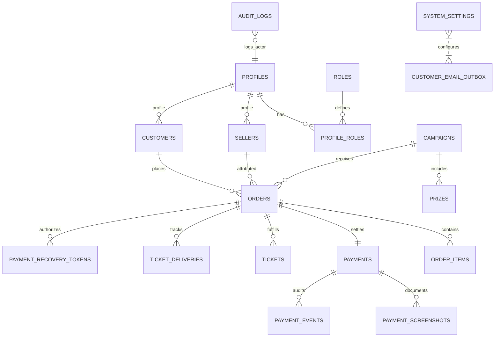
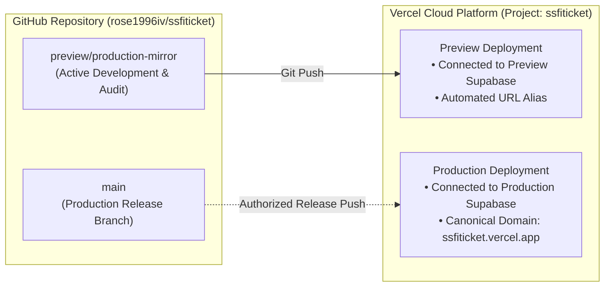

# Senthang Students Fellowship India (SSFI) — Lucky Draw Management System

A production-grade, secure, and cryptographically verifiable fundraising ticket reservation, decentralized UPI payment verification, and automated outbox delivery web application developed for the **Senthang Students Fellowship India (SSFI)**.

The platform coordinates transparent fundraising operations across an accredited regional network of student sellers, binds every reservation to an immutable payment destination snapshot, enforces multi-tier payment proof verification, and issues sequentially numbered digital ticket certificates backed by authoritative live database verification.

---

## Table of Contents

1. [Project Overview & Objectives](#1-project-overview--objectives)
2. [Live Environment Links](#2-live-environment-links)
3. [Preview vs. Production Environment Comparison](#3-preview-vs-production-environment-comparison)
4. [High-Level System Architecture](#4-high-level-system-architecture)
5. [Technology Stack](#5-technology-stack)
6. [Application Modules](#6-application-modules)
7. [User Roles and Permission Matrix](#7-user-roles-and-permission-matrix)
8. [Customer Order & Payment Lifecycle](#8-customer-order--payment-lifecycle)
9. [Seller Onboarding and UPI QR Workflow](#9-seller-onboarding-and-upi-qr-workflow)
10. [Payment Submission and Verification](#10-payment-submission-and-verification)
11. [Ticket Issuance and Public Verification](#11-ticket-issuance-and-public-verification)
12. [Transactional Email Architecture](#12-transactional-email-architecture)
13. [Security Architecture & Remediation](#13-security-architecture--remediation)
14. [Authentication and Authorization](#14-authentication-and-authorization)
15. [PostgreSQL Database Architecture](#15-postgresql-database-architecture)
16. [Row Level Security (RLS) Policies & Stored RPCs](#16-row-level-security-rls-policies--stored-rpcs)
17. [Storage Bucket Architecture](#17-storage-bucket-architecture)
18. [API and Server-Side Architecture](#18-api-and-server-side-architecture)
19. [GitHub and Vercel Deployment Workflow](#19-github-and-vercel-deployment-workflow)
20. [Preview and Production Isolation](#20-preview-and-production-isolation)
21. [Local Installation Instructions](#21-local-installation-instructions)
22. [Environment Variable Reference](#22-environment-variable-reference)
23. [Testing Strategy and Quality Gates](#23-testing-strategy-and-quality-gates)
24. [Backup and Recovery Procedures](#24-backup-and-recovery-procedures)
25. [Operational Security Recommendations](#25-operational-security-recommendations)
26. [Roadmap and Known Limitations](#26-roadmap-and-known-limitations)
27. [Contribution and Release Workflow](#27-contribution-and-release-workflow)

---

## 1. Project Overview & Objectives

The **SSFI Lucky Draw Management System** coordinates annual student fellowship fundraising across distributed chapters in India. Operating under a decentralized financial model, student sellers accept contributions directly into verified personal UPI accounts, while the platform maintains strict centralized auditability, immutable payment destination snapshots, and authoritative administrative control over ticket generation.

### Primary Objectives:
- **Empower Distributed Student Sales:** Enable accredited regional sellers to mobilize fellowship contributions within their local communities.
- **Eliminate Misdirected Payments:** Bind every order at inception to an immutable snapshot of the seller's verified UPI payment QR and virtual payment address.
- **Enforce Fraud-Resistant Verification:** Require mandatory payment screenshot uploads with magic byte validation, reviewed through seller advisory checks and verified authoritatively by operations staff.
- **Ensure Absolute Public Trust:** Provide instant, public QR code ticket verification with draw serial number validation.
- **Guarantee Zero Ticket Duplication:** Utilize sequential PostgreSQL transaction locks to guarantee strictly unique, monotonically allocated ticket numbers.
- **Mobile-First Stability:** Ensure resilient error boundaries and fast performance across mobile browsers (iOS WebKit and Android Chrome).

---

## 2. Live Environment Links

| Environment | Status | Canonical Access URL | Backing Database |
| :--- | :--- | :--- | :--- |
| **Preview Environment** | **ACTIVE & VERIFIED** | [https://ssfiticket-git-preview-production-mirror-rose1996ivs-projects.vercel.app](https://ssfiticket-git-preview-production-mirror-rose1996ivs-projects.vercel.app) | Preview Supabase (`jiyuiydzsfydjklosvvq`) |
| **Production Environment** | **NOT YET RELEASED** | *Awaiting verified owner production rollout authorization* | Production Supabase (`fohpqheglxhfdecadhzw`) |

> [!IMPORTANT]
> **Preview Testing Notice:**  
> The Preview environment is strictly isolated from Production. It connects exclusively to the Preview Supabase instance (`jiyuiydzsfydjklosvvq`), operates on sanitized test records, and executes simulated customer delivery by default. Real financial transactions, real customer SMS/WhatsApp dispatches, and unrestricted live customer emails are prohibited in Preview.

---

## 3. Preview vs. Production Environment Comparison

| Dimension | Preview Environment | Production Environment |
| :--- | :--- | :--- |
| **Git Tracking Branch** | `preview/production-mirror` | `main` |
| **Vercel Project & Target** | `ssfiticket` (Preview deployment alias) | `ssfiticket` (Production domain upon release) |
| **Supabase Project Reference** | `jiyuiydzsfydjklosvvq` | `fohpqheglxhfdecadhzw` |
| **Database Isolation** | Standalone PostgreSQL 15 instance | Standalone PostgreSQL 15 instance (Air-gapped) |
| **Historical Payment Data** | Synthetically sanitized UPI identifiers | Authoritative historical records |
| **Order Access Protection** | Token exchange & HttpOnly cookies active | Token exchange & HttpOnly cookies active |
| **Master Email Sending Gate** | `customer_email_live_enabled = false` | Configurable by Super Admin upon rollout |
| **Allowed Email Recipients** | Explicit test allowlist (`ALLOWED_TEST_EMAIL`) | Verified buyer email addresses |
| **Payment Mode** | Manual UPI with test UTR validation | Manual UPI with live bank credit verification |

---

## 4. High-Level System Architecture



---

## 5. Technology Stack

| Component | Technology | Specification / Purpose |
| :--- | :--- | :--- |
| **Framework** | Next.js 16.4.3 | App Router, React Server Components (RSC), Server Actions, Turbopack |
| **UI Library** | React 19.3.0 | Modern declarative client components, hooks, error boundaries |
| **Language** | TypeScript 5.0+ | Strict type-safety across database models, RPC signatures, and APIs |
| **Styling** | Tailwind CSS 4 | Custom SSFI color palette (Crimson `#7c1619`, Gold `#f3ce75`, Parchment) |
| **Database & Auth** | Supabase (PostgreSQL 15+) | Row Level Security (RLS), atomic RPCs, SECURITY DEFINER functions |
| **Storage Engine** | Supabase Storage | Private storage buckets with magic-byte file signature validation |
| **Icons & Media** | Lucide React | High-performance SVG iconography |
| **Doc & QR Generation**| ExcelJS, jsPDF, QRCode | Serverless export of financial ledgers, audit trails, and ticket QR codes |
| **Validation** | Zod 4 | Runtime input validation for forms, API endpoints, and uploads |
| **Testing** | Node.js Test Runner | Native ESM test suite: 26 files, 353 automated assertions |
| **Email Delivery** | Google Apps Script / Gmail | HMAC-SHA256 signed transactional outbox with duplicate deduplication |

---

## 6. Application Modules

### 6.1 Public Portal (`src/app/(public)`, `/buy`, `/verify`)
- **Landing Page (`/`):** Hero section with live campaign countdown evaluated in Indian Standard Time (IST), celebration prize breakdown, and verified regional seller directory.
- **Customer Checkout (`/buy`):** Mobile-optimized referral purchase flow with automatic seller attribution (`?ref=SELLER-XXX`), real-time campaign schedule enforcement, and buyer contact capture.
- **Order Tracking & Proof Submission (`/buy/order/[orderId]`):** Multi-step payment submission page displaying the seller's active UPI QR code, copyable UPI ID, 12-digit UTR input, and payment screenshot upload. Protected by cryptographic access tokens to prevent UUID enumeration.
- **Public Ticket Verification (`/verify/[ticketNumber]`):** Authoritative public ticket lookup verifying campaign status, draw date, issued timestamp, and official serial numbers.

### 6.2 Seller Workspace (`src/app/seller`)
- **Dashboard (`/seller`):** Real-time personal quota utilization, total sales volume, pending verifications, and campaign status.
- **Payment Settings (`/seller/payment-settings`):** Personal UPI QR upload with magic-byte header validation, UPI VPA configuration, account name, and active toggle.
- **Advisory Review Center (`/seller/payments`):** Regional sellers review customer payment proofs via secure signed URLs and record advisory checks (`RECOMMENDED_APPROVAL`, `RECOMMENDED_REJECTION`, `NEEDS_REVIEW`).
- **Attributed Orders (`/seller/orders`):** Filterable ledger of all customer reservations attributed to the seller's referral code.
- **Direct Order Entry (`/seller/orders/new`):** In-person ticket reservation workflow for direct community sales.

### 6.3 Administrator Command Center (`src/app/admin`)
- **Operations Dashboard (`/admin`):** High-level metrics on total funds raised, total tickets issued, pending verifications, and quota utilization.
- **Payment Verification Desk (`/admin/payments`):** Operations managers review bank credits against customer payment screenshots and seller advisory recommendations, executing atomic approval and ticket generation.
- **Centralized Audit Center (`/admin/audit-logs`):** Append-only audit trail logging administrative approvals, customer contact edits, campaign schedule updates, and system configuration toggles.
- **Customer Management (`/admin/customers`):** Directory of ticket holders with audited contact update workflows requiring mandatory reason logging.
- **Campaign & Schedule Management (`/admin/campaign-settings`):** Campaign date windows, maximum capacity, and automated scheduler triggers.
- **Seller Administration (`/admin/sellers`):** Seller approval, quota assignment, and status activation.
- **Data Export Center (`/api/admin/export`):** Financial ledgers and audit records exported to `.xlsx` and `.pdf`.

---

## 7. User Roles and Permission Matrix



| Permission / Capability | Public Buyer | Regional Seller | Fundraising Manager | Operations Staff | Super Admin |
| :--- | :---: | :---: | :---: | :---: | :---: |
| Browse Campaign & Seller Directory | :white_check_mark: | :white_check_mark: | :white_check_mark: | :white_check_mark: | :white_check_mark: |
| Place Order via Referral Code (`/buy`) | :white_check_mark: | :white_check_mark: | :white_check_mark: | :white_check_mark: | :white_check_mark: |
| Upload Payment Screenshot Proof | :white_check_mark: | :white_check_mark: | :white_check_mark: | :white_check_mark: | :white_check_mark: |
| Verify Ticket Publicly (`/verify/*`) | :white_check_mark: | :white_check_mark: | :white_check_mark: | :white_check_mark: | :white_check_mark: |
| Manage Personal UPI QR & Toggle | :x: | :white_check_mark: | :white_check_mark: | :white_check_mark: | :white_check_mark: |
| Inspect Attributed Payment Proofs | :x: | :white_check_mark: (own) | :white_check_mark: | :white_check_mark: | :white_check_mark: |
| Submit Advisory Review Recommendation | :x: | :white_check_mark: (own) | :white_check_mark: | :white_check_mark: | :white_check_mark: |
| Authoritative Payment Verification | :x: | :x: | :white_check_mark: | :white_check_mark: | :white_check_mark: |
| Trigger Ticket Issuance (`issue_tickets`)| :x: | :x: | :white_check_mark: | :white_check_mark: | :white_check_mark: |
| Export Campaign Ledgers (Excel / PDF) | :x: | :x: | :white_check_mark: | :white_check_mark: | :white_check_mark: |
| Edit Customer Contacts (With Audit) | :x: | :x: | :x: | :white_check_mark: | :white_check_mark: |
| Manage Campaign Schedule & Quotas | :x: | :x: | :x: | :x: | :white_check_mark: |
| Manage User Roles & Live Email Gate | :x: | :x: | :x: | :x: | :white_check_mark: |

---

## 8. Customer Order & Payment Lifecycle



---

## 9. Seller Onboarding and UPI QR Workflow

1. **Account Provisioning:** An administrator registers the seller's user profile and assigns the `SELLER` role in `profile_roles`.
2. **Referral Code Allocation:** A unique, uppercase alphanumeric seller code is assigned (e.g., `SELLER-007`).
3. **UPI Payment Configuration (`/seller/payment-settings`):**
   - The seller enters their official Beneficiary Account Name and Virtual Payment Address (UPI ID, e.g., `name@upi`).
   - The seller uploads their personal UPI QR code image.
   - The server validates the image header against binary signatures (`FF D8 FF` for JPEG, `89 50 4E 47` for PNG, `52 49 46 46` for WebP) with a 2 MB size ceiling.
   - The QR code is stored in the `payment-qr` storage bucket.
   - The seller toggles `is_qr_active = true`. Orders cannot be routed to a seller whose QR is inactive.

---

## 10. Payment Submission and Verification

### 10.1 Multi-Tier Separation of Powers
To prevent embezzlement and conflicts of interest, the platform strictly separates the **advisory role** from the **authoritative verification role**:
- **Regional Sellers (Advisory Only):** Inspect customer payment screenshots attributed to their code. They verify whether the funds appeared in their personal UPI app and submit an advisory status (`RECOMMENDED_APPROVAL`, `RECOMMENDED_REJECTION`, or `NEEDS_REVIEW`) along with review notes. Sellers **cannot** mark payments as `VERIFIED` and **cannot** invoke ticket issuance.
- **Staff Administrators (Authoritative Decision):** Inspect bank settlements, screenshot proofs, and seller advisory notes. Only authorized staff can invoke `verify_payment_and_issue` to confirm credit and mint tickets.

---

## 11. Ticket Issuance and Public Verification



### Ticket Numbering Guarantees:
- **Format:** `SSFI-######` (zero-padded 6-digit serial, e.g., `SSFI-000001` to `SSFI-999999`).
- **Atomic Serial Allocator:** Driven by PostgreSQL sequence `ssfi_ticket_number_sequence`. Enforces absolute uniqueness via unique database index.
- **Authoritative Verification:** The public endpoint `/verify/[ticketNumber]` queries live Supabase tables server-side. It displays official status (`ISSUED`, `ACTIVE`, `VOID`, or `UNREGISTERED`).

---

## 12. Transactional Email Architecture



---

## 13. Security Architecture & Remediation

During Phase 6 and Phase 7, the system underwent comprehensive independent security remediation addressing all high-priority vulnerabilities:

### 13.1 P0-1: Customer Order Access Token Architecture (SEC-04)
- **Problem:** Historically, `/buy/order/[orderId]` relied solely on UUIDv4 guessing resistance. Possessing an order ID UUID allowed viewing payment snapshots.
- **Remediation:** 
  1. Orders generate a 256-bit CSPRNG raw token at checkout.
  2. The SHA-256 digest is stored in `public.payment_recovery_tokens`.
  3. The raw token is issued to an `HttpOnly; Secure; SameSite=Lax` cookie (`ssfi_order_access_<orderId>`).
  4. Access modes are strictly enforced via RPC `public.verify_order_payment_access`:
     - **`READ`:** Permitted for order receipt, payment instructions, and ticket certificate lookup.
     - **`WRITE`:** Permitted only while `order_status = 'PENDING_PAYMENT'` and `used_at IS NULL`.
     - **`CONSUME_WRITE`:** Atomically sets `used_at = now()` during payment submission, permanently neutralizing re-submission and replay attempts (`TOKEN_WRITE_ALREADY_CONSUMED`).

### 13.2 P0-2: Rate Limiting & Denial-of-Service Defense
- **Implementation:** An in-memory sliding-window rate limiter protects sensitive public routes:
  - `/api/order-access/exchange`: 10 requests per 15 minutes per IP.
  - `/buy` checkout submission: 15 requests per 15 minutes per IP.
  - Payment proof upload: 5 uploads per 15 minutes per IP.

### 13.3 P0-3: Payment Snapshot Immutability (SEC-01)
- **Trigger:** `protect_order_payment_snapshot()` on `public.orders`.
- **Lockdown Status:** Unconditional zero-GUC, zero-allowlist immutability. Once `snapshot_captured_at` is set, any mutation to `snapshot_seller_id`, `snapshot_upi_id`, `snapshot_qr_storage_path`, or `snapshot_account_name` throws database exception `P0001` immediately.

### 13.4 P0-4: RLS Least-Privilege & Storage Hardening
- Direct `anon` execute privileges on internal helper `public.is_staff(uuid)` are strictly revoked.
- Public read access for campaigns and prizes uses dedicated role-split RLS policies.
- Private storage buckets (`payment-screenshots`, `payment-qr`) completely block anonymous directory listings. Screenshots can only be retrieved by authorized staff via 60-second time-to-live (TTL) signed URLs.

---

## 14. Authentication and Authorization

- **Identity Provider:** Supabase Auth (GoTrue) managing secure JWTs.
- **Server-Side Session Handling:** `@supabase/ssr` cookies with strict PKCE exchange flow.
- **Role Verification:** Roles are stored in `public.profile_roles` linked to `auth.users.id`.
- **Server Guard Enforcement:** All administrative routes enforce `requireAnyRole(["SUPER_ADMIN", "ADMIN"])`. Unauthorized sessions are redirected to `/unauthorized` or `/login`.

---

## 15. PostgreSQL Database Architecture

The application database schema comprises 23 relational tables and system catalogs:



---

## 16. Row Level Security (RLS) Policies & Stored RPCs

### 16.1 Critical Stored Procedures (RPCs)
1. **`public.issue_customer_order_access_token(p_order_id, p_token_hash, p_expires_in_days)`:** Atomically creates customer order access tokens.
2. **`public.verify_order_payment_access(p_order_id, p_token_hash, p_access_mode)`:** Evaluates token validity across `READ`, `WRITE`, and `CONSUME_WRITE` modes.
3. **`public.verify_payment_and_issue(p_payment_id, p_actor)`:** Verifies bank settlement, transitions order status, and triggers atomic ticket issuance in a single serializable transaction.
4. **`public.issue_tickets(p_order_id)`:** Authoritative ticket allocator reading sequence `ssfi_ticket_number_sequence`.
5. **`public.lock_order_payment_snapshot_trigger_unconditional()`:** Re-establishes unconditional immutability on payment destination snapshots.

---

## 17. Storage Bucket Architecture

| Bucket Identifier | Visibility | Allowed MIME Types | Max File Size | Access Control |
| :--- | :--- | :--- | :--- | :--- |
| `payment-screenshots` | **Private** | `image/jpeg`, `image/png`, `image/webp` | 2,097,152 bytes (2 MB) | Closed to public; 60s signed URLs for authorized staff |
| `payment-qr` | **Private** | `image/jpeg`, `image/png`, `image/webp` | 2,097,152 bytes (2 MB) | Closed to public; server-side signed URL rendering for buyers |

---

## 18. API and Server-Side Architecture

- **Server Components & Server Actions:** The application leverages Next.js 16 Server Actions for state mutations (`submitPublicUpiPayment`, `verifyPayment`, `rejectPayment`, `adminResendDeliveryAction`), eliminating traditional exposed REST mutation endpoints.
- **Route Handlers:**
  - `POST /api/order-access/exchange`: Secure token exchange exchanging URL recovery secrets for HttpOnly session cookies.
  - `GET /api/cron/campaign-schedule`: Scheduled cron handler checking campaign opening and closing windows against IST timestamps.
  - `POST /api/admin/export`: Administrative streaming export generating Excel workbooks and PDF audit ledgers.

---

## 19. GitHub and Vercel Deployment Workflow



---

## 20. Preview and Production Isolation

1. **Database Air-Gap:** Preview connects exclusively to `jiyuiydzsfydjklosvvq`. Production connects exclusively to `fohpqheglxhfdecadhzw`.
2. **Zero Shared Secrets:** Environment variables, service role keys, and webhook secrets are independently managed in Vercel project settings for Preview and Production scopes.
3. **Data Sanitization:** Historical UPI IDs in Preview were sanitized to synthetic identifiers (`preview.sellerXXX@upi`) to prevent inadvertent payment routing during testing.

---

## 21. Local Installation Instructions

### Prerequisites
- Node.js `20.x` or `22.x` (or later LTS)
- npm `10.x` or later
- Git

### Setup Steps
1. **Clone the repository:**
   ```bash
   git clone -b preview/production-mirror https://github.com/rose1996iv/ssfiticket.git
   cd ssfiticket
   ```
2. **Install dependencies:**
   ```bash
   npm install
   ```
3. **Configure environment variables:**
   ```bash
   cp .env.example .env.local
   ```
   Populate `.env.local` using your development Supabase credentials (see section below).
4. **Launch development server:**
   ```bash
   npm run dev
   ```
   Open [http://localhost:3000](http://localhost:3000) in your browser.

---

## 22. Environment Variable Reference

| Variable Name | Required Scope | Description (Names & Purpose Only — Zero Secrets) |
| :--- | :--- | :--- |
| `NEXT_PUBLIC_SUPABASE_URL` | Public / Runtime | HTTPS API URL of the target Supabase project |
| `NEXT_PUBLIC_SUPABASE_PUBLISHABLE_KEY` | Public / Browser | Anonymous publishable key for public client queries |
| `SUPABASE_SERVICE_ROLE_KEY` | Server-Only | Administrative secret key for server-side RPCs and mutations |
| `NEXT_PUBLIC_APP_URL` | Public / Runtime | Base origin URL of the deployment (used for verification links) |
| `CRON_SECRET` | Server-Only | Bearer secret authorizing automated campaign schedule cron runs |
| `APPS_SCRIPT_WEB_APP_URL` | Server-Only | Google Apps Script macro deployment URL for transactional email |
| `APPS_SCRIPT_SHARED_SECRET` | Server-Only | Shared secret for HMAC-SHA256 request signing with Apps Script |
| `APPS_SCRIPT_SENDER_NAME` | Server-Only | Sender display name shown on transactional customer emails |
| `APPS_SCRIPT_REPLY_TO` | Server-Only | Official customer support reply-to email address |
| `PREVIEW_ALLOWED_RECIPIENT` | Server-Only | Safe test recipient allowlist in Preview/Development |
| `ALLOWED_TEST_EMAIL` | Server-Only | Explicit owner test email address for controlled verification |

---

## 23. Testing Strategy and Quality Gates

The repository enforces four mandatory pre-deployment quality gates:

```bash
# 1. Automated Test Suite (26 test files, 353 assertions)
npm test

# 2. Strict TypeScript Compiler Validation
npm run typecheck

# 3. ESLint Static Code Analysis
npm run lint

# 4. Next.js Turbopack Production Build
npm run build
```

---

## 24. Backup and Recovery Procedures

1. **Schema & DDL Backups:** Maintained in `supabase/migrations/` and documented in `docs/security/`.
2. **Storage Recovery:** Storage bucket configurations and image validation policies are version-controlled in SQL migrations.
3. **Disaster Recovery Playbook:** Tested and verified in [`docs/security/PHASE_5_CORRECTED_BACKUP_RESTORE_PLAN.md`](docs/security/PHASE_5_CORRECTED_BACKUP_RESTORE_PLAN.md).

---

## 25. Operational Security Recommendations

1. **Air-Gap Preservation:** Never run migration scripts against Production without independent SHA-256 verification and preflight audit.
2. **Secret Hygiene:** Never commit `.env.local` or print unmasked API secrets in logs.
3. **Customer Email Master Gate:** In Production, keep `customer_email_live_enabled = false` in `system_settings` until final email verification is approved by the Super Admin.

---

## 26. Roadmap and Known Limitations

- **Decentralized Settlement:** Because regional sellers accept funds directly into personal UPI accounts, automated bank webhooks are unavailable. Bank settlements require manual administrator inspection.
- **Draw Date:** The official campaign lucky draw ceremony is scheduled for **19 December 2026** and will be streamed live on official SSFI social channels.

---

## 27. Contribution and Release Workflow

1. All development occurs on feature branches branched from `preview/production-mirror`.
2. Every proposed commit must pass `npm test`, `npm run typecheck`, `npm run lint`, and `npm run build`.
3. Merging `preview/production-mirror` into `main` and deploying to Production requires separate explicit authorization from the SSFI project owner.

---

*Maintained by Senthang Students Fellowship India (SSFI) &bull; Dedicated to education, unity, and student fellowship.*
