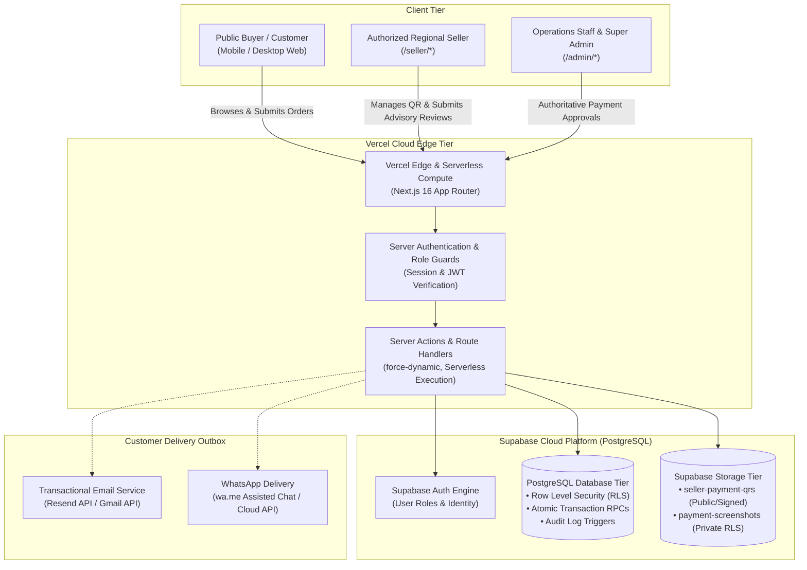

# SSFI Lucky Draw Management System — Architecture Overview

## 1. System Overview

The **SSFI Lucky Draw Management System** is a production-grade fundraising management platform built for the **Senthang Students Fellowship India (SSFI)**. The platform enables decentralized UPI ticket sales across an authorized network of regional student sellers while preserving centralized financial auditability, fraud prevention, and atomic digital ticket issuance.

---

## 2. Core Architectural Pillars

### 2.1 Server-Authoritative State & Security
- **No Client State Mutation:** Browsers and mobile clients never issue tickets or directly approve payments. All balance, quota, and state-changing actions execute via audited PostgreSQL stored procedures (`verify_payment_and_issue`, `create_seller_order`, `submit_manual_upi`).
- **Row Level Security (RLS):** Every database table is locked with strict RLS policies. Public anonymous users can only view active campaigns and verify issued tickets. Sellers can only view their own attributed orders.
- **Service Role Encapsulation:** Privileged operations utilize `SUPABASE_SERVICE_ROLE_KEY` strictly inside server actions and API route handlers. Service keys are never shipped to client bundles.

### 2.2 Decentralized UPI with Advisory vs. Authoritative Separation
- **Decentralized Collection:** Customers make payments directly to an authorized seller's personal UPI account via the seller's active QR code.
- **Order Snapshot Immutability:** When an order is created, an immutable snapshot of the seller's UPI details and QR path is locked into the order record via database triggers (`protect_order_payment_snapshot`), preventing retroactive modification.
- **Advisory Seller Review:** Sellers inspect customer payment screenshots on `/seller/payments` and submit advisory feedback (`RECOMMENDED_APPROVAL`, `RECOMMENDED_REJECTION`, `FLAGGED_DISCREPANCY`). Sellers cannot approve payments or issue tickets.
- **Authoritative Staff Verification:** Only authenticated administrators (`is_staff: true`) can execute payment verification via `verify_payment_and_issue`. Approval atomically updates the payment status to `VERIFIED`, updates the order to `PAYMENT_VERIFIED`, generates unique sequential tickets via `issue_tickets`, and creates customer outbox delivery records.

### 2.3 Resilient Dynamic Rendering & Mobile Stability
- **Next.js 16 Dynamic Architecture:** High-concurrency transactional routes (`/`, `/buy`, `/seller/*`, `/admin/*`) utilize `export const dynamic = "force-dynamic"` and `prefetch={false}` on dynamic links, eliminating experimental edge stub serialization mismatches.
- **Defensive Error Boundaries:** `src/app/error.tsx` provides safe error boundaries with instant recovery actions without losing customer input or duplicating orders.

---

## 3. Subsystem Architecture Specifications

For in-depth architectural specifications and implementation details, refer to the following subsystem guides:

- **[System Architecture Specification](docs/architecture/system-architecture.md):** Detailed breakdown of compute, network, database, and storage tiers.
- **[Seller Architecture & Workflow](docs/architecture/seller-architecture.md):** Seller portal design, QR configuration, and advisory review protocol.
- **[Database Architecture & Schema](docs/DATABASE.md):** 21 relational tables, sequences, RLS policies, triggers, and atomic RPC definitions.
- **[Authentication & Authorization](docs/authentication-and-authorization.md):** RBAC role hierarchy, token verification, and route guards.
- **[Payment Workflow & Verification](docs/payment-workflow.md):** Complete decentralized UPI sequence, screenshot validation, and audit trail.
- **[Ticket Issuance & Verification](docs/ticket-verification.md):** Sequential numbering (`SSFI-000001` - `SSFI-999999`), public verification, and QR code format.
- **[Deployment Architecture](docs/DEPLOYMENT.md):** Production vs. Preview segregation, Vercel configuration, and environment variable management.
- **[Development & Testing Guide](docs/development-guide.md):** Local setup, 23 automated test suites (310 assertions), and Playwright mobile emulation.
