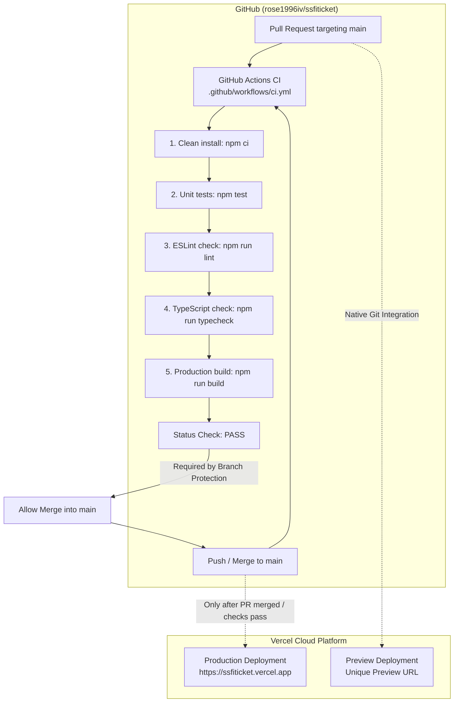

# SSFI Lucky Draw — CI/CD Architecture & Operations Guide

This guide details the Continuous Integration (CI) and Continuous Deployment (CD) pipeline for the SSFI Lucky Draw Next.js application, including GitHub Actions workflows, Vercel deployment strategies, branch protection configuration, and troubleshooting procedures.

---

## 1. Architecture Overview

The SSFI Lucky Draw project uses a modern dual-layer pipeline:



---

## 2. Continuous Integration (GitHub Actions)

### Workflow File
- Path: [`.github/workflows/ci.yml`](../.github/workflows/ci.yml)
- Triggers:
  - `push` to `main`
  - `pull_request` targeting `main`
  - `workflow_dispatch` (manual one-click trigger from the GitHub Actions tab)

### Concurrency & Performance
- **Run concurrency**: `concurrency: group: ${{ github.workflow }}-${{ github.ref }}, cancel-in-progress: true` automatically cancels superseded runs when new commits are pushed to the same branch or PR.
- **Job timeout**: Enforces a strict 15-minute cap to prevent hanging jobs from consuming runner minutes.
- **Dependency caching**: Employs `actions/setup-node@v4` with `cache: 'npm'` to cache `~/.npm` across runs based on `package-lock.json`.

### Minimal Token Permissions
In adherence to the principle of least privilege, the workflow explicitly grants minimal read permissions:
```yaml
permissions:
  contents: read
```

### Execution Gates
Every pipeline execution executes the project's actual package scripts in strict sequence. If any step fails, the job immediately terminates with an error:

1. **Clean Dependency Installation**:
   ```bash
   npm ci
   ```
   Ensures deterministic installation matching `package-lock.json`.
2. **Unit Test Suite**:
   ```bash
   npm test
   ```
   Runs Node.js native test runner against [`tests/referral.test.ts`](../tests/referral.test.ts), verifying seller code regex, referral URL resolution, QR code PNG/SVG generation, and inactive seller attribution protections.
3. **Lint Verification**:
   ```bash
   npm run lint
   ```
   Executes ESLint with Next.js core web vitals and TypeScript rules.
4. **TypeScript Compilation**:
   ```bash
   npm run typecheck
   ```
   Runs `tsc --noEmit` to verify type safety across all components, server actions, and route handlers.
5. **Next.js Production Build**:
   ```bash
   npm run build
   ```
   Compiles static and dynamic route manifests using Turbopack.

### Zero Secret Exposure Policy
- The CI workflow does **NOT** receive or store production Supabase credentials or database connection strings.
- Non-sensitive placeholder variables are supplied during CI build validation:
  - `NEXT_PUBLIC_SUPABASE_URL`: `https://ci-placeholder.supabase.co`
  - `NEXT_PUBLIC_SUPABASE_PUBLISHABLE_KEY`: `ci-placeholder-publishable-key`
  - `NEXT_PUBLIC_APP_URL`: `https://ssfiticket.vercel.app`
  - `NEXT_PUBLIC_SSFI_UPI_ID`: `ssfi@ci-test`
  - `NEXT_PUBLIC_SSFI_UPI_DISPLAY_NAME`: `SSFI Fundraising`
- Server-side administrative keys (`SUPABASE_SERVICE_ROLE_KEY`) are **never** injected into the CI runner.

---

## 3. Continuous Deployment (CD) Strategy

### Primary Recommended Mechanism: Native Vercel Git Integration
The recommended deployment strategy is Vercel's native Git Integration:
1. Import `https://github.com/rose1996iv/ssfiticket` directly in your [Vercel Dashboard](https://vercel.com/new).
2. **Preview Deployments**: Every pull request opened against `main` automatically creates an ephemeral, isolated preview deployment with its own URL.
3. **Production Deployments**: When a pull request is merged into `main`, Vercel immediately deploys to `https://ssfiticket.vercel.app`.
4. **Why Native Integration is Preferred**:
   - Eliminates duplicate builds and race conditions.
   - Avoids generating and rotating long-lived personal access tokens in GitHub Secrets.
   - Delivers automatic preview URL comments on pull requests.

### Alternative Mechanism: Vercel CLI via GitHub Actions
If native Git integration cannot be used, a dedicated GitHub Actions workflow can deploy via the Vercel CLI.

> [!NOTE]
> Do not enable both mechanisms simultaneously; doing so causes duplicate deployments for every commit.

To use the CLI alternative, the following encrypted secrets must be created in **GitHub Repository Settings** → **Secrets and variables** → **Actions**:
- `VERCEL_TOKEN`: Vercel Personal Access Token generated at `https://vercel.com/account/tokens`.
- `VERCEL_ORG_ID`: Your Vercel Team/Account ID (found in project settings or `.vercel/project.json`).
- `VERCEL_PROJECT_ID`: The unique project ID for `ssfiticket`.

Sample CLI deployment step:
```yaml
- name: Deploy to Vercel
  run: npx vercel --prod --token=${{ secrets.VERCEL_TOKEN }}
  env:
    VERCEL_ORG_ID: ${{ secrets.VERCEL_ORG_ID }}
    VERCEL_PROJECT_ID: ${{ secrets.VERCEL_PROJECT_ID }}
```

---

## 4. Production Environment Variables (Vercel)

Configure the following environment variables in **Vercel Project Settings** → **Environment Variables**:

| Variable Name | Environment | Description |
| :--- | :--- | :--- |
| `NEXT_PUBLIC_SUPABASE_URL` | Production, Preview, Development | Public Supabase project URL |
| `NEXT_PUBLIC_SUPABASE_PUBLISHABLE_KEY` | Production, Preview, Development | Public anonymous/publishable key |
| `SUPABASE_SERVICE_ROLE_KEY` | Production, Preview (Server-only) | Privileged admin key for server operations |
| `NEXT_PUBLIC_APP_URL` | Production | Canonical domain (`https://ssfiticket.vercel.app`) |
| `NEXT_PUBLIC_SSFI_UPI_ID` | Production, Preview | Organization UPI ID for payments |
| `NEXT_PUBLIC_SSFI_UPI_DISPLAY_NAME` | Production, Preview | Organization display name |

---

## 5. GitHub Repository Settings & Branch Protection

> [!IMPORTANT]
> GitHub branch protection and repository rulesets require manual activation by the repository owner (`rose1996iv`) via the GitHub web interface.

### Step-by-Step Instructions to Enforce CI Gates:

1. Open your repository on GitHub:
   `https://github.com/rose1996iv/ssfiticket`
2. Navigate to **Settings** → **Rules** → **Rulesets** (or **Settings** → **Branches**).
3. Click **New ruleset** → **New branch ruleset**.
4. Configure the ruleset:
   - **Ruleset Name**: `Main Branch Protection`
   - **Enforcement status**: `Active`
   - **Target branches**: Select `Include default branch` (`main`).
5. Under **Branch rules**, enable:
   - [x] **Require a pull request before merging**
     - Require approvals: `1`
     - Dismiss stale pull request approvals when new commits are pushed: `Checked`
   - [x] **Require status checks to pass before merging**
     - Click **Add checks** and search for: `Test, Lint, Typecheck & Build` (the job name defined in [`ci.yml`](../.github/workflows/ci.yml)).
     - [x] Require branches to be up to date before merging.
   - [x] **Block force pushes** (checked by default).
   - [x] **Do not allow deletions** (checked by default).
6. Click **Save changes**.

---

## 6. Local Validation & Troubleshooting

Before pushing changes, run the local verification suite:

```bash
# 1. Clean dependencies verification
npm ci

# 2. Run unit tests
npm test

# 3. Run linter
npm run lint

# 4. Run TypeScript checks
npm run typecheck

# 5. Run production build
npm run build
```

### Common Issues & Remedies

| Issue | Root Cause | Solution |
| :--- | :--- | :--- |
| **`npm ci` fails with `EUSAGE` or lockfile mismatch** | `package.json` was edited without updating `package-lock.json` | Run `npm install` locally to synchronize lockfile, test, and commit the updated `package-lock.json`. |
| **ESLint errors on unused variables** | An imported symbol or declared parameter is unused | Remove unused imports or prefix intentionally unused arguments with `_`. |
| **TypeScript check fails on dynamic parameters** | Next.js dynamic route params require `Promise<{ id: string }>` in Next.js 15+ | Verify route handlers and page components await `params`. |
| **Build fails on Supabase URL** | Code attempted to call `getSupabasePublicConfig()` at module root | Wrap configuration calls inside request-scoped handlers or supply fallback placeholders. |
| **Vercel deployment succeeds but shows 404/database error** | Environment variables missing in Vercel settings | Verify all keys in Section 4 are populated in Vercel Project Settings. |
