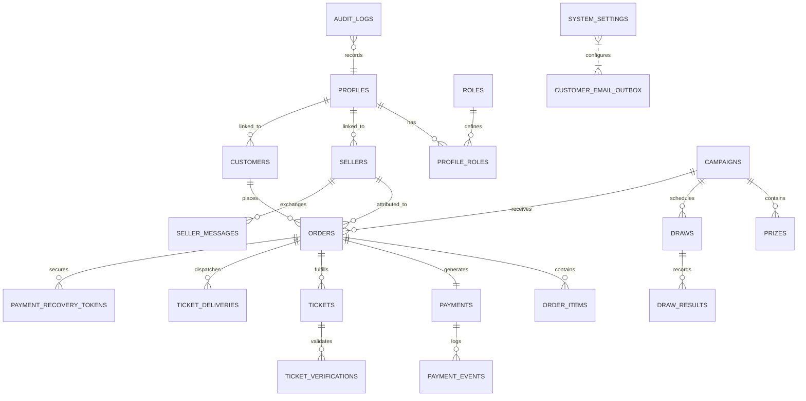

# SSFI Lucky Draw Management System — Database Architecture & Schema Reference

**Document Version:** 2.0.0
**Target Database:** Supabase PostgreSQL 15+ with Extensions (`uuid-ossp`, `pgcrypto`)
**Main Migration Catalog:** `supabase/migrations/` (17 sequential migrations)
**Consolidated Rollout Script:** `supabase/release-candidates/production-rollout-consolidated.sql`

---

## 1. Database Architecture Overview

The SSFI Lucky Draw database is engineered with PostgreSQL, utilizing **Row Level Security (RLS)**, **Server-Side Security Definer Stored Procedures (RPCs)**, and **immutable audit logging triggers**.

The architecture enforces a strict division of responsibilities:
- **Zero Direct Public Writes:** Public customers and anonymous clients cannot perform direct SQL `INSERT`, `UPDATE`, or `DELETE` operations on core business tables. All state mutations occur through audited, validated PostgreSQL RPCs or Next.js Server Actions using the isolated `service_role` client.
- **Immutable Financial Snapshots:** When an order is created, an immutable snapshot of the seller's payment configuration is captured directly on the order record, protected against subsequent modification by database triggers.
- **Atomic Concurrency Control:** Ticket issuance utilizes PostgreSQL row-level locks (`SELECT ... FOR UPDATE`) and atomic sequences (`ssfi_ticket_number_sequence`) to guarantee zero overselling, zero race conditions, and strictly unique, sequentially allocated ticket numbers.

---

## 2. Table Catalog & Schema Definitions

### 2.1 Identity & Access Control

#### `profiles`
User account profile information linked directly to Supabase Authentication (`auth.users.id`).
- `id` (`UUID`, PK, FK `auth.users.id` ON DELETE CASCADE)
- `full_name` (`TEXT`, NOT NULL)
- `phone` (`TEXT`, NULL)
- `email` (`TEXT`, NULL)
- `created_at` (`TIMESTAMPTZ`, DEFAULT `now()`)
- `updated_at` (`TIMESTAMPTZ`, DEFAULT `now()`)

#### `roles`
Catalog of system application roles.
- `id` (`UUID`, PK, DEFAULT `gen_random_uuid()`)
- `name` (`TEXT`, UNIQUE, NOT NULL): `SUPER_ADMIN`, `ADMIN`, `FUNDRAISING_MANAGER`, `SELLER`
- `created_at` (`TIMESTAMPTZ`, DEFAULT `now()`)

#### `profile_roles`
Many-to-many relationship mapping user profiles to assigned roles.
- `id` (`UUID`, PK, DEFAULT `gen_random_uuid()`)
- `profile_id` (`UUID`, FK `profiles.id` ON DELETE CASCADE, NOT NULL)
- `role_id` (`UUID`, FK `roles.id` ON DELETE CASCADE, NOT NULL)
- `created_at` (`TIMESTAMPTZ`, DEFAULT `now()`)
- *Unique Constraint:* `(profile_id, role_id)`

---

### 2.2 Campaign & Event Configuration

#### `campaigns`
Central configuration for lucky draw fundraising campaigns.
- `id` (`UUID`, PK, DEFAULT `gen_random_uuid()`)
- `public_id` (`TEXT`, UNIQUE, NOT NULL): Canonical identifier (e.g., `ssfi-fundraising-lucky-draw`)
- `name` (`TEXT`, NOT NULL)
- `description` (`TEXT`, NULL)
- `ticket_price_paise` (`INTEGER`, NOT NULL, CHECK `> 0`): Default 10000 paise (₹100)
- `currency` (`TEXT`, DEFAULT `'INR'`)
- `total_ticket_limit` (`INTEGER`, NOT NULL, CHECK `> 0`): Maximum authorized capacity
- `sold_ticket_count` (`INTEGER`, DEFAULT 0, CHECK `>= 0`)
- `status` (`TEXT`, NOT NULL, DEFAULT `'DRAFT'`): `DRAFT`, `UPCOMING`, `ACTIVE`, `PAUSED`, `CLOSED`, `ARCHIVED`, `CANCELLED`
- `start_at` (`TIMESTAMPTZ`, NULL): Scheduled start timestamp in UTC (evaluated in IST)
- `end_at` (`TIMESTAMPTZ`, NULL): Scheduled closing timestamp in UTC (evaluated in IST)
- `created_at` (`TIMESTAMPTZ`, DEFAULT `now()`)
- `updated_at` (`TIMESTAMPTZ`, DEFAULT `now()`)

#### `prizes`
Celebration and giveaway prizes defined for a campaign.
- `id` (`UUID`, PK, DEFAULT `gen_random_uuid()`)
- `campaign_id` (`UUID`, FK `campaigns.id` ON DELETE CASCADE, NOT NULL)
- `prize_number` (`INTEGER`, NOT NULL): Rank (1 to 5)
- `title` (`TEXT`, NOT NULL): e.g., `1st Prize — ₹10,000 Cash Giveaway`
- `description` (`TEXT`, NULL)
- `cash_amount_paise` (`INTEGER`, NULL)
- `display_order` (`INTEGER`, NOT NULL)
- *Unique Constraint:* `(campaign_id, prize_number)`

---

### 2.3 Sellers & Referral Network

#### `sellers`
Registered student fellowship representatives and authorized sellers.
- `id` (`UUID`, PK, DEFAULT `gen_random_uuid()`)
- `profile_id` (`UUID`, FK `profiles.id` ON DELETE CASCADE, NOT NULL)
- `seller_code` (`TEXT`, UNIQUE, NOT NULL): Formatted as `SELLER-XXX` (e.g., `SELLER-001`)
- `display_name` (`TEXT`, NOT NULL)
- `phone` (`TEXT`, NULL)
- `region` (`TEXT`, NULL)
- `is_active` (`BOOLEAN`, DEFAULT `true`, NOT NULL)
- `is_qr_active` (`BOOLEAN`, DEFAULT `false`, NOT NULL): Controls whether seller accepts orders
- `qr_storage_path` (`TEXT`, NULL): Path in `seller-payment-qrs` bucket
- `upi_id` (`TEXT`, NULL): Seller's personal UPI VPA
- `account_name` (`TEXT`, NULL): Account holder name registered on UPI
- `payment_instructions` (`TEXT`, NULL): Special instructions shown to customer
- `created_at` (`TIMESTAMPTZ`, DEFAULT `now()`)
- `updated_at` (`TIMESTAMPTZ`, DEFAULT `now()`)

---

### 2.4 Customers, Orders & Payments

#### `customers`
Customer contact records collected during order reservation.
- `id` (`UUID`, PK, DEFAULT `gen_random_uuid()`)
- `full_name` (`TEXT`, NOT NULL)
- `phone` (`TEXT`, NULL)
- `whatsapp_number` (`TEXT`, NOT NULL): Mandatory contact channel for ticket delivery
- `email` (`TEXT`, NULL): Verified contact address for receipts
- `profile_id` (`UUID`, FK `profiles.id` ON DELETE SET NULL, NULL)
- `created_at` (`TIMESTAMPTZ`, DEFAULT `now()`)
- `updated_at` (`TIMESTAMPTZ`, DEFAULT `now()`)

#### `orders`
Ticket booking reservations attributed to an authorized seller.
- `id` (`UUID`, PK, DEFAULT `gen_random_uuid()`)
- `order_number` (`TEXT`, UNIQUE, NOT NULL): Formatted `ORD-YYYY-XXXXXX`
- `campaign_id` (`UUID`, FK `campaigns.id` ON DELETE RESTRICT, NOT NULL)
- `customer_id` (`UUID`, FK `customers.id` ON DELETE RESTRICT, NOT NULL)
- `seller_id` (`UUID`, FK `sellers.id` ON DELETE RESTRICT, NOT NULL)
- `quantity` (`INTEGER`, NOT NULL, CHECK `quantity > 0 AND quantity <= 100`)
- `unit_price_paise` (`INTEGER`, NOT NULL)
- `total_amount_paise` (`INTEGER`, NOT NULL)
- `status` (`TEXT`, NOT NULL, DEFAULT `'PENDING_PAYMENT'`):
  - `PENDING_PAYMENT`: Initial order placed; awaiting customer proof upload
  - `PAYMENT_SUBMITTED`: Payment screenshot uploaded; under review
  - `PAYMENT_VERIFIED`: Staff administrator verified bank credit
  - `TICKETS_ISSUED`: Sequential tickets atomically allocated
  - `CANCELLED`: Expired or cancelled reservation
- **Immutable Payment Snapshot Fields (Locked by trigger):**
  - `snapshot_seller_id` (`UUID`, NULL)
  - `snapshot_seller_code` (`TEXT`, NULL)
  - `snapshot_seller_display_name` (`TEXT`, NULL)
  - `snapshot_qr_storage_path` (`TEXT`, NULL)
  - `snapshot_upi_id` (`TEXT`, NULL)
  - `snapshot_account_name` (`TEXT`, NULL)
  - `snapshot_payment_instructions` (`TEXT`, NULL)
  - `snapshot_captured_at` (`TIMESTAMPTZ`, NULL)
- `created_at` (`TIMESTAMPTZ`, DEFAULT `now()`)
- `updated_at` (`TIMESTAMPTZ`, DEFAULT `now()`)

#### `payments`
Manual UPI payment records and verification metadata.
- `id` (`UUID`, PK, DEFAULT `gen_random_uuid()`)
- `order_id` (`UUID`, FK `orders.id` ON DELETE CASCADE, NOT NULL)
- `amount_paise` (`INTEGER`, NOT NULL)
- `payment_method` (`TEXT`, NOT NULL, DEFAULT `'MANUAL_UPI'`)
- `status` (`TEXT`, NOT NULL, DEFAULT `'PENDING'`): `PENDING`, `SUBMITTED`, `VERIFIED`, `REJECTED`
- `utr_reference` (`TEXT`, NULL): 12-digit bank UTR reference (optional)
- `payer_name` (`TEXT`, NULL): Name on payer bank account
- `screenshot_storage_path` (`TEXT`, NULL): Path to proof image in `payment-screenshots` bucket
- `submitted_at` (`TIMESTAMPTZ`, NULL): Timestamp when proof was submitted
- `verified_at` (`TIMESTAMPTZ`, NULL): Timestamp when staff approved payment
- `verified_by` (`UUID`, FK `profiles.id` ON DELETE SET NULL, NULL)
- `rejection_reason` (`TEXT`, NULL): Explanation if rejected by staff
- **Seller Advisory Review Fields:**
  - `seller_review_status` (`TEXT`, NULL): `RECOMMEND_APPROVE`, `RECOMMEND_REJECT`, `NEEDS_REVIEW`
  - `seller_review_notes` (`TEXT`, NULL): Optional feedback from seller
  - `seller_reviewed_at` (`TIMESTAMPTZ`, NULL)
  - `seller_reviewed_by` (`UUID`, FK `profiles.id` ON DELETE SET NULL, NULL)
- `created_at` (`TIMESTAMPTZ`, DEFAULT `now()`)
- `updated_at` (`TIMESTAMPTZ`, DEFAULT `now()`)

#### `payment_recovery_tokens`
One-time cryptographic tokens enabling customers to resume proof upload if disconnected.
- `id` (`UUID`, PK, DEFAULT `gen_random_uuid()`)
- `order_id` (`UUID`, FK `orders.id` ON DELETE CASCADE, NOT NULL)
- `token_hash` (`TEXT`, UNIQUE, NOT NULL): SHA-256 hash of token
- `expires_at` (`TIMESTAMPTZ`, NOT NULL): Default 48-hour expiration
- `used_at` (`TIMESTAMPTZ`, NULL)
- `created_at` (`TIMESTAMPTZ`, DEFAULT `now()`)

---

### 2.5 Tickets & Public Verification

#### `tickets`
Authoritatively issued sequential lucky draw tickets.
- `id` (`UUID`, PK, DEFAULT `gen_random_uuid()`)
- `campaign_id` (`UUID`, FK `campaigns.id` ON DELETE RESTRICT, NOT NULL)
- `order_id` (`UUID`, FK `orders.id` ON DELETE RESTRICT, NOT NULL)
- `customer_id` (`UUID`, FK `customers.id` ON DELETE RESTRICT, NOT NULL)
- `seller_id` (`UUID`, FK `sellers.id` ON DELETE RESTRICT, NOT NULL)
- `ticket_number` (`TEXT`, UNIQUE, NOT NULL): Sequential identifier `SSFI-000001` to `SSFI-999999`
- `status` (`TEXT`, NOT NULL, DEFAULT `'ISSUED'`): `ISSUED`, `ACTIVE`, `VOID`
- `issued_at` (`TIMESTAMPTZ`, DEFAULT `now()`, NOT NULL)
- `void_reason` (`TEXT`, NULL)
- `created_at` (`TIMESTAMPTZ`, DEFAULT `now()`)
- `updated_at` (`TIMESTAMPTZ`, DEFAULT `now()`)

#### `ticket_verifications`
Log of public ticket verification queries.
- `id` (`UUID`, PK, DEFAULT `gen_random_uuid()`)
- `ticket_id` (`UUID`, FK `tickets.id` ON DELETE CASCADE, NOT NULL)
- `verified_at` (`TIMESTAMPTZ`, DEFAULT `now()`, NOT NULL)
- `ip_hash` (`TEXT`, NULL)
- `user_agent` (`TEXT`, NULL)

---

### 2.6 Outbox Deliveries & Audit Logs

#### `ticket_deliveries`
Outbox delivery queue for transactional emails and WhatsApp dispatches.
- `id` (`UUID`, PK, DEFAULT `gen_random_uuid()`)
- `order_id` (`UUID`, FK `orders.id` ON DELETE CASCADE, NOT NULL)
- `ticket_id` (`UUID`, FK `tickets.id` ON DELETE SET NULL, NULL)
- `channel` (`TEXT`, NOT NULL): `'EMAIL'` or `'WHATSAPP'`
- `recipient` (`TEXT`, NOT NULL)
- `status` (`TEXT`, NOT NULL, DEFAULT `'QUEUED'`): `QUEUED`, `SENDING`, `SENT`, `FAILED`, `RETRY`, `SIMULATED`
- `attempt_count` (`INTEGER`, DEFAULT 0)
- `error_message` (`TEXT`, NULL)
- `sent_at` (`TIMESTAMPTZ`, NULL)
- `created_at` (`TIMESTAMPTZ`, DEFAULT `now()`)
- `updated_at` (`TIMESTAMPTZ`, DEFAULT `now()`)

#### `seller_messages`
Bidirectional communication threads between sellers and staff administrators.
- `id` (`UUID`, PK, DEFAULT `gen_random_uuid()`)
- `seller_id` (`UUID`, FK `sellers.id` ON DELETE CASCADE, NOT NULL)
- `sender_id` (`UUID`, FK `profiles.id` ON DELETE RESTRICT, NOT NULL)
- `sender_role` (`TEXT`, NOT NULL): `'SELLER'` or `'STAFF'`
- `parent_id` (`UUID`, FK `seller_messages.id` ON DELETE CASCADE, NULL)
- `subject` (`TEXT`, NOT NULL)
- `body` (`TEXT`, NOT NULL)
- `is_read` (`BOOLEAN`, DEFAULT `false`, NOT NULL)
- `read_at` (`TIMESTAMPTZ`, NULL)
- `created_at` (`TIMESTAMPTZ`, DEFAULT `now()`)

#### `audit_logs`
Append-only system security and operational audit trail.
- `id` (`UUID`, PK, DEFAULT `gen_random_uuid()`)
- `actor_user_id` (`UUID`, NULL)
- `action` (`TEXT`, NOT NULL)
- `entity_type` (`TEXT`, NOT NULL)
- `entity_id` (`UUID`, NULL)
- `old_values` (`JSONB`, NULL)
- `new_values` (`JSONB`, NULL)
- `metadata` (`JSONB`, NULL)
- `created_at` (`TIMESTAMPTZ`, DEFAULT `now()`, NOT NULL)

---

## 3. Database Sequences

1. `public.ssfi_ticket_number_sequence`:
   - **Start:** `1`
   - **Increment:** `1`
   - **Max Value:** `999999`
   - **Usage:** Authoritative ticket issuance via `issue_tickets(p_order_id)`. Produces `SSFI-000001` through `SSFI-999999`.

2. `public.ssfi_order_number_sequence`:
   - **Start:** `1`
   - **Increment:** `1`
   - **Usage:** Formats order numbers as `ORD-YYYY-XXXXXX`.

---

## 4. Key Database Functions & Stored Procedures (RPCs)

### 4.1 `issue_tickets(p_order_id uuid)`
- **Security:** `SECURITY DEFINER`, search_path = `public`, execution revoked from `public`/`anon`/`authenticated`, granted strictly to `service_role`.
- **Preconditions:**
  - Order must exist and be locked with `FOR UPDATE`.
  - Payment must exist with status `VERIFIED` and `amount_paise == orders.total_amount_paise`.
  - Order status must be `PAYMENT_VERIFIED`.
  - Campaign must be `ACTIVE` and have sufficient unsold ticket quota.
- **Actions:**
  - Iterates `1..order.quantity`, fetches `nextval('ssfi_ticket_number_sequence')`.
  - Inserts ticket records formatted as `SSFI-######`.
  - Atomically increments `campaigns.sold_ticket_count`.
  - Transitions order to `TICKETS_ISSUED`.
  - Records `TICKET_ISSUED` in `audit_logs`.

### 4.2 `verify_payment_and_issue(p_payment_id uuid, p_actor uuid)`
- **Security:** `SECURITY DEFINER`, accessible to service role and authenticated staff managers (`is_staff`).
- **Actions:**
  - Enforces `is_staff(p_actor)` and verifies non-null staff actor.
  - Locks payment record (`FOR UPDATE`), requiring `status = 'SUBMITTED'`.
  - Locks order record (`FOR UPDATE`), requiring `status = 'PAYMENT_SUBMITTED'` and amount match.
  - Transitions payment to `VERIFIED` and order to `PAYMENT_VERIFIED`.
  - Atomically calls `issue_tickets(order_id)`.
  - Records `PAYMENT_VERIFIED` audit log entry.
  - Server action then enqueues ticket delivery records.

### 4.3 Advisory Seller Payment Review (`submitSellerPaymentReview`)
- **Security:** Server Action verifying caller possesses `SELLER` role and owns `orders.seller_id`.
- **Actions:**
  - Updates `seller_review_status` (`RECOMMENDED_APPROVAL`, `RECOMMENDED_REJECTION`, `FLAGGED_DISCREPANCY`), `seller_review_note`, and `seller_reviewed_at` on the `payments` record.
  - Strictly advisory: cannot approve payment or issue tickets. Final approval remains exclusive to staff administrators via `verify_payment_and_issue`.

### 4.4 `process_scheduled_campaign_transitions()`
- **Security:** `SECURITY DEFINER`. Called by Vercel Cron (`/api/cron/campaign-schedule`) and pre-flight order actions.
- **Actions:**
  - Transitions `DRAFT` or `UPCOMING` campaigns to `ACTIVE` when `now() >= start_at`.
  - Transitions `ACTIVE` campaigns to `CLOSED` when `now() >= end_at`.

---

## 5. Row-Level Security (RLS) Policy Summary

| Table | `anon` Access | `authenticated` (Seller) | `authenticated` (Staff / Admin) |
| :--- | :--- | :--- | :--- |
| `campaigns` | `SELECT` (active only) | `SELECT` (active) | `ALL` (`is_staff` check) |
| `prizes` | `SELECT` (active only) | `SELECT` (active) | `ALL` (`is_staff` check) |
| `sellers` | `SELECT` (active only) | `SELECT` (own profile) | `ALL` (`is_staff` check) |
| `orders` | No direct access | `SELECT` (attributed orders) | `ALL` (`is_staff` check) |
| `payments` | No direct access | `SELECT` (attributed orders) | `ALL` (`is_staff` check) |
| `tickets` | No direct table access | `SELECT` (attributed orders) | `ALL` (`is_staff` check) |
| `audit_logs` | No access | No access | `SELECT` (read-only audit) |
| `payment_recovery_tokens` | Handled via RPC / Action | No direct access | `SELECT` / `UPDATE` |
