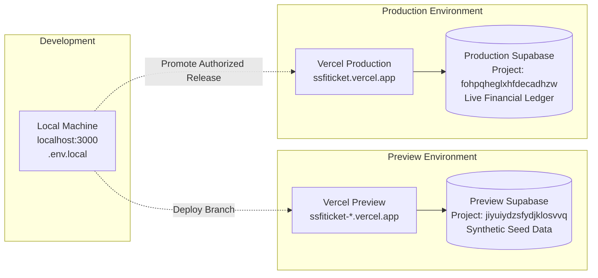

# SSFI Lucky Draw Management System — Deployment & Environment Configuration

**Document Version:** 2.0.0
**Target Hosting:** Vercel Cloud Platform &bull; Supabase Cloud Database
**Production URL:** [https://ssfiticket.vercel.app](https://ssfiticket.vercel.app)

---

## 1. Dual-Environment Architecture

To safeguard financial accounting, customer data, and live lucky draw operations, the SSFI Lucky Draw System maintains strict physical isolation between the **Production** and **Preview** environments.



---

## 2. Environment Specifications

| Attribute | Preview Environment | Production Environment |
| :--- | :--- | :--- |
| **Vercel Project** | `ssfiticket` (Feature Branches) | `ssfiticket` (`main` branch) |
| **Public Domain** | `https://ssfiticket-*-rose1996ivs-projects.vercel.app` | `https://ssfiticket.vercel.app` |
| **Supabase Project ID** | `jiyuiydzsfydjklosvvq` | `fohpqheglxhfdecadhzw` |
| **Data Scope** | Synthetic test data & mock sellers | Live accredited sellers & real customer orders |
| **Active Test Seller** | `SELLER-007`, `SELLER-008` (active QR) | `SELLER-005` (accredited active QR) |
| **Email Dispatch** | Simulated / Test-filtered | Production transactional outbox |
| **Purpose** | Verification, mobile device testing, audits | Live lucky draw ticket sales & verification |

> [!CAUTION]
> **Strict Isolation Rules:**
> - Never use Preview Supabase credentials in Production.
> - Never use Production Supabase credentials in Preview or local development.
> - Never execute destructive SQL (`DROP`, `TRUNCATE`, `DELETE`) on Production.

---

## 3. Required Environment Variables

Configure these variables in **Vercel Project Settings &rarr; Environment Variables**:

### 3.1 Public Variables (Exposed to Client)
- `NEXT_PUBLIC_APP_URL`: Base application URL.
  - Production: `https://ssfiticket.vercel.app`
  - Preview: Automatically resolved via dynamic environment helpers.
- `NEXT_PUBLIC_SUPABASE_URL`: Supabase project API URL.
  - Production: `https://fohpqheglxhfdecadhzw.supabase.co`
  - Preview: `https://jiyuiydzsfydjklosvvq.supabase.co`
- `NEXT_PUBLIC_SUPABASE_PUBLISHABLE_KEY`: Public anonymous API key protected by PostgreSQL RLS.
- `NEXT_PUBLIC_HERO_YOUTUBE_URL`: Optional YouTube video ID for ambient hero background.
- `NEXT_PUBLIC_SSFI_UPI_ID`: Organization fallback/advisory UPI ID (`6909251270@ptaxis`).
- `NEXT_PUBLIC_SSFI_UPI_DISPLAY_NAME`: Payee display name (`HLAWN THA DAWT`).
- `NEXT_PUBLIC_SUPPORT_EMAIL`: Support contact address (`Senthangstudents@gmail.com`).

### 3.2 Server-Only Variables (STRICTLY PRIVATE)
- `SUPABASE_SERVICE_ROLE_KEY`: Privileged Supabase key used exclusively by server actions to bypass RLS for administrative RPC operations (order creation, ticket issuance, admin verification).
- `CRON_SECRET`: Secret bearer token required to authenticate Vercel Cron requests to `/api/cron/campaign-schedule`.
- `GMAIL_API_CLIENT_ID`: OAuth client ID for Gmail API delivery outbox.
- `GMAIL_API_CLIENT_SECRET`: OAuth client secret for Gmail API delivery outbox.
- `GMAIL_API_REFRESH_TOKEN`: OAuth refresh token for Gmail API delivery outbox.
- `GMAIL_SENDER_ADDRESS`: Verified Gmail sender address.
- `GMAIL_CUSTOMER_LIVE_SEND_ENABLED`: Set to `"true"` in production to enable real email dispatch.

---

## 4. Deployment Runbooks

### 4.1 Preview Deployment Workflow
1. Run local validation:
   ```bash
   npm test
   npm run typecheck
   npm run lint
   npm run build
   ```
2. Deploy to Preview:
   ```bash
   npx vercel
   ```
3. Test the generated preview URL on a physical mobile device (Android Chrome & iOS Safari).
4. Verify the following routes:
   - `/`: Homepage countdown and seller directory.
   - `/buy?ref=SELLER-007`: Order reservation form.
   - `/login`: Multi-role login entrypoint.
   - `/verify/SSFI-000001`: Public verification portal.

### 4.2 Production Deployment Workflow (Authorized Release)
> [!IMPORTANT]
> Production deployment must be explicitly authorized by the project owner.

1. Ensure all database migrations in `supabase/release-candidates/production-rollout-consolidated.sql` have been executed in the Production Supabase SQL Editor.
2. Verify Production Vercel environment variables point to `fohpqheglxhfdecadhzw`.
3. Deploy to Production:
   ```bash
   npx vercel --prod
   ```
4. Execute non-destructive post-deployment smoke tests:
   - Homepage (`https://ssfiticket.vercel.app`)
   - Login page (`https://ssfiticket.vercel.app/login`)
   - Admin command center (`https://ssfiticket.vercel.app/admin`)
   - Seller review portal (`https://ssfiticket.vercel.app/seller/payments`)
