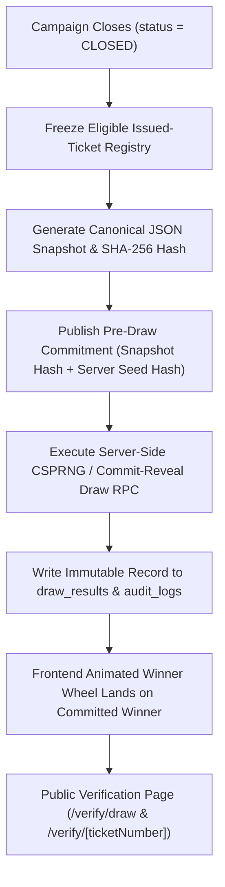

# SSFI Lucky Draw System — Future Lucky Draw Engine Technical Readiness Design

**Status:** Architectural Blueprint & Readiness Specification (Pre-Implementation)  
**Target Event:** Official SSFI Fundraising Lucky Draw (19 December 2026)  
**Scope:** Backend Cryptographic Selection, Frozen Eligibility Snapshot, Immutable Draw Ledger, Animated Winner Wheel Contract, and Public Audit Verification.

---

## 1. Design Principles & Non-Negotiable Guarantees

1. **Ticket Identity Immutability (`public.tickets`):**
   - `ticket_number`, `id`, `order_id`, `campaign_id`, `customer_id`, `seller_id`, and `issued_at` are locked by database trigger `trg_protect_ticket_identity_immutability`.
   - Customer profile edits (`CUSTOMER_PROFILE_UPDATED`) or single-ticket contact edits (`TICKET_CONTACT_UPDATED`) modify only contact delivery metadata (`customers.*` or `tickets.contact_*`) and **never** alter `ticket_number` or draw eligibility.
2. **Backend-First Selection Authority:**
   - The frontend animated winner wheel is strictly a **presentation layer** that renders the winner already selected and committed by the backend PostgreSQL/Server CSPRNG engine.
   - Client-side JavaScript (`Math.random()` or browser `crypto.getRandomValues()`) is **never** used to determine a winner.
3. **Deterministic Auditability:**
   - Before any prize is drawn, the eligible ticket set is frozen into an ordered snapshot and hashed with SHA-256 so any observer can verify the exact pool of tickets that participated in the draw.

---

## 2. System Architecture & Lifecycle Flow



---

## 3. Component Specifications

### 3.1 Eligible Issued-Ticket Registry
A ticket in `public.tickets` is eligible for a campaign's draw if and only if:
- `campaign_id = <active_campaign_id>`
- `status = 'ISSUED'` (strictly excluding `VOID` tickets)
- Associated `public.orders.status = 'TICKETS_ISSUED'`
- Associated `public.payments.status = 'VERIFIED'`
- Not already recorded as a winning ticket in `public.draw_results` for a mutually exclusive prize tier.

### 3.2 Frozen Eligibility Snapshot & Cryptographic Hash
Before executing a draw (`public.draws`), the server executes `freeze_draw_eligibility_snapshot(p_draw_id uuid, p_actor uuid)`:
1. Queries all eligible tickets ordered deterministically by `ticket_number ASC`:
   ```sql
   SELECT id, ticket_number, order_id, issued_at
   FROM public.tickets
   WHERE campaign_id = v_campaign_id
     AND status = 'ISSUED'
   ORDER BY ticket_number ASC;
   ```
2. Serializes the ordered list into a canonical newline-delimited string:
   `SSFI-000001|id|order_id|issued_at\nSSFI-000002|...`
3. Computes the SHA-256 digest (`encode(digest(v_canonical_payload, 'sha256'), 'hex')`) and stores:
   - `eligible_ticket_count integer`
   - `snapshot_sha256 text`
   - `snapshot_frozen_at timestamptz`
   - `snapshot_frozen_by uuid`

### 3.3 Server-Side CSPRNG & Commit-Reveal Selection
1. **Commit Phase (Pre-Draw):**
   - Server generates a 256-bit cryptographically secure random seed $S_{\text{server}}$ via Node.js `crypto.randomBytes(32)` and stores $H(S_{\text{server}}) = \text{SHA256}(S_{\text{server}})$ in `draws.server_seed_commitment`.
   - Optionally combines a public organizer/witness entropy string $S_{\text{public}}$ entered live before the draw.
2. **Reveal & Selection Phase (Atomic PostgreSQL RPC):**
   - Combined digest:
     $$D = \text{HMAC-SHA256}(S_{\text{server}}, \text{snapshot\_sha256} \parallel \text{prize\_id} \parallel S_{\text{public}})$$
   - Winning index $k \in [0, N - 1]$ is derived via rejection sampling over 64-bit unsigned integers from $D$ to eliminate modulo bias.
   - The $k$-th ticket in the frozen ordered snapshot is selected as the winner.

### 3.4 Immutable Draw Result Record (`public.draw_results`)
- Once inserted into `public.draw_results`, a `BEFORE UPDATE OR DELETE` trigger (`trg_protect_draw_results_immutability`) permanently blocks any alteration or deletion of:
  - `draw_id`, `prize_id`, `ticket_id`, `ticket_number`, `snapshot_sha256`, `winning_index`, `created_at`.
- Simultaneously writes an append-only `DRAW_WINNER_SELECTED` event into `public.audit_logs`.

### 3.5 Animated Winner Wheel Contract
- The Admin Draw Console invokes the server action `executePrizeDraw(drawId, prizeId)`.
- Only **after** the database transaction commits and returns `{ ticketNumber, customerDisplayName, sellerCode, snapshotHash, auditId }` does the frontend wheel animation begin its spin sequence and deterministically decelerate onto `ticketNumber`.
- If the network disconnects mid-animation, reloading the page reads the already-committed winner from `public.draw_results`—re-spinning can never produce a different winner.

### 3.6 Public Verification Page
- `/verify/[ticketNumber]` and `/verify/draw` display:
  - Ticket validity (`ACTIVE` vs `VOID`), issuance timestamp, and order reference.
  - Pre-draw `snapshot_sha256` and total eligible ticket count $N$.
  - Winning prize tier (if the ticket won) and cryptographic verification proof.

