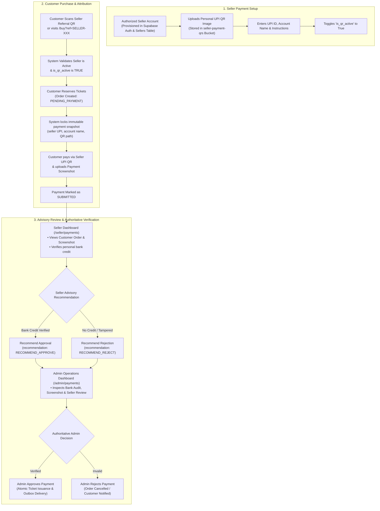
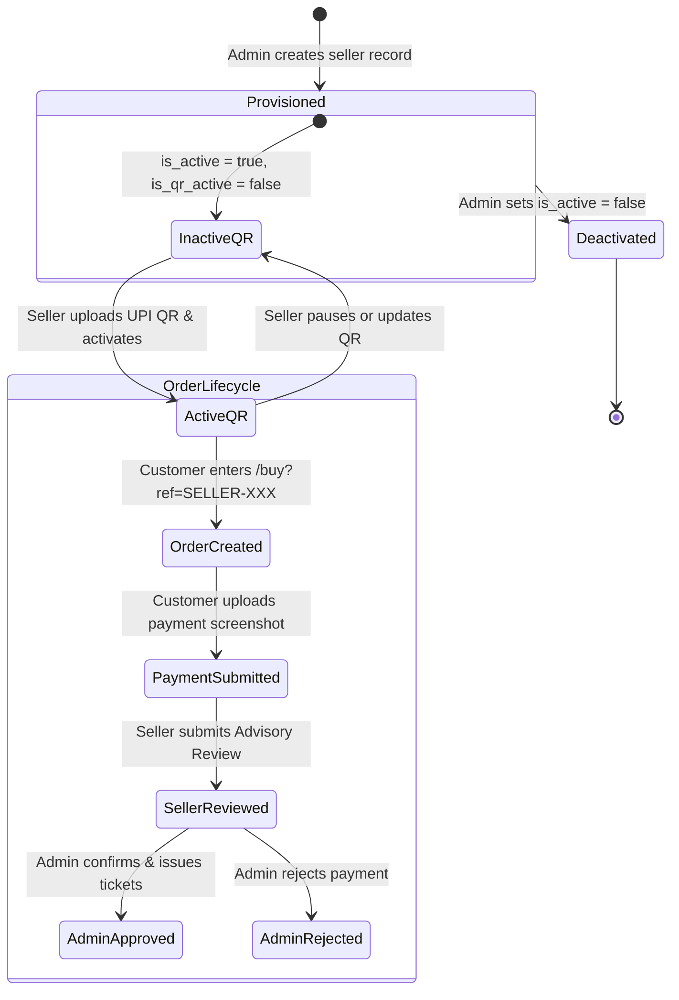

# SSFI Lucky Draw Management System — Seller Architecture & Workflow

**Document Version:** 1.0.0
**Target Platform:** Next.js 16 App Router &bull; Supabase PostgreSQL &bull; Storage
**Audience:** Technical Staff, Regional Seller Coordinators, Core Maintainers

---

## 1. Overview of the Seller Subsystem

In the SSFI Lucky Draw architecture, **Sellers** are authorized regional representatives appointed by the Senthang Students Fellowship India (SSFI) fundraising committee.

Unlike traditional multi-vendor platforms where sellers receive payments through a centralized merchant account, the SSFI Lucky Draw utilizes a **decentralized, seller-owned UPI payment model**:
1. Each seller configures their **own personal UPI QR code and payment details**.
2. Customers referred by a seller pay **directly to that seller's personal account**.
3. Customers submit their payment screenshot as proof.
4. Sellers inspect customer payment screenshots on their seller dashboard and provide an **advisory review** (`Recommend Approval` or `Recommend Rejection`).
5. **Staff Administrators** retain sole authoritative power to execute final verification and trigger ticket generation.

---

## 2. Key Seller Workflows

### 2.1 Seller Provisioning & Authentication
1. **Creation:** Sellers are created by administrators or provisioned via Supabase database migration scripts. Each seller possesses:
   - A unique, immutable `seller_code` matching regex `^SELLER-[0-9]{3,}$` (e.g., `SELLER-001`, `SELLER-005`).
   - A display name and regional attribution.
   - A foreign key relationship `user_id` linked to `auth.users(id)`.
2. **Role Verification:** On login via `/login`, the server auth helper verifies that the authenticated user possesses the `SELLER` role in `user_roles`.
3. **Workspace Isolation:** Access to `/seller/*` is strictly guarded by server-side middleware and layout checks. Unauthenticated users are redirected to `/login`, while unauthorized roles are redirected to `/unauthorized`.

### 2.2 Payment QR Configuration (`/seller/payment-settings`)
To accept customer orders, every seller must configure their payment destination:
- **QR Image Upload:** The seller uploads an image file (JPEG, PNG, or WebP; maximum 4MB). Magic bytes are verified server-side (`src/lib/payment/sellerQr.ts`) before uploading to the `seller-payment-qrs` Supabase storage bucket under path: `seller-{sellerId}/{uuid}.{ext}`.
- **Payee Details:** The seller provides:
  - Account Holder Name (e.g., `"JOSEPH"`).
  - UPI ID / VPA (e.g., `"8810366357@ptyes"`).
  - Optional custom payment instructions.
- **Activation Gate:** Setting `is_qr_active = true` marks the seller eligible to receive public referrals. If `is_qr_active = false`, visitors navigating to `/buy?ref=SELLER-XXX` are presented with an informative *"Payment QR Unavailable"* card, preventing payments from being routed to unconfigured sellers.

### 2.3 Buyer Referral Entry & Immutable Snapshotting
When a buyer accesses `/buy?ref=SELLER-005`:
1. The server executes `getActiveSellerByReferralCode("SELLER-005")`.
2. Both `is_active` and `is_qr_active` must be `true`.
3. When the customer submits the order form (`PublicOrderForm`), an atomic database record is created in `orders`.
4. **Snapshot Lockdown:** The server immediately updates the order with the seller's active payment parameters:
   - `snapshot_seller_id`
   - `snapshot_seller_code`
   - `snapshot_seller_display_name`
   - `snapshot_qr_storage_path`
   - `snapshot_upi_id`
   - `snapshot_account_name`
   - `snapshot_payment_instructions`
   - `snapshot_captured_at`
5. **Database Protection Trigger:** The PostgreSQL trigger `protect_order_payment_snapshot` aborts any subsequent SQL update that attempts to alter these snapshot fields once set, preventing retroactive destination tampering.

### 2.4 Payment Proof Submission & Screenshot Upload
1. On `/buy/order/[orderId]`, the customer views the designated seller's personal payment QR, account name, and UPI ID.
2. The customer scans the QR in their preferred UPI app (Google Pay, PhonePe, Paytm, BHIM) and completes payment.
3. The customer takes a payment screenshot and uploads it via `PaymentScreenshotField`.
4. The server validates the image file signature (JPEG, PNG, WebP) and writes the encrypted proof to `payment-screenshots` under `orders/{orderId}/{uuid}.{ext}`.
5. The payment record transitions from `PENDING_PAYMENT` to `SUBMITTED`.

### 2.5 Seller Advisory Review (`/seller/payments`)
Sellers have direct visibility into payments attributed to their referral code:
1. **List View:** `/seller/payments` queries payments where `orders.seller_id == current_seller.id`.
2. **Screenshot Inspection:** Signed temporary URLs (60-minute expiry) are generated for the payment screenshot so sellers can inspect transaction IDs, payer names, timestamps, and amounts against their personal bank records.
3. **Advisory Submission:** The seller submits an advisory recommendation:
   - `RECOMMEND_APPROVE`: Seller confirms receipt of funds in their personal bank account.
   - `RECOMMEND_REJECT`: Seller confirms no funds arrived or screenshot appears fabricated.
   - `NEEDS_REVIEW`: Seller notes an anomaly (e.g., partial amount, duplicate transaction ID).
4. **Advisory Notes:** Sellers can include an optional note for administrators.
5. **Non-Authoritative Guard:** The seller review is stored in `payments.seller_review_status` and `payments.seller_review_notes`. It **does not** change `payments.status` to `VERIFIED` and **does not** issue tickets.

### 2.6 Administrative Verification & Ticket Issuance (`/admin/payments`)
1. Operations managers inspect pending payments on `/admin/payments`.
2. The interface surfaces:
   - Customer details & ticket quantity.
   - Seller payment snapshot & assigned seller code.
   - Customer payment screenshot preview.
   - **Seller advisory recommendation and notes**.
3. Upon independent verification, the administrator clicks **Approve Payment**:
   - Executes atomic RPC `process_payment_verification`.
   - Transitions `payments.status` to `VERIFIED`.
   - Transitions `orders.status` to `TICKETS_ISSUED`.
   - Sequential, unique tickets are minted in `tickets` table.
   - Customer outbox records are enqueued in `ticket_deliveries`.

---

## 3. Strict Seller Security Restrictions & RLS Policies

| Security Rule | Enforcement Mechanism | Failure Consequence |
| :--- | :--- | :--- |
| **No Cross-Seller Visibility** | PostgreSQL RLS on `orders` and `payments` | Seller A querying Seller B's orders receives an empty array (`[]`). |
| **No Ticket Issuance Authority** | Stored procedure check `is_staff()` | Direct RPC call by seller returns PostgreSQL Error `42501 (Permission Denied)`. |
| **No Direct Payment Approval** | Table-level column security & RLS | Sellers cannot update `payments.status = 'VERIFIED'`. |
| **No Tampering with Payment Snapshots** | Trigger `protect_order_payment_snapshot` | Database transaction aborts with error `"Payment snapshot is immutable"`. |
| **Secure Screenshot Storage Access** | Storage RLS policy `payment_screenshots_select` | Enforces that only the assigned seller or staff administrators can request signed URLs. |

---

## 4. Seller Lifecycle & Status Matrix

