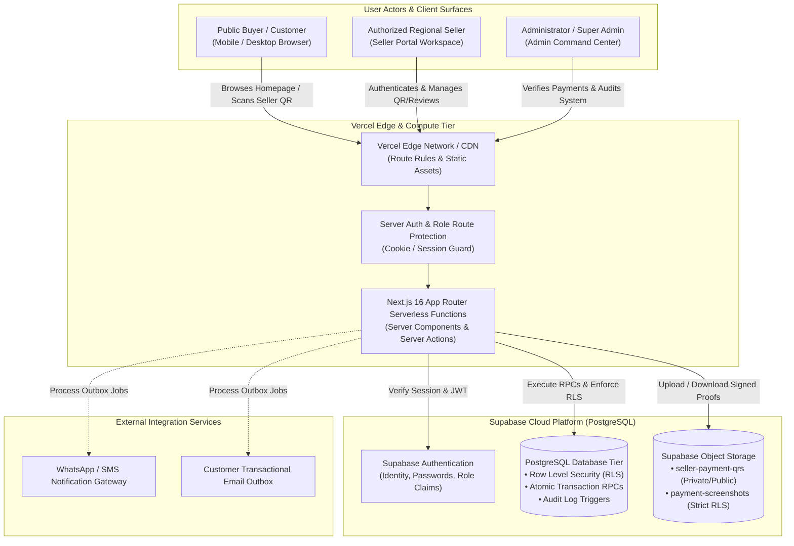
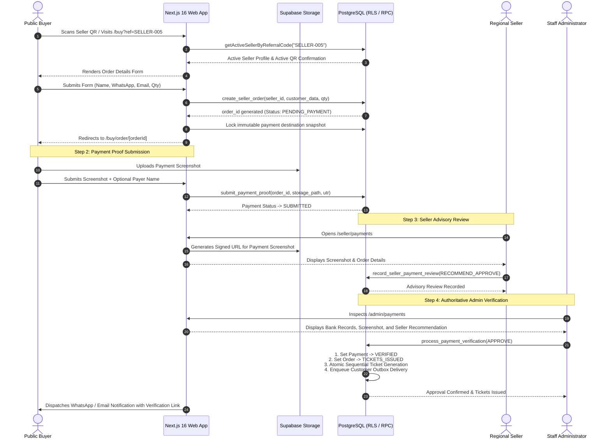
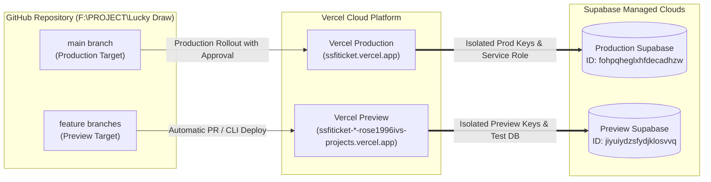

# SSFI Lucky Draw Management System — System Architecture

**Document Version:** 1.0.0
**Target Platform:** Next.js 16 App Router &bull; Supabase &bull; Vercel
**Organization:** Senthang Students Fellowship India (SSFI)

---

## 1. System Overview

The **SSFI Lucky Draw Management System** is a mission-critical web application designed for transparent, secure, and verifiable fundraising operations. The system coordinates ticket reservations across an authorized network of regional sellers, validates manual UPI payments through mandatory customer screenshot uploads, facilitates seller advisory reviews, enforces authoritative administrator payment verification, and issues cryptographically verifiable digital tickets with automated outbox delivery.

---

## 2. Key Architecture Principles

1. **Defense in Depth & Server-Side Authority:**
   - Client applications never issue tickets, approve payments, or directly mutate financial records.
   - All state transitions occur through audited PostgreSQL stored procedures (`process_payment_verification`, `create_seller_order`, `record_seller_payment_review`) executing under administrative isolation with strict Row Level Security (RLS).
2. **Immutable Payment Snapshot Isolation:**
   - At the instant an order is created, an immutable snapshot of the assigned seller's payment configuration (`snapshot_seller_id`, `snapshot_qr_storage_path`, `snapshot_upi_id`, `snapshot_account_name`) is locked to the order record. Subsequent updates to a seller's profile do not alter historical or in-flight payment destinations.
3. **Decoupled Seller Advisory vs. Admin Verification Authority:**
   - Customers pay directly using the designated seller's personal payment QR.
   - Sellers review submitted payment screenshots and provide advisory recommendations (`RECOMMEND_APPROVE`, `RECOMMEND_REJECT`, `NEEDS_REVIEW`).
   - Sellers **cannot** approve payments or issue tickets. Final financial verification and ticket issuance are strictly restricted to verified staff administrators.
4. **Environment Isolation:**
   - Preview deployments run against an isolated Supabase project (`jiyuiydzsfydjklosvvq`).
   - Production operations run against the dedicated Production Supabase project (`fohpqheglxhfdecadhzw`).
   - Secrets, service keys, and test data are strictly segregated.

---

## 3. Tiered System Architecture

### 3.1 Client Layer (Next.js 16 App Router)
- **Framework:** Next.js 16.4.3 with React 19.3.0 and TypeScript 5.
- **Routing Paradigm:** App Router utilizing Server Components for initial payload streaming and Client Components (`"use client"`) only for interactive forms, real-time counters, and QR rendering.
- **Dynamic Optimization:** Critical transactional routes (`/buy`, `/(public)`, `/buy/order/[orderId]`) configure `export const instant = false;` to guarantee on-demand server rendering without stale edge caching or empty Partial Prerender stubs.
- **Styling:** Tailwind CSS 4 with custom design tokens adhering to the SSFI brand identity (Crimson `#7c1619`, Deep Bronze `#35110f`, Cream `#fffaf7`, and Gold `#d6a23b`).

### 3.2 Security & Authentication Layer
- **Identity Provider:** Supabase Auth with custom user metadata and `user_roles` association.
- **Role Hierarchy:**
  - `PUBLIC`: Anonymous buyers reserving tickets via referral codes.
  - `SELLER`: Authorized regional sellers with access to `/seller` (dashboard, personal QR configuration, buyer review interface, order ledger).
  - `STAFF` / `ADMIN`: Operations managers with access to `/admin` (order approvals, payment verification, dispute resolution, campaign scheduler).
  - `SUPER_ADMIN`: Executive committee members with full system control, role provisioning, and audit log exports.
- **Session Enforcement:** Validated on every server component and server action via `createSupabaseServerClient()` reading cryptographically signed request cookies.

### 3.3 Database & Storage Layer (Supabase PostgreSQL)
- **Relational Tables:**
  - `campaigns`: Central fundraising configuration, ticket quota, price, and IST schedule boundaries.
  - `sellers`: Authorized regional representatives, assigned referral codes, and active payment QR configuration.
  - `orders`: Ticket reservations, customer attribution, quantity, and immutable payment snapshots.
  - `payments`: Financial records tracking payment proofs, screenshot storage references, UTR numbers, seller reviews, and verification statuses.
  - `tickets`: Sequential, unique lucky draw tickets with cryptographic verification tokens and draw serial numbers.
  - `ticket_deliveries`: Outbox queue tracking multi-channel dispatch (Email, WhatsApp) with retry counts.
  - `audit_logs`: Immutable security ledger capturing actor IDs, IP hashes, previous states, and transition metadata.
- **Storage Buckets:**
  - `seller-payment-qrs`: Stores verified seller UPI QR codes.
  - `payment-screenshots`: Encrypted bucket for customer payment screenshots, restricted via RLS to the paying customer, the attributed seller, and verified administrators.

---

## 4. End-to-End Order & Verification State Flow

---

## 5. Security & Trust Boundaries

| Boundary | Enforcing Mechanism | Failure Behavior |
| :--- | :--- | :--- |
| **Referral Validation** | Server-side regex + PostgreSQL lookup | Rejects order before record creation with friendly advisory notice. |
| **Inactive Seller QR** | Checked during both page load and order creation | Rejects order if `is_qr_active` is false, preventing misdirected payments. |
| **Order Snapshot Protection** | Database trigger `protect_order_payment_snapshot` | Blocks SQL updates attempting to modify snapshot fields once captured. |
| **Screenshot Access** | Supabase Storage RLS policies | Unauthenticated requests receive HTTP 403; URLs require short-lived HMAC signatures. |
| **Seller Review Scope** | PostgreSQL RLS scoped to `auth.uid() == seller.user_id` | Sellers cannot view other sellers' customer screenshots or order histories. |
| **Ticket Issuance** | Restricted strictly to `is_staff()` administrators | Direct API calls by buyers or sellers fail with permission denied (`42501`). |
| **Sequential Uniqueness** | Database sequence + unique constraint on `ticket_number` | Guarantees zero duplicate ticket numbers during concurrent high-volume transactions. |

---

## 6. Multi-Environment & Deployment Architecture

