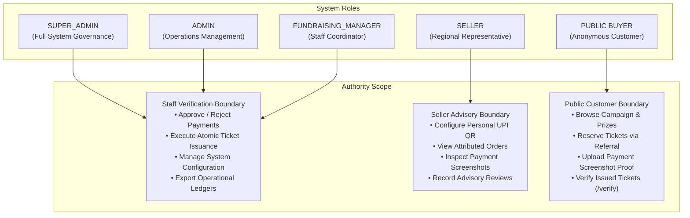

# SSFI Lucky Draw Management System — Authentication & Authorization Architecture

**Document Version:** 2.0.0
**Target Platform:** Next.js 16 App Router &bull; Supabase Auth &bull; PostgreSQL RLS
**Reference Code:** `src/lib/auth/server.ts`, `src/lib/supabase/admin.ts`, `src/lib/supabase/server.ts`

---

## 1. Role Hierarchy & Authority Boundaries

The SSFI Lucky Draw Management System implements a strict multi-tier role hierarchy to preserve separation of duties across financial, operational, and public surfaces.

---

## 2. Defined Roles and Permissions Matrix

| Capability / Action | Public Buyer | Seller | Staff Manager (`ADMIN` / `FUNDRAISING_MANAGER`) | Super Admin (`SUPER_ADMIN`) |
| :--- | :---: | :---: | :---: | :---: |
| Browse Public Campaign & Prizes |  Yes |  Yes |  Yes |  Yes |
| Place Ticket Order via Referral |  Yes |  Yes |  Yes |  Yes |
| Upload Payment Screenshot Proof |  Yes |  Yes |  Yes |  Yes |
| Public Ticket Verification (`/verify`) |  Yes |  Yes |  Yes |  Yes |
| Access Seller Workspace (`/seller/*`) |  No |  Yes |  No (Redirected) |  No (Redirected) |
| Configure Personal UPI Payment QR |  No |  Yes |  No |  No |
| View Attributed Order Ledger |  No |  Yes |  Yes (All Orders) |  Yes (All Orders) |
| Inspect Payment Proofs |  No (Own order only) |  Yes (Attributed orders) |  Yes (All orders) |  Yes (All orders) |
| **Submit Advisory Payment Review** |  No |  **Yes** |  No |  No |
| **Authoritative Payment Approval** |  **No** |  **No** |  **Yes** |  **Yes** |
| **Atomic Ticket Issuance** |  **No** |  **No** |  **Yes** |  **Yes** |
| Manage Campaign Quotas & Schedule |  No |  No |  Yes |  Yes |
| Void / Withdraw Invalid Tickets |  No |  No |  Yes |  Yes |
| Role Provisioning & Staff Management |  No |  No |  No |  **Yes** |
| Export Audit Logs & Financial Ledgers |  No |  No |  Yes |  Yes |

---

## 3. The Advisory vs. Authoritative Payment Boundary

A core security tenet of the SSFI Lucky Draw System is the separation between **Seller Advisory Review** and **Staff Authoritative Verification**:

1. **Why Sellers Cannot Issue Tickets:**
   - Under the decentralized UPI model, customers pay funds directly to the regional seller's personal UPI account.
   - If sellers had the power to approve payments and issue tickets, a compromised or unverified seller account could issue authentic lucky draw tickets without actual funds reaching the organization.
   - Therefore, seller interaction with payments is strictly limited to an **Advisory Review** (`RECOMMEND_APPROVE`, `RECOMMEND_REJECT`, `NEEDS_REVIEW`).
2. **Authoritative Staff Verification:**
   - Only staff administrators holding the `is_staff` claim (`ADMIN`, `SUPER_ADMIN`, `FUNDRAISING_MANAGER`) possess authorization to execute `process_payment_verification`.
   - The database stored procedure `issue_tickets(p_order_id)` verifies that the caller is operating under the service role and that the payment was officially approved by a staff administrator.

---

## 4. Server-Side Authentication & Session Guards

Authentication is handled via Supabase Authentication (JWTs stored in cryptographically signed HTTP-only cookies).

### 4.1 Server Route Protection
Route protection is enforced on every Server Component and Server Action via `src/lib/auth/server.ts`:

- `requireAuth()`: Ensures the client has an active authenticated session; redirects unauthenticated visitors to `/login`.
- `requireRole(role)`: Validates that the current user has the specified application role using the database function `has_role(p_user_id, p_role)`.
- `requireAnyRole(roles)`: Validates that the user has at least one role from the allowed set.
- **Workspace Redirection:** If a staff member attempts to open `/seller/*`, the application safely redirects them to `/unauthorized?reason=seller_only`. If a seller attempts to open `/admin/*`, they are redirected to `/unauthorized?reason=admin_only`.

### 4.2 Database Security Definer Functions
- `public.has_role(p_user_id uuid, p_role text) -> boolean`:
  Checks if `p_user_id` has an active record in `profile_roles` matching `roles.name = p_role`.
- `public.is_staff(p_user_id uuid) -> boolean`:
  Returns `true` if the user holds `SUPER_ADMIN`, `ADMIN`, or `FUNDRAISING_MANAGER`.

Both functions are compiled with `SECURITY DEFINER` and hardened with explicit search paths to eliminate privilege escalation attacks.
