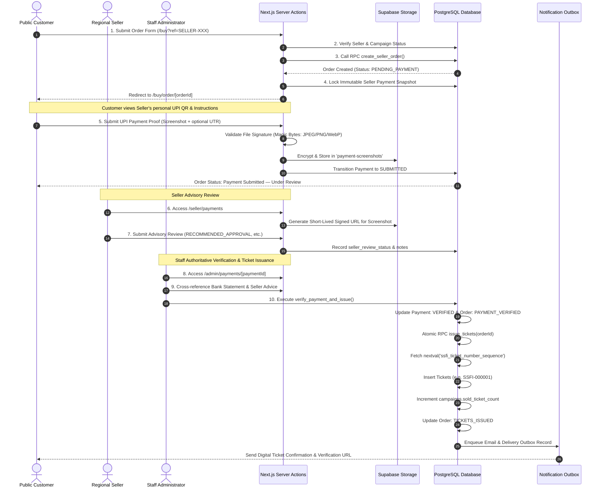

# SSFI Lucky Draw Management System — Payment & Ticket Workflow Architecture

**Document Version:** 2.0.0
**Target Platform:** Next.js 16 App Router &bull; Supabase PostgreSQL &bull; Supabase Storage
**Reference Code:** `src/server/actions/publicOrder.ts`, `src/server/actions/sellerPaymentReview.ts`, `src/lib/payment/screenshot.ts`

---

## 1. End-to-End Workflow Architecture

The SSFI Lucky Draw payment architecture coordinates transparent, human-verified financial accounting across a decentralized network of authorized student sellers.



---

## 2. Detailed Step-by-Step Execution

### Step 1: Customer Referral Selection & Pre-Flight Validation
- The customer scans an active seller's referral QR code or opens `https://ssfiticket.vercel.app/buy?ref=SELLER-XXX`.
- Server action `createPublicCustomerOrder` executes server-side validation:
  1. Validates that the referral code exists in `sellers` and `is_active = true`.
  2. Enforces that the seller has an active personal payment QR configured (`is_qr_active = true` and `qr_storage_path` is not null). If inactive, the customer is directed to select another seller.
  3. Executes `process_scheduled_campaign_transitions` to ensure live campaign schedule enforcement.
  4. Confirms that `campaigns.status === 'ACTIVE'`, current time is within `start_at` and `end_at`, and requested quantity does not exceed remaining quota.

### Step 2: Atomic Order Creation
- The server action calls the database stored procedure `create_seller_order`:
  ```sql
  select * from create_seller_order(
    p_seller_id := seller.id,
    p_name := parsed.data.name,
    p_whatsapp := parsed.data.whatsapp,
    p_email := parsed.data.email,
    p_quantity := parsed.data.quantity
  );
  ```
- Creates customer record (if new), creates order record with status `PENDING_PAYMENT`, and creates associated `payments` record with status `PENDING`.

### Step 3: Immutable Payment Destination Snapshot Capture
- Immediately following order creation, the server action captures an immutable snapshot of the assigned seller's payment configuration:
  - `snapshot_seller_id`
  - `snapshot_seller_code`
  - `snapshot_seller_display_name`
  - `snapshot_qr_storage_path`
  - `snapshot_upi_id`
  - `snapshot_account_name`
  - `snapshot_payment_instructions`
  - `snapshot_captured_at`
- **Database Trigger Protection:** PostgreSQL trigger `protect_order_payment_snapshot` intercepts subsequent updates and aborts any mutation to these snapshot fields, guaranteeing that historical orders remain bound to the payment details presented at reservation time.

### Step 4: Customer Payment Submission & Proof Upload
- The customer is redirected to `/buy/order/[orderId]`.
- The customer scans the seller's verified QR code using their UPI application (Google Pay, PhonePe, Paytm, etc.) and completes the transfer.
- The customer submits:
  - **Mandatory Payment Screenshot:** Upload of transaction receipt.
  - **Optional UTR:** 12-digit bank reference number.
  - **Optional Payer Name:** Name on the remitting bank account.
- **File Signature Validation:** The server action verifies the file header magic bytes (`FF D8 FF` for JPEG, `89 50 4E 47` for PNG, `52 49 46 46` for WebP) to prevent arbitrary file upload vulnerabilities.
- Stores the encrypted image in the private Supabase Storage bucket `payment-screenshots`.
- Payment record transitions to `SUBMITTED`, and order displays as **Payment Submitted — Under Review**.

### Step 5: Seller Advisory Review Interface
- The attributed seller navigates to `/seller/payments`.
- The seller inspects the payment screenshot using short-lived signed URLs.
- The seller submits an **Advisory Review**:
  - `RECOMMENDED_APPROVAL`: Seller confirms incoming credit received in their UPI account.
  - `RECOMMENDED_REJECTION`: Seller reports no matching payment found.
  - `FLAGGED_DISCREPANCY`: Ambiguous amount or illegible receipt.
- *Notice:* Sellers **cannot** approve payments or issue tickets. Their review serves as advisory intelligence for administrators.

### Step 6: Staff Authoritative Verification & Atomic Ticket Issuance
- Staff administrators navigate to `/admin/payments/[paymentId]`.
- The administrator inspects:
  1. The uploaded payment screenshot.
  2. The optional bank UTR reference.
  3. The seller's advisory recommendation and review notes.
  4. The organization bank statements.
- When confirmed, the administrator clicks **Approve Payment & Issue Tickets**.
- Stored procedure `verify_payment_and_issue` runs inside an atomic PostgreSQL transaction:
  1. Locks payment and order records with `FOR UPDATE`.
  2. Updates payment status to `VERIFIED` and records `verified_by` and `verified_at`.
  3. Updates order status to `PAYMENT_VERIFIED`.
  4. Invokes `issue_tickets(p_order_id)`.
  5. Iterates `1..order.quantity`, calling `nextval('ssfi_ticket_number_sequence')`.
  6. Inserts ticket records formatted as `SSFI-######`.
  7. Atomically increments `campaigns.sold_ticket_count`.
  8. Updates order status to `TICKETS_ISSUED`.
  9. Enqueues digital ticket delivery records in `ticket_deliveries`.

---

## 3. Financial Status Transitions

| Entity | Status Transition Flow | Authorized Actor |
| :--- | :--- | :--- |
| **Order** | `PENDING_PAYMENT` &rarr; `PAYMENT_SUBMITTED` | Customer (proof upload) |
| **Order** | `PAYMENT_SUBMITTED` &rarr; `PAYMENT_VERIFIED` | Staff Administrator |
| **Order** | `PAYMENT_VERIFIED` &rarr; `TICKETS_ISSUED` | Atomic RPC `issue_tickets` |
| **Order** | Any State &rarr; `CANCELLED` | Staff Administrator |
| **Payment** | `PENDING` &rarr; `SUBMITTED` | Customer (proof upload) |
| **Payment** | `SUBMITTED` &rarr; `VERIFIED` | Staff Administrator |
| **Payment** | `SUBMITTED` &rarr; `REJECTED` | Staff Administrator |
| **Ticket** | Initial State: `ISSUED` / `ACTIVE` | Atomic RPC `issue_tickets` |
| **Ticket** | `ACTIVE` &rarr; `VOID` | Staff Administrator (with reason) |
