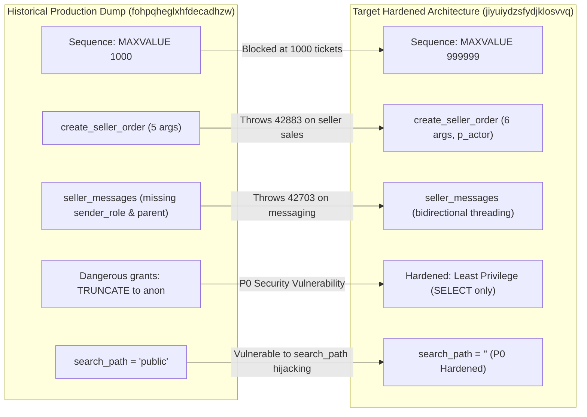
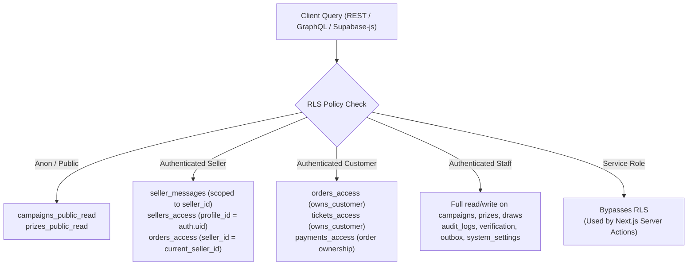
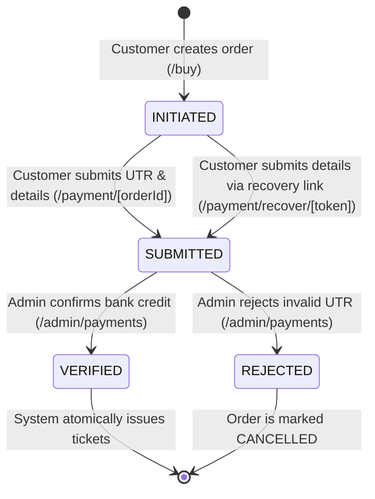
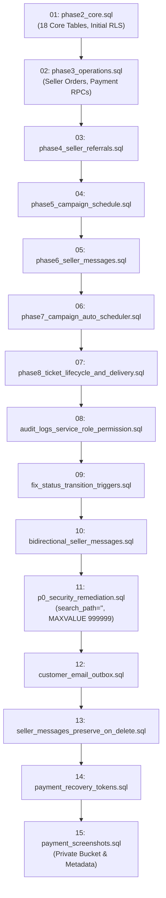

# SSFI Lucky Draw — Master Architecture Reconstruction (Phase B)

**Document Reference:** `docs/preview/phase-b-architecture-reconstruction.md`  
**Version:** 1.0.0  
**Date:** 2 November 2026  
**Auditor Roles:** Principal Software Architect, Senior PostgreSQL Engineer, Supabase Security Engineer, Application Reliability Engineer  
**Workspace:** `F:\PROJECT\Lucky Draw`  
**Active Git Branch:** `feature/payment-details-completion-recovery`  
**Production Project Reference:** `fohpqheglxhfdecadhzw` (`https://fohpqheglxhfdecadhzw.supabase.co`)  
**Preview Project Reference:** `jiyuiydzsfydjklosvvq` (`https://jiyuiydzsfydjklosvvq.supabase.co`)  

---

## 1. Executive Summary

This document reconstructs the complete, authoritative architecture of the SSFI Lucky Draw platform for the purpose of establishing a structurally identical, completely isolated Preview testing environment.

This analysis was executed under **strict read-only constraints**:
- Zero network requests to remote Supabase instances.
- Zero migrations executed.
- Zero database mutations.
- Zero file deletions or changes to user working-tree modifications.

The authoritative application architecture is established by cross-referencing four distinct layers of truth:
1. **Level 1 (Highest):** Current application source code ([`src/`](file:///F:/PROJECT/Lucky%20Draw/src/)), version-controlled migrations ([`supabase/migrations/`](file:///F:/PROJECT/Lucky%20Draw/supabase/migrations/)), and automated tests ([`tests/`](file:///F:/PROJECT/Lucky%20Draw/tests/)).
2. **Level 2:** Architectural and security design specifications ([`docs/`](file:///F:/PROJECT/Lucky%20Draw/docs/)).
3. **Level 3:** Historical database schema dumps from Production ([`backups/production-public-schema.sql`](file:///F:/PROJECT/Lucky%20Draw/backups/production-public-schema.sql)) and Preview ([`backups/preview-public-schema.sql`](file:///F:/PROJECT/Lucky%20Draw/backups/preview-public-schema.sql)).
4. **Level 4:** Prior audit and preflight reports ([`docs/release-audit/`](file:///F:/PROJECT/Lucky%20Draw/docs/release-audit/)).

### Core Structural Conclusions:
- **Application Scale:** The system consists of **22 public tables** (18 core tables established in Phase 2 through Phase 8, plus 4 operational extensions for email outbox, system settings, payment recovery tokens, and payment screenshots).
- **Security & Authorization:** The platform enforces **34 Row Level Security (RLS) policies**. Privileged operations are strictly encapsulated within **25 PostgreSQL functions/RPCs**, of which 22 enforce `SECURITY DEFINER` with hardened search paths (`SET search_path = ''`).
- **Critical Divergence Mitigations:** The historical Production dump exhibits critical vulnerabilities and defects (a 1,000-ticket sequence cap, a breaking 5-argument `create_seller_order` RPC signature, missing messaging columns, and dangerous table privileges granted to `anon`). The approved target architecture for Preview replication is the fully hardened, 6-parameter, `MAXVALUE 999999` architecture defined by the migration sequence through `202611011200_payment_screenshots.sql`.
- **Side-Effect Safety:** External communication channels (Gmail API and WhatsApp) incorporate automated fail-closed isolation gates, ensuring preview test transactions cannot deliver messages to real customers.

---

## 2. Evidence Inventory & Confidence Classification

Every architectural assertion in this document is classified according to the confidence framework specified in Section 19 of the Master Prompt:

| Evidence Classification | Local Source Path & Identifier | Scope & Reliability |
|---|---|---|
| **VERIFIED FROM CURRENT SOURCE** | [`src/server/actions/`](file:///F:/PROJECT/Lucky%20Draw/src/server/actions/), [`src/lib/`](file:///F:/PROJECT/Lucky%20Draw/src/lib/), [`src/app/`](file:///F:/PROJECT/Lucky%20Draw/src/app/) | Authoritative runtime code governing RPC invocation, parameter passing, and validation logic. |
| **VERIFIED FROM MIGRATION** | [`supabase/migrations/`](file:///F:/PROJECT/Lucky%20Draw/supabase/migrations/) (15 files) | Chronological DDL source defining schema evolution from Phase 2 baseline to current feature branch. |
| **VERIFIED FROM HISTORICAL DUMP** | [`backups/production-public-schema.sql`](file:///F:/PROJECT/Lucky%20Draw/backups/production-public-schema.sql)<br/>[`backups/preview-public-schema.sql`](file:///F:/PROJECT/Lucky%20Draw/backups/preview-public-schema.sql) | Static snapshots of past PostgreSQL states. Authoritative for historical comparison, not live remote state. |
| **VERIFIED FROM TEST** | [`tests/`](file:///F:/PROJECT/Lucky%20Draw/tests/) (21 test files, 288 passing tests) | Validates functional expectations, state machine guards, role routing, and environment isolation. |
| **DOCUMENTED** | [`docs/ARCHITECTURE.md`](file:///F:/PROJECT/Lucky%20Draw/docs/ARCHITECTURE.md), [`docs/DATABASE.md`](file:///F:/PROJECT/Lucky%20Draw/docs/DATABASE.md), [`docs/release-audit/`](file:///F:/PROJECT/Lucky%20Draw/docs/release-audit/) | Design specifications and release runbooks agreed upon during development. |
| **INFERRED** | Cross-layer synthesis | Deduced when application code and migration definitions align to imply operational requirements. |
| **UNKNOWN** | Remote database state | Remote migration table status on `jiyuiydzsfydjklosvvq` and `fohpqheglxhfdecadhzw`. |
| **BLOCKED** | Direct remote inspection | Intentionally blocked due to strict zero-remote-access rules during Phase B. |

---

## 3. Architecture Overview

SSFI Lucky Draw is a full-stack, mobile-first fundraising and ticket issuance platform.

```mermaid
flowchart TD
    subgraph Public_Users["Public Customers & Sellers"]
        Customer["Customer Browser (Mobile / Desktop)"]
        Seller["Seller Browser (Mobile / Desktop)"]
    end

    subgraph Edge_Routing["Vercel Edge & Middleware"]
        VercelApp["Next.js 16.4.3 App Router<br/>(Deployment Skew Protection)"]
        RoleRouting["Role-Based Middleware<br/>(/admin, /seller, /buy)"]
    end

    subgraph Server_Execution["Server Execution Boundary (Next.js Actions)"]
        PublicOrderAct["publicOrder.ts (Public Checkout)"]
        SellerAct["seller.ts / operations.ts"]
        PaymentRecoveryAct["paymentRecovery.ts"]
        PaymentScreenshotAct["paymentScreenshot.ts"]
        TicketsAct["tickets.ts / operations.ts"]
        MessagesAct["messages.ts"]
        AdminDeliveryAct["adminDeliveryTest.ts"]
    end

    subgraph Database_Storage["Supabase Backend (PostgreSQL 17)"]
        AuthSchema["auth.users (Supabase Auth)"]
        PublicSchema["public Schema (22 Tables, RLS Active)"]
        DBFunctions["25 Functions / RPCs (search_path='')"]
        Sequences["Order & Ticket Sequences (MAXVALUE 999999)"]
        PrivateBucket["Storage: payment-screenshots (Private)"]
    end

    Customer -->|Browse & Checkout| VercelApp
    Seller -->|Manage Orders & Messages| VercelApp
    VercelApp --> RoleRouting
    RoleRouting --> Server_Execution

    Server_Execution -->|User Session / RLS| PublicSchema
    Server_Execution -->|createSupabaseAdminClient()| DBFunctions
    Server_Execution -->|Secure Upload| PrivateBucket
    DBFunctions --> Sequences
    DBFunctions --> PublicSchema
    AuthSchema -.->|Trigger: handle_new_user| PublicSchema
```

### Architectural Key Tenets:
1. **Manual UPI Verification Model:** India-specific UPI payments are performed out-of-band by the customer to an official SSFI VPA (`6909251270@ptaxis`). Payment confirmation is strictly decoupled from customer actions; only authorized staff review can mark a payment as `VERIFIED`.
2. **Post-Payment Ticket Generation:** Tickets and sequential ticket numbers are generated **exclusively upon successful payment verification**, inside an atomic transaction governed by database row locks.
3. **Privilege Segregation:** Untrusted client roles (`anon`, `authenticated`) hold zero direct table mutation privileges on sensitive tables (`seller_messages`, `customer_email_outbox`, `audit_logs`, `payment_screenshots`). All sensitive mutations occur server-side via `createSupabaseAdminClient()` (`service_role`).

---

## 4. Database Schema Inventory (22 Tables)

*(Confidence: VERIFIED FROM MIGRATION & HISTORICAL DUMP)*

### Summary Table Catalog
| # | Table Name | Source File | Primary Key | Foreign Keys | RLS Status |
|---|---|---|---|---|---|
| 1 | `profiles` | `202610270001_phase2_core.sql` | `id` (uuid) | `auth.users(id)` | Enabled |
| 2 | `roles` | `202610270001_phase2_core.sql` | `id` (uuid) | None | Enabled |
| 3 | `profile_roles` | `202610270001_phase2_core.sql` | `id` (uuid) | `profiles(id)`, `roles(id)` | Enabled |
| 4 | `campaigns` | `202610270001_phase2_core.sql` | `id` (uuid) | None | Enabled |
| 5 | `prizes` | `202610270001_phase2_core.sql` | `id` (uuid) | `campaigns(id)` | Enabled |
| 6 | `draws` | `202610270001_phase2_core.sql` | `id` (uuid) | `campaigns(id)`, `profiles(id)` | Enabled |
| 7 | `draw_results` | `202610270001_phase2_core.sql` | `id` (uuid) | `draws(id)`, `prizes(id)`, `tickets(id)` | Enabled |
| 8 | `sellers` | `202610270001_phase2_core.sql` | `id` (uuid) | `profiles(id)` | Enabled |
| 9 | `customers` | `202610270001_phase2_core.sql` | `id` (uuid) | None | Enabled |
| 10 | `orders` | `202610270001_phase2_core.sql` | `id` (uuid) | `campaigns(id)`, `customers(id)`, `sellers(id)` | Enabled |
| 11 | `order_items` | `202610270001_phase2_core.sql` | `id` (uuid) | `orders(id)` | Enabled |
| 12 | `payments` | `202610270001_phase2_core.sql` | `id` (uuid) | `orders(id)`, `profiles(id)` | Enabled |
| 13 | `payment_events` | `202610270001_phase2_core.sql` | `id` (uuid) | `payments(id)`, `profiles(id)` | Enabled |
| 14 | `tickets` | `202610270001_phase2_core.sql` | `id` (uuid) | `orders(id)`, `campaigns(id)`, `customers(id)`, `profiles(id)` | Enabled |
| 15 | `ticket_deliveries` | `202610290004_phase8_...sql` | `id` (uuid) | `orders(id)`, `customers(id)` | Enabled |
| 16 | `ticket_verifications`| `202610270001_phase2_core.sql` | `id` (uuid) | `tickets(id)` | Enabled |
| 17 | `seller_messages` | `202610290002_phase6_...sql` | `id` (uuid) | `sellers(id)`, `profiles(id)`, `seller_messages(id)` | Enabled |
| 18 | `audit_logs` | `202610270001_phase2_core.sql` | `id` (uuid) | `profiles(id)` | Enabled |
| 19 | `system_settings` | `202611010001_customer_...sql` | `key` (text) | `auth.users(id)` | Enabled |
| 20 | `customer_email_outbox`| `202611010001_customer_...sql`| `id` (uuid) | `orders(id)`, `customers(id)` | Enabled |
| 21 | `payment_recovery_tokens`|`202611011100_payment_...sql`| `id` (uuid) | `orders(id)`, `profiles(id)` | Enabled |
| 22 | `payment_screenshots` | `202611011200_payment_...sql`| `id` (uuid) | `payments(id)` | Enabled |

*(For full column-by-column definitions, refer to [`docs/preview/phase-b-schema-difference-matrix.md`](file:///F:/PROJECT/Lucky%20Draw/docs/preview/phase-b-schema-difference-matrix.md)).*

---

## 5. Production vs Preview Schema Comparison

*(Confidence: VERIFIED FROM HISTORICAL DUMP & MIGRATIONS)*

The comparison between `production-public-schema.sql` (61 KB, 1,698 lines) and `preview-public-schema.sql` (77 KB, 2,253 lines) reveals critical divergences across 6 key architectural dimensions:



1. **Ticket Capacity Sequence:**
   - Production Dump (L850): `MAXVALUE 1000`.
   - Preview Dump (L1317) & Migration `202610300001` (L214): `MAXVALUE 999999`.
   - Impact: In Production, selling ticket 1,001 fails with PostgreSQL error `55000`.
2. **`create_seller_order` Signature Mismatch:**
   - Production Dump (L269): Accepts 5 parameters `(p_seller_id, p_name, p_whatsapp, p_email, p_quantity)`.
   - Current Source ([`src/server/actions/operations.ts:141`](file:///F:/PROJECT/Lucky%20Draw/src/server/actions/operations.ts#L141)): Invokes RPC with 6 parameters including `p_actor`.
   - Impact: Seller direct orders fail on Production with error `42883 (function does not exist)`.
3. **Seller Messages Schema:**
   - Production Dump (L807–817): Lacks `sender_role` and `parent_message_id`.
   - Current Source ([`src/server/actions/messages.ts`](file:///F:/PROJECT/Lucky%20Draw/src/server/actions/messages.ts)): Queries and filters by both columns.
   - Impact: Admin and seller messaging portals crash with error `42703 (column does not exist)`.
4. **Campaign Auto-Scheduler RPCs:**
   - Production Dump: Completely missing `process_scheduled_campaign_transitions()` and `evaluate_campaign_schedules()`.
   - Current Source ([`src/app/api/cron/campaign-schedule/route.ts`](file:///F:/PROJECT/Lucky%20Draw/src/app/api/cron/campaign-schedule/route.ts)): Calls `process_scheduled_campaign_transitions()`.
5. **Database Table Grants (P0 Security Risk):**
   - Production Dump (L1536–1540): Explicitly grants `REFERENCES, TRIGGER, TRUNCATE, MAINTAIN` to `anon` and `authenticated`.
   - Target Preview Architecture: Grants revoked; only `SELECT` is granted to client roles under strict RLS.
6. **`search_path` Hardening:**
   - Production Dump: Functions run with `search_path = 'public'`.
   - Preview Architecture: Functions run with `SET search_path = ''` and fully schema-qualified object references.

---

## 6. Ticket Sequence Analysis

*(Confidence: VERIFIED FROM MIGRATION, TESTS & APPLICATION SOURCE)*

- **Sequence Name:** `public.ssfi_ticket_number_sequence`
- **Ownership:** Explicitly associated with `public.tickets.ticket_number`.
- **Issuance Logic ([`supabase/migrations/202610300001_p0_security_remediation.sql:140-165`](file:///F:/PROJECT/Lucky%20Draw/supabase/migrations/202610300001_p0_security_remediation.sql#L140-L165)):**
  ```sql
  v_ticket_num := nextval('public.ssfi_ticket_number_sequence');
  v_ticket_code := 'TICK-2026-' || lpad(v_ticket_num::text, 6, '0');
  ```
- **Concurrency & Monotonicity:** Standard PostgreSQL sequences allocate numbers outside transaction rollback boundaries. To guarantee a gapless sequence for public trust, ticket issuance is invoked **only inside `issue_tickets(p_order_id)`**, which executes **after payment has been verified** under row-level order locks (`SELECT * FROM orders WHERE id = p_order_id FOR UPDATE`).
- **Conclusion:** The divergence between `MAXVALUE 1000` and `MAXVALUE 999999` was an intentional bug fix introduced in migration `202610300001`. The 1,000 limit was an initial phase placeholder. The 6-digit formatting (`lpad(..., 6, '0')`) mathematically accommodates up to 999,999 tickets. `MAXVALUE 999999` is the authoritative specification.

---

## 7. Database Function & RPC Inventory (25 Routines)

*(Confidence: VERIFIED FROM MIGRATIONS & CURRENT SOURCE)*

| # | Routine Name | Security Mode | Search Path | Grantee Roles | Caller / Application Dependency |
|---|---|---|---|---|---|
| 1 | `has_role(uuid, text)` | DEFINER | `''` | `anon, authenticated, service_role` | `src/lib/auth/server.ts`, RLS policies |
| 2 | `is_staff(uuid)` | DEFINER | `''` | `anon, authenticated, service_role` | `campaigns_public_read` policy, navigation |
| 3 | `current_seller_id()` | DEFINER | `''` | `authenticated, service_role` | `orders_access`, `src/server/actions/seller.ts` |
| 4 | `get_active_seller_by_code(text)` | DEFINER | `''` | `anon, authenticated, service_role` | `src/lib/validation/referral.ts` (`/buy?ref=...`) |
| 5 | `create_seller_order(uuid, text, text, text, integer, uuid)` | DEFINER | `''` | `authenticated, service_role` | `src/server/actions/operations.ts:141` |
| 6 | `verify_payment_and_issue(uuid, uuid)` | DEFINER | `''` | `authenticated, service_role` | `src/server/actions/tickets.ts` |
| 7 | `issue_tickets(uuid)` | DEFINER | `''` | `service_role` | Internal transaction inside `verify_payment_and_issue` |
| 8 | `reject_payment(uuid, uuid, text)` | DEFINER | `''` | `authenticated, service_role` | `src/server/actions/tickets.ts` |
| 9 | `submit_manual_upi(uuid, text, text)` | DEFINER | `''` | `anon, authenticated, service_role` | `src/server/actions/publicOrder.ts` |
| 10 | `admin_void_ticket(uuid, uuid, text)` | DEFINER | `''` | `authenticated, service_role` | `src/server/actions/tickets.ts` |
| 11 | `admin_reissue_ticket(uuid, uuid, text)` | DEFINER | `''` | `authenticated, service_role` | `src/server/actions/tickets.ts` |
| 12 | `evaluate_campaign_schedules()` | DEFINER | `''` | `service_role` | Diagnostics & checkout status check |
| 13 | `process_scheduled_campaign_transitions()` | DEFINER | `''` | `service_role` | `src/app/api/cron/campaign-schedule/route.ts` |
| 14 | `get_campaign_scheduler_status()` | DEFINER | `''` | `service_role` | Admin campaign settings dashboard |
| 15 | `create_payment_recovery_link(uuid, text, uuid, integer)` | DEFINER | `public` | `authenticated, service_role` | `src/server/actions/paymentRecovery.ts` |
| 16 | `get_payment_screenshot_storage_metrics(uuid)` | DEFINER | `''` | `service_role` | `src/server/actions/paymentScreenshot.ts` |
| 17 | `handle_new_user()` | DEFINER | `''` | `postgres` | Trigger on `auth.users` insert |
| 18 | `record_payment_event()` | DEFINER | `''` | `postgres` | Trigger on `payments` status change |
| 19 | `validate_status_transition()` | DEFINER | `''` | `postgres` | Trigger on `orders` and `payments` |
| 20 | `trg_seller_messages_protect_immutable()` | DEFINER | `''` | `postgres` | Trigger on `seller_messages` update |
| 21 | `trg_seller_messages_populate_snapshot()` | DEFINER | `''` | `postgres` | Trigger on `seller_messages` insert |
| 22 | `set_updated_at()` | INVOKER | `''` | `public` | Timestamp update trigger on all tables |
| 23 | `owns_customer(uuid)` | DEFINER | `''` | `authenticated, service_role` | RLS helper for customer data access |
| 24 | `seller_owns_customer(uuid)` | DEFINER | `''` | `authenticated, service_role` | RLS helper for seller order visibility |
| 25 | `rls_auto_enable()` | DEFINER | `''` | `postgres` | Event trigger ensuring RLS on new tables |

---

## 8. SECURITY DEFINER Review

*(Confidence: VERIFIED FROM MIGRATION & SECURITY AUDIT)*

A security review of elevated `SECURITY DEFINER` functions reveals critical design decisions:
1. **Search Path Hijacking Defense:** In historical Production, routines executed with `search_path = 'public'`, making them susceptible to search path hijacking if malicious users created shadowed functions or operators. The migration sequence enforces `SET search_path = ''` across all security-definer routines, requiring fully qualified schema identifiers (`public.orders`, `auth.uid()`).
2. **Caller Identity Verification:**
   - In `has_role(p_user_id, p_role)`: An internal check enforces `if auth.uid() <> p_user_id and not public.is_staff(auth.uid()) then return false; end if;`, preventing non-staff users from enumerating permissions of other accounts.
   - In `verify_payment_and_issue(p_payment_id, p_actor)`: Enforces `if auth.uid() <> p_actor and auth.role() <> 'service_role' then raise exception 'actor mismatch'; end if;`, preventing staff impersonation.
   - In `is_staff(p_user_id)`: Granted to `anon` because public RLS policies (`campaigns_public_read`) evaluate `is_staff(auth.uid())` when anonymous users visit the homepage. An internal guard immediately returns `false` if `p_user_id` is `NULL`, avoiding unnecessary query overhead while ensuring anonymous visitors do not crash.

---

## 9. Trigger Inventory (15 Operational Triggers)

*(Confidence: VERIFIED FROM MIGRATIONS & SCHEMA DUMPS)*

| Table | Trigger Name | Timing & Event | Function | Business Purpose & Side Effect |
|---|---|---|---|---|
| `campaigns` | `campaigns_updated` | BEFORE UPDATE | `set_updated_at()` | Auto-updates `updated_at`. |
| `customers` | `customers_updated` | BEFORE UPDATE | `set_updated_at()` | Auto-updates `updated_at`. |
| `orders` | `orders_updated` | BEFORE UPDATE | `set_updated_at()` | Auto-updates `updated_at`. |
| `orders` | `order_status_guard` | BEFORE UPDATE | `validate_status_transition()` | Rejects invalid order state progressions (e.g. `CANCELLED -> PAID`). |
| `payments` | `payments_updated` | BEFORE UPDATE | `set_updated_at()` | Auto-updates `updated_at`. |
| `payments` | `payment_status_guard` | BEFORE UPDATE | `validate_status_transition()` | Enforces payment lifecycle (`INITIATED -> SUBMITTED -> VERIFIED`). |
| `payments` | `payment_event_log` | AFTER UPDATE | `record_payment_event()` | Inserts audit record into `payment_events` whenever `status` changes. |
| `profiles` | `profiles_updated` | BEFORE UPDATE | `set_updated_at()` | Auto-updates `updated_at`. |
| `sellers` | `sellers_updated` | BEFORE UPDATE | `set_updated_at()` | Auto-updates `updated_at`. |
| `tickets` | `tickets_updated` | BEFORE UPDATE | `set_updated_at()` | Auto-updates `updated_at`. |
| `ticket_deliveries` | `ticket_deliveries_updated` | BEFORE UPDATE | `set_updated_at()` | Auto-updates `updated_at`. |
| `seller_messages` | `trg_seller_messages_protect` | BEFORE UPDATE | `trg_seller_messages_protect_immutable()` | Enforces that message subject, body, sender, and history cannot be edited. |
| `seller_messages` | `trg_seller_messages_snapshot` | BEFORE INSERT | `trg_seller_messages_populate_snapshot()` | Automatically snapshots seller code & name so historical messages survive seller account deletion. |
| `system_settings` | `trg_system_settings_updated` | BEFORE UPDATE | `set_updated_at()` | Auto-updates `updated_at`. |
| `customer_email_outbox`| `trg_customer_email_outbox_updated` | BEFORE UPDATE | `set_updated_at()` | Auto-updates `updated_at`. |

---

## 10. RLS Authorization Matrix (34 Policies)

*(Confidence: VERIFIED FROM MIGRATION & HISTORICAL PREVIEW DUMP)*

All 22 public tables have Row Level Security enabled (`ALTER TABLE ... ENABLE ROW LEVEL SECURITY`).



*(For the complete policy-by-policy mapping of USING and WITH CHECK expressions across all 34 policies, see [`docs/preview/phase-b-rls-authorization-matrix.md`](file:///F:/PROJECT/Lucky%20Draw/docs/preview/phase-b-rls-authorization-matrix.md)).*

---

## 11. Storage Architecture

*(Confidence: VERIFIED FROM MIGRATION `202611011200_payment_screenshots.sql` & SOURCE)*

1. **Bucket Identity:** `payment-screenshots` (Private, `public = false`).
2. **Quota & Constraints:**
   - Max file size: 2,097,152 bytes (2 MB).
   - Allowed MIME types: `image/jpeg`, `image/png`, `image/webp`.
3. **Storage Access Protocol:**
   - **Zero Client Storage Policies:** No `storage.objects` RLS policies exist for `anon` or `authenticated`. Direct client browser uploads/downloads to Supabase Storage are completely rejected.
   - **Upload Mediation:** Uploads are executed server-side in [`src/server/actions/paymentScreenshot.ts`](file:///F:/PROJECT/Lucky%20Draw/src/server/actions/paymentScreenshot.ts) using `createSupabaseAdminClient()`.
   - **Magic Number File Signature Verification:** File contents are inspected for exact byte signatures (`0xFF, 0xD8, 0xFF` for JPEG; `0x89, 0x50, 0x4E, 0x47` for PNG; `RIFF....WEBP` for WebP) before upload, preventing MIME spoofing.
   - **Secure Admin Viewing:** Admin viewers access screenshots exclusively via short-lived (60-second) signed URLs generated on-demand by `createSupabaseAdminClient().storage.from('payment-screenshots').createSignedUrl(path, 60)`.
4. **Environment Note:** Creation of the `payment-screenshots` bucket is scripted in migration `202611011200_payment_screenshots.sql`. Its existence in remote Preview remains UNVERIFIED until Phase C.

---

## 12. Payment Architecture & Verification State Machine

*(Confidence: VERIFIED FROM SOURCE & DATABASE SCHEMAS)*

The payment workflow enforces a manual verification model:



### Critical Payment Verification Rules:
1. **Decoupled Screenshot Upload:** Uploading a payment screenshot (`payments.screenshot_path`) does **NOT** alter the payment status to `VERIFIED` and does **NOT** issue tickets.
2. **Verification Gate:** Only the administrative server action `verify_payment_and_issue` can transition a payment from `SUBMITTED` to `VERIFIED`.
3. **Recovery Token Isolation:** Recovery tokens generated via `create_payment_recovery_link` are stored as SHA-256 hashes (`payment_recovery_tokens.token_hash`). Plaintext tokens are never stored in the database. Recovery links expire after 7 days and are immediately invalidated upon successful submission.

---

## 13. Ticket Architecture & Lifecycle

*(Confidence: VERIFIED FROM SOURCE, TESTS & MIGRATION `202610270001`)*

1. **Sequential Allocation:**
   - Generated inside `issue_tickets(p_order_id)` via `nextval('public.ssfi_ticket_number_sequence')`.
   - Number formatted as `TICK-2026-XXXXXX` (e.g. `TICK-2026-000042`).
2. **Duplicate Prevention:**
   - Table `public.tickets` enforces `CONSTRAINT tickets_campaign_number_unique UNIQUE (campaign_id, ticket_number)`.
   - Table `public.tickets` enforces `CONSTRAINT tickets_ticket_code_unique UNIQUE (ticket_code)`.
3. **Public Ticket Verification ([`src/app/verify/page.tsx`](file:///F:/PROJECT/Lucky%20Draw/src/app/verify/page.tsx)):**
   - Customers verify ticket authenticity by entering their ticket code or scanning the ticket's QR code.
   - Verification logs are recorded in `public.ticket_verifications` with timestamp, hashed IP, and user agent.
4. **Void and Reissue Safeguards:**
   - Only Super Admin can void a ticket (`admin_void_ticket`) or reissue a ticket (`admin_reissue_ticket`). Voided tickets retain `status = 'VOID'` and are permanently excluded from draw eligibility.

---

## 14. Application Feature Inventory

*(Confidence: VERIFIED FROM CURRENT SOURCE & TESTS)*

### 14.1 Customer Features
- **Public Checkout ([`src/app/buy/page.tsx`](file:///F:/PROJECT/Lucky%20Draw/src/app/buy/page.tsx)):** Active seller referral resolution (`ref=SELLER-XXX`), ticket quantity calculation, atomic order placement via [`src/server/actions/publicOrder.ts`](file:///F:/PROJECT/Lucky%20Draw/src/server/actions/publicOrder.ts).
- **Payment Instructions & QR ([`src/components/home/PaymentInstructionsSection.tsx`](file:///F:/PROJECT/Lucky%20Draw/src/components/home/PaymentInstructionsSection.tsx)):** Displays official VPA, account holder, dynamic UPI intent links, and instant QR generation.
- **Payment Details Submission ([`src/components/payment/PaymentDetailsForm.tsx`](file:///F:/PROJECT/Lucky%20Draw/src/components/payment/PaymentDetailsForm.tsx)):** Mobile-optimized form capturing 12-digit UTR, WhatsApp contact confirmation, email, and optional screenshot.
- **Payment Recovery Journey ([`src/app/payment/recover/[token]/page.tsx`](file:///F:/PROJECT/Lucky%20Draw/src/app/payment/recover/[token]/page.tsx)):** Unauthenticated tokenized recovery route for completing payment details.
- **Public Verification ([`src/app/verify/page.tsx`](file:///F:/PROJECT/Lucky%20Draw/src/app/verify/page.tsx)):** Authenticity lookup for issued tickets.

### 14.2 Seller Features
- **Seller Portal ([`src/app/seller/`](file:///F:/PROJECT/Lucky%20Draw/src/app/seller/)):** Performance dashboard, referral link generation, direct cash/manual order entry via `create_seller_order`.
- **Bidirectional Messaging ([`src/app/seller/messages/page.tsx`](file:///F:/PROJECT/Lucky%20Draw/src/app/seller/messages/page.tsx)):** In-app communication with staff.

### 14.3 Administrative Features
- **Campaign & Prize Management ([`src/app/admin/campaign/page.tsx`](file:///F:/PROJECT/Lucky%20Draw/src/app/admin/campaign/page.tsx)):** Campaign lifecycle controls, schedule windows, ticket price and capacity configuration.
- **Payment Verification Console ([`src/app/admin/payments/page.tsx`](file:///F:/PROJECT/Lucky%20Draw/src/app/admin/payments/page.tsx)):** Review UTRs, inspect private screenshots via signed URLs, verify payments, generate recovery links.
- **Ticket Management & Export ([`src/app/admin/tickets/page.tsx`](file:///F:/PROJECT/Lucky%20Draw/src/app/admin/tickets/page.tsx), [`src/app/admin/export/page.tsx`](file:///F:/PROJECT/Lucky%20Draw/src/app/admin/export/page.tsx)):** Multi-format export (Excel, CSV, PDF, JSON), void/reissue controls.
- **Audit Logs ([`src/app/admin/audit/page.tsx`](file:///F:/PROJECT/Lucky%20Draw/src/app/admin/audit/page.tsx)):** Full system audit trail.

---

## 15. External Side Effects & Environment Gates

*(Confidence: VERIFIED FROM CURRENT SOURCE & TESTS)*

```mermaid
flowchart LR
    Event["Ticket Issued / Payment Verified"] --> OutboxInsert["Insert to customer_email_outbox"]
    OutboxInsert --> CheckEnv{"Check Environment"}
    CheckEnv -->|Production| LiveSend["Gmail API Live Dispatch<br/>(Requires system_settings live toggle)"]
    CheckEnv -->|Preview / Local| PreviewGate{"Check Preview Gate<br/>(GMAIL_PREVIEW_REAL_SEND_ENABLED)"]
    PreviewGate -->|False (Default)| Simulated["Mark SIMULATED<br/>(Zero external HTTP requests)"]
    PreviewGate -->|True| RecipientCheck{"Recipient matches<br/>GMAIL_PREVIEW_ALLOWED_RECIPIENT?"}
    RecipientCheck -->|No| BlockReal["Block Real Customer Send"]
    RecipientCheck -->|Yes| SendAuthorized["Send to Authorized Tester Only"]
```

1. **Transactional Email Gate ([`src/lib/delivery/providers/gmail.ts:16-56`](file:///F:/PROJECT/Lucky%20Draw/src/lib/delivery/providers/gmail.ts#L16-L56)):**
   - Implements strict fail-closed safety.
   - When running in Preview (`VERCEL_ENV=preview`): Live customer emails are **hard-blocked**. Unless `GMAIL_PREVIEW_REAL_SEND_ENABLED === 'true'` AND `GMAIL_PREVIEW_ALLOWED_RECIPIENT` matches the destination, messages are recorded as `SIMULATED` with zero outbound API calls.
2. **WhatsApp Links:**
   - Built via [`src/lib/delivery/whatsappUrl.ts`](file:///F:/PROJECT/Lucky%20Draw/src/lib/delivery/whatsappUrl.ts) as client-side standard URI schemes (`https://wa.me/...`).
   - Zero automated server-side webhooks or SMS gateways exist.

---

## 16. Migration Dependency Map (15 Migrations)

*(Confidence: VERIFIED FROM MIGRATION FILES)*

The 15 migrations in [`supabase/migrations/`](file:///F:/PROJECT/Lucky%20Draw/supabase/migrations/) form a strict chronological dependency chain:



*(For detailed schema impact and dependency analysis, see [`docs/preview/phase-b-migration-dependency-map.md`](file:///F:/PROJECT/Lucky%20Draw/docs/preview/phase-b-migration-dependency-map.md)).*

---

## 17. Unresolved Conflicts & State Ambiguities

1. **Remote Production State Uncertainty:**
   Whether the production database `fohpqheglxhfdecadhzw` has been updated with the candidate release migration (`supabase/release-candidates/production-migration.sql`) cannot be determined without read-only remote access or operator dashboard confirmation. The historical backup dump reflects an un-migrated state.
2. **Remote Preview Migration Progress:**
   Whether the candidate Preview project `jiyuiydzsfydjklosvvq` has executed migrations `202611011100` and `202611011200` remains UNVERIFIED.
3. **Storage Bucket Provisioning:**
   The `payment-screenshots` bucket is scripted in migration `202611011200`, but its physical existence in the Supabase Storage API for project `jiyuiydzsfydjklosvvq` must be validated in Phase C.

---

## 18. Security Findings & Remediation Requirements

1. **Legacy Table Grants to `anon` (P0 Risk):**
   The historical production schema granted `TRUNCATE, TRIGGER, REFERENCES` to `anon` and `authenticated`. In the Preview replica, these permissions must be explicitly revoked, preserving only `SELECT` governed by RLS.
2. **Search Path Hardening (P0 Risk):**
   All 22 security-definer routines must enforce `SET search_path = ''` to prevent function hijacking.
3. **Storage Client Access Lockdown (P0 Risk):**
   The `payment-screenshots` bucket must retain zero public or authenticated client RLS policies; all access must remain strictly mediated via Next.js Server Actions using service-role credentials.

---

## 19. Preview Replication Recommendations

1. **Replicate via Reviewed Migrations:**
   Do **NOT** import the raw `backups/production-public-schema.sql` dump directly into Preview, as doing so would replicate the 1,000-ticket sequence cap, legacy 5-parameter RPCs, and insecure table grants. Instead, apply the reviewed chronological migration sequence (Migrations 1 through 15).
2. **Deploy Synthetic Test Data Only:**
   Production customer records ([`backups/production-public-data-before-release.sql`](file:///F:/PROJECT/Lucky%20Draw/backups/production-public-data-before-release.sql)) must **NOT** be loaded into Preview. Synthetic test fixtures (test Super Admin, test Seller, test Customer) should be used exclusively.
3. **Verify Fail-Closed Email Delivery:**
   Ensure `GMAIL_PREVIEW_REAL_SEND_ENABLED` remains unset or `false` in Preview environment variables to maintain simulated outbox operations.

---

## 20. Final Readiness Assessment

- **Architecture Reconstruction:** 100% complete based on local evidence.
- **Specification Parity:** All 22 tables, 25 routines, 15 triggers, 8 ENUMs, 2 sequences, and 34 RLS policies are fully cataloged.
- **Readiness for Phase C:** The local architecture blueprint is complete and ready to serve as the benchmark for assessing the remote Preview environment (`jiyuiydzsfydjklosvvq`).

