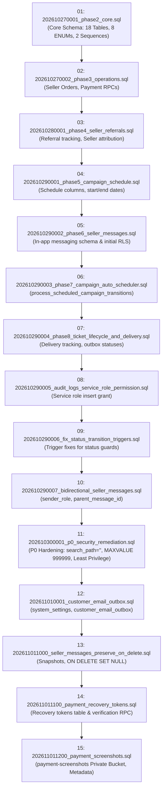

# SSFI Lucky Draw — Migration Dependency Map & Execution Sequence (Phase B)

**Document Reference:** `docs/preview/phase-b-migration-dependency-map.md`  
**Version:** 1.0.0  
**Date:** 2 November 2026  
**Auditor Roles:** Principal Software Architect, Senior PostgreSQL Engineer, Release Manager  
**Workspace:** `F:\PROJECT\Lucky Draw`  
**Migration Directory:** [`supabase/migrations/`](file:///F:/PROJECT/Lucky%20Draw/supabase/migrations/) (15 files)

---

## 1. Migration Dependency Topology

---

## 2. Chronological Migration Inventory (15 Files)

| Version | Migration Filename | Primary Purpose | Schema Objects Affected | Reversibility & Rollback |
|---|---|---|---|---|
| `202610270001` | `phase2_core.sql` | Foundational schema: 18 tables, 8 ENUMs, 2 sequences, initial RLS | `profiles`, `campaigns`, `orders`, `tickets`, `payments`, etc. | Destructive (drops tables) |
| `202610270002` | `phase3_operations.sql` | Operations RPCs: `create_seller_order`, `verify_payment_and_issue` | `create_seller_order`, `verify_payment_and_issue` | Reversible (drop functions) |
| `202610280001` | `phase4_seller_referrals.sql` | Seller referral tracking & constraints | `sellers.seller_code`, referral lookup | Reversible (drop index/column) |
| `202610290001` | `phase5_campaign_schedule.sql` | Campaign start/end date validation | `campaigns.start_date`, `campaigns.end_date` | Reversible |
| `202610290002` | `phase6_seller_messages.sql` | Initial seller in-app messaging schema | `seller_messages`, messaging RLS | Reversible (drop table) |
| `202610290003` | `phase7_campaign_auto_scheduler.sql` | Automated campaign state machine RPCs | `process_scheduled_campaign_transitions` | Reversible (drop function) |
| `202610290004` | `phase8_ticket_lifecycle_and_delivery.sql` | Ticket delivery tracking table & channel ENUMs | `ticket_deliveries`, `delivery_channel` | Reversible |
| `202610290005` | `audit_logs_service_role_permission.sql` | Grants `audit_logs` insert to `service_role` | `audit_logs` permissions | Reversible (revoke grant) |
| `202610290006` | `fix_status_transition_triggers.sql` | Fixes enum comparison casting in status guards | `validate_status_transition()` | Reversible |
| `202610290007` | `bidirectional_seller_messages.sql` | Adds threading (`parent_message_id`, `sender_role`) | `seller_messages` columns, FK, check | Reversible |
| `202610300001` | `p0_security_remediation.sql` | **Critical P0 Hardening:** `search_path = ''`, sequence cap upgrade to `999999`, revokes dangerous grants from `anon` | Functions, sequences, table permissions | Reversible |
| `202611010001` | `customer_email_outbox.sql` | Transactional email outbox & system settings tables | `system_settings`, `customer_email_outbox` | Reversible (drop tables) |
| `202611011000` | `seller_messages_preserve_on_delete.sql` | Snapshot columns on `seller_messages`, changes FK to `ON DELETE SET NULL` | `seller_messages` columns, triggers, FK | Reversible |
| `202611011100` | `payment_recovery_tokens.sql` | Secure token table and generation RPCs | `payment_recovery_tokens`, RPCs | Reversible (drop table/RPC) |
| `202611011200` | `payment_screenshots.sql` | Private Storage bucket and screenshot metadata table | `payment_screenshots`, `payments.screenshot_path`, `storage.buckets` | Reversible (drop table/bucket) |

---

## 3. Dependency Constraints & Migration Ordering Rules

1. **Strict Linearity:**
   - Migration `202610300001_p0_security_remediation.sql` assumes all prior functions (`has_role`, `is_staff`, `create_seller_order`, `verify_payment_and_issue`) exist so it can replace them with `SET search_path = ''` versions.
   - Migration `202611011000_seller_messages_preserve_on_delete.sql` requires `202610290007_bidirectional_seller_messages.sql` because it updates the immutability trigger covering `sender_role` and `parent_message_id`.
   - Migration `202611011200_payment_screenshots.sql` references `public.payments(id)` established in `202610270001_phase2_core.sql`.
2. **Replication Recommendation for Preview:**
   - Execute all 15 migrations in exact ascending timestamp order.
   - Zero migration skipping or out-of-order execution should be permitted.

