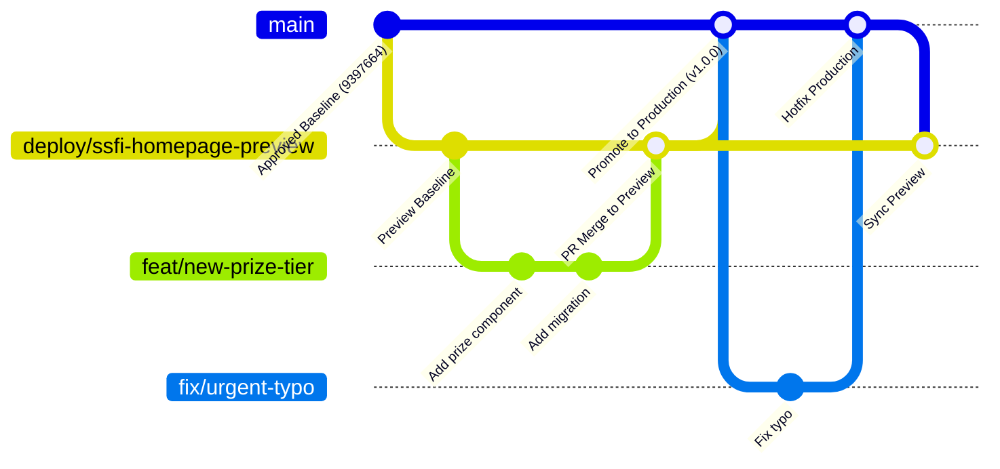
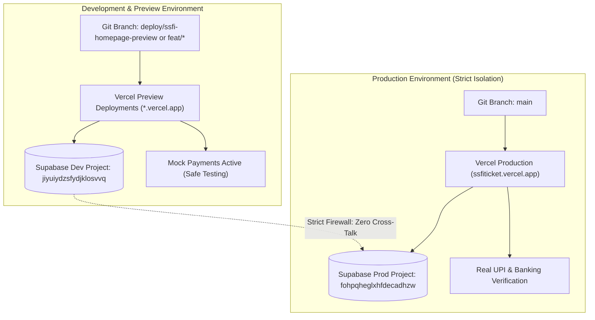

# SSFI Lucky Draw — Future Feature Update & Release Workflow

This document establishes the permanent, long-term release engineering workflow for all future feature development, enhancements, and maintenance of the SSFI Fundraising Ticket System.

---

## 1. Approved Baseline & UX Preservation Invariants

The approved Preview release (on branch `deploy/ssfi-homepage-preview`) serves as the official **UI/UX, visual branding, and functional baseline**.

### Non-Negotiable Rules:
1. **Design & Layout Freeze:** Do not redesign, simplify, alter colors, or reorganize approved layouts, components, or typography without explicit written owner authorization.
2. **Customer-Facing Copy Preservation:** Do not rewrite marketing messages, campaign explanations, countdown descriptions, rules, or prize details without authorization.
3. **Mandatory Buyer Information:** Buyer Name, Email address (RFC format), and WhatsApp mobile number (7–15 digits) are strictly mandatory requirements for both public orders and seller-assisted purchases. They must be validated at every layer:
   - Frontend form inputs (HTML5 + Zod client validation).
   - Server Actions (`src/server/actions/publicOrder.ts` and `src/server/actions/operations.ts`).
   - PostgreSQL stored procedures (`create_seller_order` regex check).
4. **Zero-Destruction Upgrades:** Future updates must follow the **Expand and Contract** pattern. Existing columns, tables, and routines must remain compatible while new capabilities are phased in.

---

## 2. Git Branching & Lifecycle Strategy

The repository follows an adapted GitHub Flow tailored for strict environment separation:



### Branch Definitions & Access Policies

| Branch Name | Target Environment | Purpose | Protection Rules |
|---|---|---|---|
| `main` | **Vercel Production** (`https://ssfiticket.vercel.app`) | Live production deployment. Strictly immutable without passing all CI/CD gates and approved PR. | Protected branch. Requires passing CI, linear history, and owner review. |
| `deploy/ssfi-homepage-preview` | **Vercel Preview Baseline** | Approved staging / preview environment. All QA and user verification happens here. | Protected branch. Requires passing CI checks. |
| `feat/<feature-name>` | **Ephemeral Preview Branch** | Development of new features (e.g. `feat/new-prize-tier`, `feat/volunteer-dashboard`). | Created from `deploy/ssfi-homepage-preview`. Merges back via Pull Request. |
| `fix/<issue-name>` | **Ephemeral Preview / Hotfix** | Targeted bug fixes (e.g. `fix/ist-formatting-bug`). | Created from `deploy/ssfi-homepage-preview` (or `main` for critical P0 hotfixes). |

---

## 3. Environment & Database Isolation Architecture

Development/Preview and Production are physically and logically segregated:



### Environment Variable Matrix

| Variable | Development / Preview | Production | Purpose |
|---|---|---|---|
| `NEXT_PUBLIC_SUPABASE_URL` | `https://jiyuiydzsfydjklosvvq.supabase.co` | `https://fohpqheglxhfdecadhzw.supabase.co` | Supabase API Gateway |
| `NEXT_PUBLIC_SUPABASE_ANON_KEY` | Preview Anon Key | Production Anon Key | Public Client Queries (RLS) |
| `SUPABASE_SERVICE_ROLE_KEY` | Preview Service Role Key | Production Service Role Key | Backend Server Actions |
| `NEXT_PUBLIC_APP_URL` | `https://ssfiticket-*.vercel.app` | `https://ssfiticket.vercel.app` | Canonical URL for QR/Links |
| `NEXT_PUBLIC_MOCK_PAYMENTS` | `true` | `false` | Disables real money in Preview |
| `CRON_SECRET` | Dev Cron Secret | Prod High-Entropy Secret | Secures scheduled endpoints |

---

## 4. Version-Controlled Database Migration Workflow

To prevent database drift and guarantee zero-downtime releases:

### Step 1: Sequential Migration File Creation
Every database change must be committed as a standalone file in `supabase/migrations/` using timestamped naming:
```
supabase/migrations/YYYYMMDDNNNN_<descriptive_name>.sql
```
*Example:* `supabase/migrations/202611150001_add_volunteer_badge.sql`

### Step 2: Test Against Development Supabase First
1. Apply the new migration to Development (`jiyuiydzsfydjklosvvq`) via the Supabase Dashboard SQL Editor or direct Session Pooler.
2. Run the automated test suite locally:
   ```powershell
   npm test
   npm run typecheck
   ```
3. Verify that the feature functions as expected in the Vercel Preview deployment without side effects.

### Step 3: Backward-Compatible Design Rules
- **Add Column:** Always provide a `DEFAULT` value or allow `NULL` so old application code continues to function while new code is deploying.
- **Rename Column:** Never rename a live column directly. Add the new column, dual-write in application code, backfill data, and drop the old column in a future release.
- **New Constraints:** Use `VALIDATE CONSTRAINT` or ensure all existing rows comply before adding `NOT NULL` or `CHECK`.
- **Stored Procedures:** When adding arguments, assign `DEFAULT` values (e.g. `p_actor uuid DEFAULT NULL`) so callers using older signatures do not break.

### Step 4: Production Pre-Migration Review
Before applying to Production:
1. Verify that the migration does not acquire table-level exclusive locks on high-traffic tables (`tickets`, `orders`, `payments`).
2. Confirm that the migration is wrapped in an atomic `BEGIN ... COMMIT` block.
3. Review against the Production Runbook ([`docs/release-audit/05-production-release-runbook.md`](file:///F:/PROJECT/Lucky%20Draw/docs/release-audit/05-production-release-runbook.md)).

---

## 5. Pull Request Lifecycle & Quality Sign-Off

All changes must follow this step-by-step lifecycle before entering `main`:

```
[Developer creates feat/* branch]
               │
               ▼
   [Local Development & Testing]
   - npm test (214/214 passing)
   - npm run typecheck
   - npm run lint
               │
               ▼
  [Push to GitHub -> Open PR against deploy/ssfi-homepage-preview]
  - Complete PR Template (.github/pull_request_template.md)
  - Automatic GitHub Actions CI runs
               │
               ▼
[Vercel Generates Isolated Preview URL]
  - Reviewer tests Preview URL
  - Visual regression check against approved baseline
               │
               ▼
  [PR Approval & Squash-and-Merge to deploy/ssfi-homepage-preview]
               │
               ▼
[Release Candidate Verification on Preview]
               │
               ▼
 [Production Promotion PR: deploy/ssfi-homepage-preview -> main]
  - Run database migration on Production Supabase (if required)
  - Merge into main -> Vercel deploys to Production
  - Smoke test live site (https://ssfiticket.vercel.app)
```

---

## 6. Feature Flag Strategy for Risky or Incremental Capabilities

To avoid risky "big bang" deployments, use the lightweight, zero-dependency feature flag module located at [`src/lib/config/featureFlags.ts`](file:///F:/PROJECT/Lucky%20Draw/src/lib/config/featureFlags.ts).

### Built-in Feature Flags:
- `ENABLE_LIVE_PAYMENT_GATEWAY`: Controls whether external payment gateways (Razorpay, PhonePe) are active. Defaults to `false` (preserving the verified Manual UPI workflow).
- `ENABLE_WHATSAPP_CLOUD_API`: Controls whether server-side WhatsApp Cloud API is invoked. Defaults to `false` (preserving verified click-to-chat).
- `ENABLE_DETAILED_AUDIT_EXPORT`: Controls whether staff managers can export CSV/JSON audit dumps. Defaults to `true`.
- `ENABLE_SELLER_SELF_REGISTRATION`: Controls whether sellers can register themselves publicly. Defaults to `false` (staff-managed provisioning).
- `ENABLE_MAINTENANCE_MODE`: Globally puts the public checkout into read-only mode with an informative maintenance banner. Defaults to `false`.

### How to Use in Code:
```typescript
import { isFeatureEnabled } from "@/lib/config/featureFlags";

export default function CheckoutPage() {
  if (isFeatureEnabled("ENABLE_MAINTENANCE_MODE")) {
    return <MaintenanceBanner />;
  }

  return <OrderCheckoutForm />;
}
```

### How to Toggle via Environment Variables:
- On Vercel Preview or Production: Add environment variable `FEATURE_ENABLE_MAINTENANCE_MODE=true` or `NEXT_PUBLIC_FEATURE_ENABLE_MAINTENANCE_MODE=true`.
- No code change or re-deployment of core logic is necessary to activate or deactivate features.

