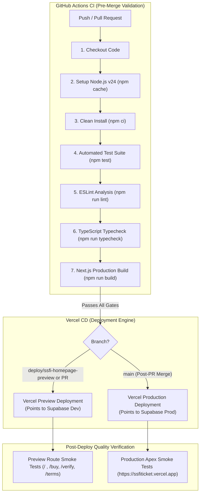

# SSFI Lucky Draw — CI/CD Pipeline Architecture & Quality Gates

This document defines the automated Continuous Integration and Continuous Delivery (CI/CD) architecture, quality gates, and deployment policies for the SSFI Fundraising Ticket System.

---

## 1. Pipeline Overview & Topology

The SSFI Lucky Draw deployment architecture pairs GitHub Actions (for strict pre-merge automated validation) with Vercel (for atomic Preview and Production hosting).



---

## 2. Six Non-Negotiable CI/CD Quality Gates

Every code change must pass all six quality gates before it can be merged into `deploy/ssfi-homepage-preview` or `main`:

### Gate 1: Deterministic Dependency Installation (`npm ci`)
- **Objective:** Ensures 100% reproducible builds matching `package-lock.json`.
- **Command:** `npm ci`
- **Criteria:** No missing peer dependencies, zero installation errors, matching Node.js runtime (v24.x).

### Gate 2: Static Code Analysis (`npm run lint`)
- **Objective:** Enforces Next.js App Router rules, React 19 hooks standards, and code hygiene.
- **Command:** `npm run lint`
- **Criteria:** Zero ESLint errors or unhandled warnings.

### Gate 3: Strict Static Type Checking (`npm run typecheck`)
- **Objective:** Guarantees end-to-end type safety between database schemas, server actions, and React components.
- **Command:** `npm run typecheck` (`tsc --noEmit`)
- **Criteria:** 0 TypeScript compilation errors.

### Gate 4: Automated Unit & Integration Tests (`npm test`)
- **Objective:** Validates business rules, capacity limits, campaign scheduling, WhatsApp/email delivery, audit log security, and role routing.
- **Command:** `npm test`
- **Current Coverage:** **214/214 passing tests** across 17 test suites:
  - `tests/referral.test.ts`
  - `tests/youtube.test.ts`
  - `tests/export.test.ts`
  - `tests/seller.test.ts`
  - `tests/publicOrder.test.ts`
  - `tests/sellerLifecycle.test.ts`
  - `tests/exportReliability.test.ts`
  - `tests/roleRouting.test.ts`
  - `tests/sellerOrder.test.ts`
  - `tests/campaignSettings.test.ts`
  - `tests/sellerMessaging.test.ts`
  - `tests/campaignScheduler.test.ts`
  - `tests/purchaseAndDeliveryFlow.test.ts`
  - `tests/campaignAuditLogs.test.ts`
  - `tests/mandatoryContactsAndDelivery.test.ts`
  - `tests/productionReadiness.test.ts`
  - `tests/featureFlags.test.ts`

### Gate 5: Production Build Compilation (`npm run build`)
- **Objective:** Verifies that Next.js static generation, Turbopack bundling, server action bundling, and route segment configurations compile without errors.
- **Command:** `npm run build`
- **Criteria:** Successful output artifact generation in `.next/`.

### Gate 6: End-to-End Route Smoke Verification
- **Objective:** Confirms that live endpoints return HTTP 200 and render core DOM elements properly without client hydration errors.
- **Monitored Routes:**
  - `/`: Main homepage with countdown timer.
  - `/buy?ref=SELLER-002`: Public referral order form.
  - `/verify`: Public ticket number verification lookup.
  - `/terms`: Legal terms, draw date, and contest rules.
  - `/admin/login`: Administrative authentication entry point.

---

## 3. GitHub Actions CI Configuration

The automated pipeline is defined in [`.github/workflows/ci.yml`](file:///F:/PROJECT/Lucky%20Draw/.github/workflows/ci.yml):

```yaml
name: CI

on:
  push:
    branches:
      - main
      - deploy/ssfi-homepage-preview
  pull_request:
    branches:
      - main
      - deploy/ssfi-homepage-preview
  workflow_dispatch:

permissions:
  contents: read

concurrency:
  group: ${{ github.workflow }}-${{ github.ref }}
  cancel-in-progress: true

jobs:
  validate:
    name: Test, Lint, Typecheck & Build
    runs-on: ubuntu-latest
    timeout-minutes: 15

    env:
      # Safe, non-sensitive placeholders for build-time validation.
      # Production credentials and database secrets are never exposed to CI.
      NEXT_PUBLIC_SUPABASE_URL: "https://ci-placeholder.supabase.co"
      NEXT_PUBLIC_SUPABASE_PUBLISHABLE_KEY: "ci-placeholder-publishable-key"
      NEXT_PUBLIC_APP_URL: "https://ssfiticket.vercel.app"
      NEXT_PUBLIC_SSFI_UPI_ID: "ssfi@ci-test"
      NEXT_PUBLIC_SSFI_UPI_DISPLAY_NAME: "SSFI Fundraising"

    steps:
      - name: Checkout repository
        uses: actions/checkout@v4

      - name: Set up Node.js
        uses: actions/setup-node@v4
        with:
          node-version: 24
          cache: "npm"

      - name: Install dependencies (clean)
        run: npm ci

      - name: Run unit tests
        run: npm test

      - name: Run ESLint
        run: npm run lint

      - name: Run TypeScript typecheck
        run: npm run typecheck

      - name: Run Next.js production build
        run: npm run build
```

---

## 4. Secrets Management & Credential Isolation

A foundational tenet of the SSFI release system is **zero secret exposure**:

1. **GitHub Actions Secrets Policy:**
   - The CI runner uses **safe non-sensitive placeholders** for build-time compilation.
   - Real database passwords, service role keys, and Gmail API tokens are **never configured in GitHub Actions**.
   - Builds do not require live database connections to compile or test.
2. **Vercel Environment Scoping:**
   - Production secrets (`SUPABASE_SERVICE_ROLE_KEY`, `GMAIL_*`, `CRON_SECRET`) are scoped exclusively to the **Production** environment in the Vercel Dashboard.
   - Preview deployments automatically receive Development credentials (`jiyuiydzsfydjklosvvq`).
3. **Client-Side vs Server-Side Scoping:**
   - Only variables prefixed with `NEXT_PUBLIC_` are exposed to the browser.
   - `SUPABASE_SERVICE_ROLE_KEY` is strictly server-side and never bundled into client JavaScript.

