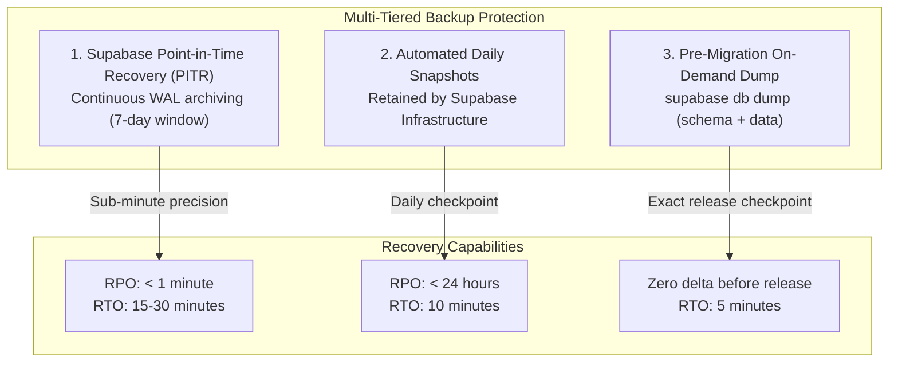
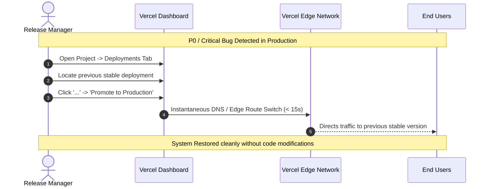

# SSFI Lucky Draw — Rollback Protocols, Backup Strategy & Incident Response

This document establishes the official Disaster Recovery (DR), backup schedules, rollback procedures, and emergency hotfix protocols for the SSFI Fundraising Ticket System.

---

## 1. Incident Severity Classification & Escalation

To ensure proportional and rapid response during live operations:

| Level | Classification | Impact Definition | Target Response (SLA) | Primary Action |
|---|---|---|---|---|
| **P0** | **Critical Disaster** | Total checkout outage, payment verification crash, ticket number corruption, or data leak. | **< 15 minutes** | Immediate Vercel rollback or enable `ENABLE_MAINTENANCE_MODE`. |
| **P1** | **High Functional** | Specific feature failure (e.g. email delivery fails, seller messaging fails) while orders still function. | **< 2 hours** | Fast-track hotfix via `fix/*` branch or toggle relevant feature flag. |
| **P2** | **Moderate Quality** | Non-blocking visual glitch, minor formatting defect, or slow export query. | **< 24 hours** | Standard development lifecycle via `feat/*` / `fix/*` PR. |
| **P3** | **Minor / Trivial** | Internal documentation typo or administrative UI styling defect. | Next release | Scheduled sprint release. |

---

## 2. Production Database Backup Strategy

To ensure zero data loss under any catastrophe:



### Pre-Release On-Demand Snapshot Procedure
Before applying any database migration in Production:
1. Open PowerShell in `F:\PROJECT\Lucky Draw`.
2. Execute the pre-release dump command:
   ```powershell
   $TIMESTAMP = Get-Date -Format "yyyyMMdd-HHmmss"
   $BACKUP_DIR = "backups/production-snapshots/$TIMESTAMP"
   New-Item -ItemType Directory -Force -Path $BACKUP_DIR

   # Dump complete public schema
   supabase db dump --project-ref fohpqheglxhfdecadhzw -f "$BACKUP_DIR/schema.sql"

   # Dump production data records only
   supabase db dump --project-ref fohpqheglxhfdecadhzw --data-only -f "$BACKUP_DIR/data.sql"
   ```
3. Verify that the exported files have non-zero size before proceeding with DDL execution.

---

## 3. Instant Vercel Application Rollback (RTO < 30 Seconds)

If a newly deployed build on `main` causes runtime errors or regression:



### Step-by-Step Rollback Execution:
1. Open the Vercel Dashboard: `https://vercel.com/rose1996ivs-projects/ssfiticket/deployments`.
2. Locate the deployment that was active immediately before the regression.
3. Click the three dots menu `...` on the right side of the deployment card.
4. Select **Promote to Production** (or **Instant Rollback**).
5. The Edge Network immediately redirects all production traffic (`https://ssfiticket.vercel.app`) to the previous deployment. Total downtime: **< 30 seconds**.

---

## 4. Database Migration Rollback Protocols

### A. The "Expand and Contract" Principle
Database changes should never be breaking. When introducing new capabilities:
1. **Phase 1 (Expand):** Add new columns with `NULL` or safe defaults; add new tables; create new stored procedures.
2. **Phase 2 (Dual Write / Migrate):** Update application code to use the new columns while maintaining backward compatibility with the old schema.
3. **Phase 3 (Contract - Future Release):** Once old versions are retired, deprecate and clean up old structures.

### B. Handling Non-Breaking Schema Additions
If an application rollback occurs after a migration has run:
- Columns added with `DEFAULT` or `NULL` do **not** need to be dropped. The older application code simply ignores them.
- New stored procedures do **not** affect older application code that does not call them.
- **Rule:** Avoid rolling back database schema unless the schema itself caused data corruption or performance locking.

### C. Down-Migration Execution
If an errant schema change must be reverted:
1. Author a dedicated down-migration script (e.g. `supabase/migrations/revert/...`).
2. Test the down-migration in Development first.
3. Execute within an explicit transaction:
   ```sql
   BEGIN;
   -- Revert statements
   COMMIT;
   ```

---

## 5. Emergency Hotfix Runbook (`fix/*`)

For high-severity issues (P0 / P1) requiring immediate code remediation:

```mermaid
gitGraph
   commit id: "Production v1.0.0 (main)"
   branch "fix/critical-hotfix"
   commit id: "Apply targeted patch"
   commit id: "Pass npm test locally"
   checkout "main"
   merge "fix/critical-hotfix" id: "Emergency Merge to main"
   checkout "deploy/ssfi-homepage-preview"
   merge "main" id: "Backport to Preview Baseline"
```

### Hotfix Steps:
1. **Branch Creation:**
   Create hotfix branch directly from `main`:
   ```powershell
   git checkout main
   git pull origin main
   git checkout -b fix/urgent-issue-name
   ```
2. **Implement Minimal Targeted Patch:**
   Change only the lines necessary to resolve the defect. Do not include unrelated refactors or feature work.
3. **Local Validation:**
   ```powershell
   npm test
   npm run typecheck
   npm run lint
   ```
4. **Fast-Track PR & Merge:**
   - Open PR targeting `main`.
   - Title: `fix: <Clear explanation of emergency fix> [HOTFIX]`.
   - Complete the security & rollback sections of the PR template.
   - Obtain peer review and merge into `main`.
5. **Backport to Preview Baseline:**
   Immediately sync `deploy/ssfi-homepage-preview` with `main` to prevent regression:
   ```powershell
   git checkout deploy/ssfi-homepage-preview
   git pull origin deploy/ssfi-homepage-preview
   git merge main
   git push origin deploy/ssfi-homepage-preview
   ```

---

## 6. Emergency Maintenance Mode Activation

If a critical database corruption or financial reconciliation discrepancy occurs during live ticket sales:

1. Open the Vercel Dashboard for `ssfiticket`.
2. Navigate to **Settings -> Environment Variables**.
3. Under **Production**, set:
   ```
   FEATURE_ENABLE_MAINTENANCE_MODE = "true"
   ```
4. Redeploy or trigger an instant configuration refresh.
5. The public checkout immediately displays the maintenance banner and halts new order submissions while leaving the homepage and legal terms accessible.
6. Once the issue is resolved, remove or set `FEATURE_ENABLE_MAINTENANCE_MODE = "false"`.

