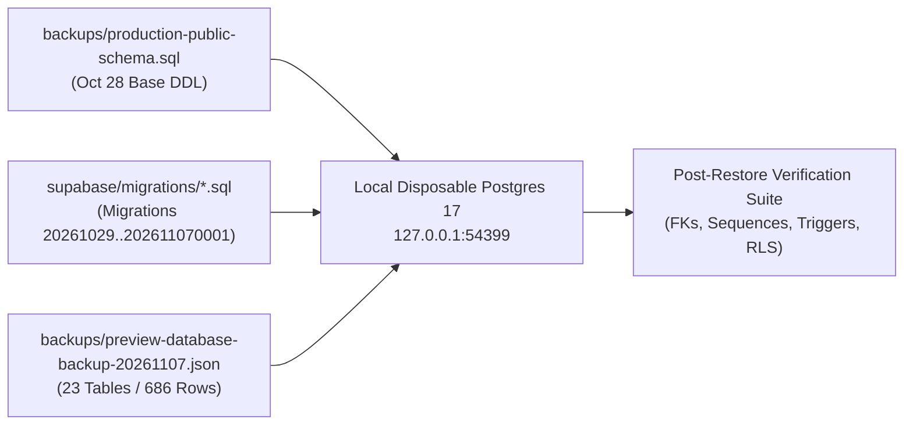

# SSFI Lucky Draw — Phase 3: Reproducible Local Disposable Backup Restore Test Plan

**Document Status:** `PROCEDURE DESIGN ONLY — NOT EXECUTED AGAINST PREVIEW OR PRODUCTION`  
**Prepared At:** `2026-11-07T17:11:30+05:30` (`2026-11-07T11:41:30Z`)  
**Source Backup Artifact:** [`backups/preview-database-backup-20261107.json`](file:///f:/PROJECT/Lucky%20Draw/backups/preview-database-backup-20261107.json) (`909,075` bytes, SHA-256 `63cece903e29690c13a9efb08365569d99519dc40aaa800f0a5aa6ceb6e858bf`)  
**Target Environment for Restore Test:** Ephemeral Local PostgreSQL 17 Container (`localhost:54399/ssfi_disposable_restore`) — **Zero network access to `fohpqheglxhfdecadhzw` or `jiyuiydzsfydjklosvvq`**

---

## 1. Architecture & Isolation Guarantees

To verify that [`backups/preview-database-backup-20261107.json`](file:///f:/PROJECT/Lucky%20Draw/backups/preview-database-backup-20261107.json) can reconstruct the pre-clone Preview database state (`2026-11-07T10:34:21.313Z`, commit `304134d69712b4d89a1475688dde031cc3f51a2a`) without touching Production (`fohpqheglxhfdecadhzw`) or active Preview (`jiyuiydzsfydjklosvvq`), the restore test runs entirely inside a disposable local Docker container (`postgres:17-alpine`) bound only to `127.0.0.1:54399`.



---

## 2. Step-by-Step Reproducible Restore Procedure

### Step 1 — Launch Ephemeral Local PostgreSQL 17 Container

```powershell
docker run --rm -d `
  --name ssfi-disposable-restore `
  -e POSTGRES_PASSWORD=postgres `
  -e POSTGRES_DB=ssfi_restore_test `
  -p 127.0.0.1:54399:5432 `
  postgres:17-alpine
```

### Step 2 — Bootstrap Supabase Local Roles & Auth/Storage Stubs

Before replaying [`backups/production-public-schema.sql`](file:///f:/PROJECT/Lucky%20Draw/backups/production-public-schema.sql), create the standard Supabase roles (`anon`, `authenticated`, `service_role`) and minimal `auth` / `storage` stub schemas required by foreign keys and RLS helper functions:

```sql
-- bootstrap_supabase_stubs.sql
CREATE EXTENSION IF NOT EXISTS pgcrypto;

DO $$
BEGIN
  IF NOT EXISTS (SELECT 1 FROM pg_roles WHERE rolname = 'anon') THEN CREATE ROLE anon NOLOGIN; END IF;
  IF NOT EXISTS (SELECT 1 FROM pg_roles WHERE rolname = 'authenticated') THEN CREATE ROLE authenticated NOLOGIN; END IF;
  IF NOT EXISTS (SELECT 1 FROM pg_roles WHERE rolname = 'service_role') THEN CREATE ROLE service_role NOLOGIN BYPASSRLS; END IF;
END $$;

CREATE SCHEMA IF NOT EXISTS auth;
CREATE TABLE IF NOT EXISTS auth.users (
  id uuid PRIMARY KEY,
  email text,
  created_at timestamptz DEFAULT now()
);

CREATE OR REPLACE FUNCTION auth.uid() RETURNS uuid LANGUAGE sql STABLE AS $$
  SELECT nullif(current_setting('request.jwt.claim.sub', true), '')::uuid;
$$;

CREATE OR REPLACE FUNCTION auth.role() RETURNS text LANGUAGE sql STABLE AS $$
  SELECT coalesce(nullif(current_setting('request.jwt.claim.role', true), ''), current_user);
$$;

CREATE SCHEMA IF NOT EXISTS storage;
CREATE TABLE IF NOT EXISTS storage.buckets (
  id text PRIMARY KEY,
  name text NOT NULL UNIQUE,
  public boolean DEFAULT false,
  file_size_limit bigint,
  allowed_mime_types text[],
  created_at timestamptz DEFAULT now(),
  updated_at timestamptz DEFAULT now()
);
CREATE TABLE IF NOT EXISTS storage.objects (
  id uuid PRIMARY KEY DEFAULT gen_random_uuid(),
  bucket_id text REFERENCES storage.buckets(id),
  name text NOT NULL,
  owner uuid,
  created_at timestamptz DEFAULT now(),
  updated_at timestamptz DEFAULT now(),
  last_accessed_at timestamptz DEFAULT now(),
  metadata jsonb
);
```

### Step 3 — Schema, Trigger, Function, & RLS Policy Reconstruction

Replay the base schema followed by the incremental migrations in chronological order (excluding `202611070002_preview_clone_alignment_and_isolation.sql`, which was not applied prior to the backup):

1. `backups/production-public-schema.sql` *(creates initial 18 tables, enums, sequences `ssfi_order_number_sequence` & `ssfi_ticket_number_sequence`, base RPCs, and base RLS policies)*
2. `supabase/migrations/202610290001_phase5_campaign_schedule.sql`
3. `supabase/migrations/202610290002_phase6_seller_messages.sql`
4. `supabase/migrations/202610290003_phase7_campaign_auto_scheduler.sql`
5. `supabase/migrations/202610290004_phase8_ticket_lifecycle_and_delivery.sql`
6. `supabase/migrations/202610290005_audit_logs_service_role_permission.sql`
7. `supabase/migrations/202610290006_fix_status_transition_triggers.sql`
8. `supabase/migrations/202610290007_bidirectional_seller_messages.sql`
9. `supabase/migrations/202610300001_p0_security_remediation.sql`
10. `supabase/migrations/202611010001_customer_email_outbox.sql`
11. `supabase/migrations/202611011000_seller_messages_preserve_on_delete.sql`
12. `supabase/migrations/202611011100_payment_recovery_tokens.sql`
13. `supabase/migrations/202611011200_payment_screenshots.sql`
14. `supabase/migrations/202611020001_seller_qr_and_mandatory_screenshots.sql`
15. `supabase/migrations/202611020002_protect_all_order_snapshot_fields.sql`
16. `supabase/migrations/202611070001_customer_contact_overrides_collaboration_and_ticket_immutability.sql`

### Step 4 — Topological Table Data Restoration (All 23 Tables, 686 Rows)

1. Verify `backups/preview-database-backup-20261107.json` SHA-256 checksum matches `63cece903e29690c13a9efb08365569d99519dc40aaa800f0a5aa6ceb6e858bf`.
2. Seed `auth.users` with the `6` `id` values from `backup.tables.profiles` so foreign keys `profiles.id -> auth.users.id` succeed cleanly without disabling FK constraints.
3. Insert rows in strict parent-to-child topological order inside a single transaction:

| Order | Table Name | Expected Row Count | Parent Foreign Key Dependencies |
| :-: | :--- | :---: | :--- |
| 1 | `public.roles` | `4` | None |
| 2 | `public.profiles` | `6` | `auth.users(id)` |
| 3 | `public.profile_roles` | `5` | `profiles(id)`, `roles(id)` |
| 4 | `public.campaigns` | `1` | None |
| 5 | `public.prizes` | `5` | `campaigns(id)` |
| 6 | `public.sellers` | `4` | `profiles(id)` |
| 7 | `public.customers` | `52` | None |
| 8 | `public.orders` | `51` | `campaigns(id)`, `customers(id)`, `sellers(id)` |
| 9 | `public.order_items` | `46` | `orders(id)` |
| 10 | `public.payments` | `51` | `orders(id)`, `profiles(id)` |
| 11 | `public.payment_events` | `127` | `payments(id)` |
| 12 | `public.payment_screenshots` | `12` | `payments(id)` |
| 13 | `public.payment_recovery_tokens` | `2` | `orders(id)`, `profiles(id)` |
| 14 | `public.tickets` | `36` | `orders(id)`, `campaigns(id)`, `customers(id)`, `sellers(id)` |
| 15 | `public.ticket_deliveries` | `52` | `orders(id)`, `customers(id)` |
| 16 | `public.ticket_verifications` | `0` | `tickets(id)` |
| 17 | `public.draws` | `0` | `campaigns(id)` |
| 18 | `public.draw_results` | `0` | `draws(id)`, `prizes(id)`, `tickets(id)` |
| 19 | `public.seller_messages` | `12` | `sellers(id)`, `profiles(id)` |
| 20 | `public.order_collaboration_notes` | `0` | `orders(id)`, `profiles(id)` |
| 21 | `public.system_settings` | `2` | `profiles(id)` |
| 22 | `public.customer_email_outbox` | `38` | `orders(id)`, `customers(id)` |
| 23 | `public.audit_logs` | `270` | `profiles(id)` |
| — | **Total Restored Rows** | **`686`** | — |

### Step 5 — Sequence Restoration

Because `preview-database-backup-20261107.json` is a JSON row dump, PostgreSQL sequences must be explicitly synchronized to the highest restored `order_number` (`ORD-2026-000051` -> `51`) and `ticket_number` (`SSFI-000036` -> `36`):

```sql
SELECT pg_catalog.setval('public.ssfi_order_number_sequence', 51, true);
SELECT pg_catalog.setval('public.ssfi_ticket_number_sequence', 36, true);
```

### Step 6 — Foreign-Key, Trigger, Function, & RLS Verification Queries

Run the following verification assertions against the disposable instance (`localhost:54399`):

```sql
-- 1. Verify exact row counts across all 23 tables (must total 686 rows)
SELECT relname AS table_name, n_live_tup AS row_count
FROM pg_stat_user_tables
WHERE schemaname = 'public'
ORDER BY relname;

-- 2. Verify zero broken foreign keys across all public tables
SELECT conname, conrelid::regclass AS table_name
FROM pg_constraint
WHERE contype = 'f' AND connamespace = 'public'::regnamespace AND NOT convalidated;
-- Expected: 0 rows

-- 3. Verify all 3 critical immutability / append-only triggers are active (tgenabled = 'O')
SELECT tgname, tgrelid::regclass AS table_name, tgenabled
FROM pg_trigger
WHERE tgname IN (
  'trg_protect_order_payment_snapshot',
  'trg_protect_ticket_identity_immutability',
  'trg_audit_logs_immutable'
);
-- Expected: 3 rows, all with tgenabled = 'O'

-- 4. Verify RLS is enabled (relrowsecurity = true) on all 23 public tables
SELECT relname, relrowsecurity
FROM pg_class
WHERE relnamespace = 'public'::regnamespace
  AND relkind = 'r'
  AND NOT relrowsecurity;
-- Expected: 0 rows
```

---

## 3. Storage Binary Recovery Limitations During Restore

As established in [`docs/security/PHASE_3_STORAGE_RECOVERY_REPORT.md`](file:///f:/PROJECT/Lucky%20Draw/docs/security/PHASE_3_STORAGE_RECOVERY_REPORT.md):
1. **Storage Bucket Metadata (`storage.buckets` & `storage.objects`):**
   - `backup.buckets` (`payment-screenshots`, `seller-payment-qrs`, both `public: false`) and `backup.bucketObjects` can be restored into `storage.buckets` and `storage.objects`.
2. **Binary File Blobs (`5 / 16` Recoverable Byte-for-Byte; `11 / 16` Metadata-Only):**
   - The `5` scripted `67`-byte `1x1` PNG objects (`e2e-test-qr.png` and `4` `payment-screenshots` PNGs) can be restored byte-for-byte from the hex buffer in `scratch/preview_acceptance_e2e.js`.
   - The `11` manually uploaded browser test images (`3` `SELLER-008` QR JPEGs and `8` payment screenshot JPEGs/PNG) were not captured as binary blobs in `preview-database-backup-20261107.json` and can only be represented by synthetic placeholder files at their original paths unless the original files are supplied from the Project Owner's local device.

---

## 4. Teardown of Disposable Container

Once verification completes, destroy the disposable container immediately:

```powershell
docker stop ssfi-disposable-restore
```

