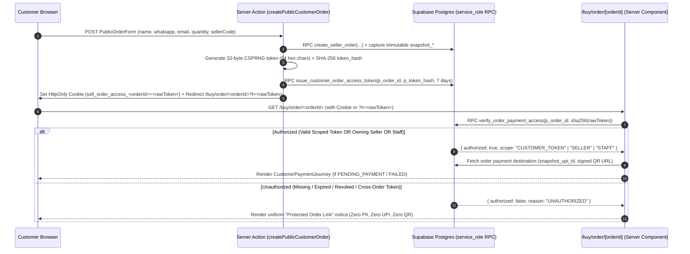

# SSFI Lucky Draw — Phase 3: P0 Security Remediation Design & Recovery Plan

**Document Status:** `DESIGN AND CODE REVIEW ONLY — AWAITING OWNER APPROVAL`  
**Prepared At:** `2026-11-07T17:06:00+05:30` (`2026-11-07T11:36:00Z`)  
**Audited Branch:** `preview/production-mirror` (`6646f903e169cf7194d759efc12f1236e17906cf`)  
**Production Supabase (`fohpqheglxhfdecadhzw`):** `STRICTLY READ-ONLY / AIR-GAPPED`  
**Preview Supabase (`jiyuiydzsfydjklosvvq`):** `STRICTLY READ-ONLY / FROZEN`  
**Prerequisite Audits:**
- [`docs/security/POST_CLONE_SECURITY_AUDIT.md`](file:///f:/PROJECT/Lucky%20Draw/docs/security/POST_CLONE_SECURITY_AUDIT.md)
- [`docs/security/PHASE_2_HISTORICAL_EXPOSURE_AND_CLONE_PROVENANCE_AUDIT.md`](file:///f:/PROJECT/Lucky%20Draw/docs/security/PHASE_2_HISTORICAL_EXPOSURE_AND_CLONE_PROVENANCE_AUDIT.md)

---

## 1. Strict Safety Boundaries & Execution Freeze Verification

| Boundary Rule | Enforcement Status |
| :--- | :--- |
| Production (`fohpqheglxhfdecadhzw`) & Preview (`jiyuiydzsfydjklosvvq`) Read-Only | **`VERIFIED`** — Zero database writes, migrations, or RPC mutations executed. |
| Storage Buckets (`payment-screenshots`, `seller-payment-qrs`) Untouched | **`VERIFIED`** — Zero uploads, replacements, or deletions executed. |
| Database Triggers Active & Unmodified | **`VERIFIED`** — Zero triggers disabled, dropped, or altered. |
| Application Code (`src/**`), Git History, & Vercel Deployments Untouched | **`VERIFIED`** — Only Phase 3 design/plan documents in `docs/security/` were created. |
| Zero Unmasked PII, UPI IDs, Tokens, or Signed URLs | **`VERIFIED`** — All historical identifiers remain masked (`ssfi******@okaxis`, `8810******@ptyes`). |

---

## 2. P0 — Customer Payment Page Authorization Design

### 2.1 Vulnerability Recap (`F-03` from Phase 2 Audit)

Currently, [`src/app/buy/order/[orderId]/page.tsx`](file:///f:/PROJECT/Lucky%20Draw/src/app/buy/order/%5BorderId%5D/page.tsx#L60-L136) is a public Server Component route that instantiates `createSupabaseAdminClient()` (`service_role`) and queries `public.orders` by `orderId` (UUIDv4) alone:
1. Possession of an `orderId` UUID acts as an unauthenticated bearer credential.
2. When `order.status === "PENDING_PAYMENT"` or `payment.status === "FAILED"`, lines 106–136 and 436–460 compute and pass `upiId` (`snapshot_upi_id`), `payeeName` (`snapshot_account_name`), `upiIntentUri`, `dynamicQrDataUrl`, and a 5-minute signed URL (`staticQrImagePath`) to the client component [`CustomerPaymentJourney`](file:///f:/PROJECT/Lucky%20Draw/src/components/payment/CustomerPaymentJourney.tsx).
3. Similarly, [`submitPublicUpiPayment`](file:///f:/PROJECT/Lucky%20Draw/src/server/actions/publicOrder.ts#L262) and [`uploadPaymentScreenshot`](file:///f:/PROJECT/Lucky%20Draw/src/server/actions/paymentScreenshot.ts) accept `orderId` from `FormData` without verifying a scoped customer capability token.

### 2.2 Target Security Architecture: Scoped Order Capability Token + HttpOnly Cookie + Role Session Fallback

Because public ticket buyers in the SSFI checkout flow do not create Supabase Auth accounts (`public.customers` is a contact record, not an `auth.users` account), customer ownership must be proven via a **cryptographically random, order-scoped, expiring capability token** (reusing the proven `public.payment_recovery_tokens` SHA-256 infrastructure from [`src/lib/payment/recoveryToken.ts`](file:///f:/PROJECT/Lucky%20Draw/src/lib/payment/recoveryToken.ts)), combined with authenticated role verification for Sellers and Staff.

### 2.3 Detailed Component & Server Action Changes (Proposed — Not Yet Applied)

#### A. Database RPC Layer (`PHASE_3_PROPOSED_SECURITY_MIGRATIONS.sql` Section 1)
1. **`public.issue_customer_order_access_token(p_order_id uuid, p_token_hash text, p_expires_days integer default 7)`:**
   - `SECURITY DEFINER SET search_path = ''`, callable **only** by `service_role`.
   - Revokes any prior active unrevoked token for `p_order_id` and inserts a new row into `public.payment_recovery_tokens(order_id, token_hash, expires_at)` with `created_by = NULL` (system-issued at checkout).
   - Logs `ORDER_ACCESS_TOKEN_ISSUED` to `public.audit_logs` (storing only `token_id`, `order_id`, and `expires_at` — never the raw token or hash).
2. **`public.verify_order_payment_access(p_order_id uuid, p_token_hash text)`:**
   - `SECURITY DEFINER SET search_path = ''`, callable **only** by `service_role`.
   - Looks up `public.payment_recovery_tokens` where **`order_id = p_order_id AND token_hash = trim(p_token_hash)`**.
   - **Prevents Cross-Order Token Reuse:** A valid token for Order A (`order_id = A`) evaluated against Order B (`p_order_id = B`) returns `{ "authorized": false, "code": "UNAUTHORIZED" }`.
   - **Enforces Expiry & Revocation:** Returns `{ "authorized": false, "code": "UNAUTHORIZED" }` if `revoked_at IS NOT NULL` or `expires_at <= now()`.
   - **Enforces Order Lifecycle State:** Looks up `public.orders` for `p_order_id`. If `status IN ('CANCELLED', 'REFUNDED', 'VOID')`, returns `{ "authorized": false, "code": "ORDER_INACTIVE" }`.

#### B. Server Authorization Helper (`src/lib/auth/orderAccess.ts` — Proposed)
Creates a single server-only gate `authorizeOrderAccess(orderId: string, candidateToken?: string | null)`:
1. Validates `orderId` is a valid UUIDv4.
2. Checks if the request carries an authenticated Supabase session (`createSupabaseServerClient()`):
   - If authenticated as `SUPER_ADMIN`, `ADMIN`, or `FUNDRAISING_MANAGER`: returns `{ authorized: true, actorType: "STAFF" }`.
   - If authenticated as `SELLER`: queries `public.orders` for `id = orderId` and verifies `seller_id === currentSeller.id || snapshot_seller_id === currentSeller.id`. If matched, returns `{ authorized: true, actorType: "SELLER" }`; if the order belongs to a different seller, returns `{ authorized: false, reason: "CROSS_SELLER_FORBIDDEN" }`.
3. Otherwise (unauthenticated customer / public visitor):
   - Reads candidate token from `?t=` query/form parameter or `cookies().get(\`ssfi_order_access_\${orderId}\`)`.
   - Validates 64-char hex format (`isValidTokenFormat`) and applies sliding-window rate limiting (`checkTokenRateLimit(\`order_access:\${orderId}:\${tokenPrefix}\`)`).
   - Calls `admin.rpc("verify_order_payment_access", { p_order_id: orderId, p_token_hash: hashRecoveryToken(rawToken) })`.
   - Returns `{ authorized: true, actorType: "CUSTOMER_TOKEN" }` only when RPC confirms validity.

#### C. Pre-Authorization Data Isolation in [`src/app/buy/order/[orderId]/page.tsx`](file:///f:/PROJECT/Lucky%20Draw/src/app/buy/order/%5BorderId%5D/page.tsx)
1. **Strict Ordering:** `authorizeOrderAccess(orderId, query.t)` runs **before** any query selecting `snapshot_upi_id`, `snapshot_account_name`, `snapshot_qr_storage_path`, `customers(...)`, `payments(...)`, or `tickets(...)`, and **before** `db.storage.from("seller-payment-qrs").createSignedUrl(...)`.
2. **Uniform Error / Unauthorized Response (Zero Enumeration Leakage):**
   - Whether `orderId` does not exist, the token is missing, the token is expired/revoked, or the token belongs to another order, `/buy/order/[orderId]` renders the same neutral HTTP `403`/`404`-equivalent **"Order Access Verification Required"** card containing zero customer PII, zero seller UPI IDs, and zero QR URLs.
3. **Lifecycle State Guards After Authorization:**
   - `PENDING_PAYMENT` or `FAILED`: Renders `<CustomerPaymentJourney>` with seller snapshot QR and UPI details, passing `accessToken` as a hidden input into `<PaymentDetailsForm>`.
   - `PAYMENT_SUBMITTED` (`SUBMITTED`): Does **not** render `<CustomerPaymentJourney>` payment destination credentials (`snapshot_upi_id` / QR); renders only the "Payment Submitted — Under Review" card and the collapsible correction form (`PaymentDetailsForm`).
   - `TICKETS_ISSUED` (`VERIFIED`): Renders only issued ticket numbers, ticket verification QR badges, and delivery status — **never** renders `snapshot_upi_id` or seller payment QR.
   - `VOID` / `CANCELLED` / `REFUNDED`: Renders a static order-inactive notice — **never** renders payment destinations or submission forms.

#### D. Preserving Legitimate Customer Resumption
1. **Same-Browser Resumption:** Automatic via the `HttpOnly; Secure; SameSite=Lax` cookie `ssfi_order_access_<orderId>` (7-day TTL matching token expiry).
2. **Cross-Device / Email / WhatsApp Link Resumption:** `createPublicCustomerOrder` passes the tokenized URL (`/buy/order/<orderId>?t=<rawToken>`) to `enqueueOrderCreatedNotification`, and Admins can continue to issue fresh `/payment/complete/[token]` links from `/admin/orders/[orderId]` via `generateOrderRecoveryLink`.
3. **Payment Completion Page (`/payment/complete/[token]/page.tsx`) Alignment:** Update [`lookup_payment_recovery_token`](file:///f:/PROJECT/Lucky%20Draw/supabase/migrations/202611011100_payment_recovery_tokens.sql#L191) and [`src/app/payment/complete/[token]/page.tsx`](file:///f:/PROJECT/Lucky%20Draw/src/app/payment/complete/%5Btoken%5D/page.tsx#L94-L103) so that `/payment/complete/[token]` uses the order's captured seller snapshot (`snapshot_upi_id`, `snapshot_account_name`, `snapshot_qr_storage_path`) rather than `manualUpiConfig.upiId`.

---

## 3. P0 — Historical UPI Remediation Design (16 Orders)

### 3.1 Design Constraints

Per Phase 3 Section 3 requirements, remediation of the `16` historical Preview orders (`ORD-2026-000031`..`ORD-2026-000046`) must:
1. **Preserve ticket and order identity** (`orders.id`, `orders.order_number`, `tickets.id`, `tickets.ticket_number` untouched).
2. **Preserve audit history** (`public.audit_logs` remains append-only; full before/after trail recorded).
3. **NOT disable immutable snapshot triggers** (`ALTER TABLE public.orders DISABLE TRIGGER trg_protect_order_payment_snapshot` is **not** used).
4. **Not expose real UPI values to unauthorized roles.**
5. **Not silently modify historical financial records.**

### 3.2 Trigger-Preserving Controlled Sanitization Mechanism

Instead of disabling `trg_protect_order_payment_snapshot`, we upgrade [`public.protect_order_payment_snapshot()`](file:///f:/PROJECT/Lucky%20Draw/supabase/migrations/202611020002_protect_all_order_snapshot_fields.sql#L7-L26) and introduce a dedicated, `SUPER_ADMIN`-authorized, Preview-only `SECURITY DEFINER` RPC `public.admin_sanitize_preview_historical_order_snapshots(p_actor uuid, p_reason text)`:

1. **How `public.protect_order_payment_snapshot()` Stays Active Without Disabling Triggers:**
   - `trg_protect_order_payment_snapshot` remains enabled (`tgenabled = 'O'`) at all times.
   - Inside `public.protect_order_payment_snapshot()`, if `OLD.snapshot_captured_at IS NOT NULL` and any `snapshot_*` column changes, the function checks whether **all** of the following strict conditions hold simultaneously:
     - Transaction-local flag `current_setting('ssfi.allow_preview_snapshot_sanitization', true) = 'true'` is set (which can only be set inside our `SECURITY DEFINER` RPC for the current transaction via `set_config('ssfi.allow_preview_snapshot_sanitization', 'true', true)`).
     - `OLD.snapshot_upi_id IS NOT NULL AND OLD.snapshot_upi_id NOT LIKE 'preview.%@upi'` (only unsanitized non-synthetic historical values can ever be transitioned; already-synthetic snapshots can never be modified).
     - `NEW.snapshot_upi_id LIKE 'preview.%@upi'` (target value must be a designated synthetic Preview UPI ID).
     - `NEW.snapshot_seller_id IS NOT DISTINCT FROM OLD.snapshot_seller_id` and `NEW.snapshot_seller_code IS NOT DISTINCT FROM OLD.snapshot_seller_code` and `NEW.snapshot_captured_at IS NOT DISTINCT FROM OLD.snapshot_captured_at` (seller attribution and capture timestamp remain 100% immutable!).
   - Any other update attempt raises `'Order payment destination snapshot is immutable and cannot be modified.'`.

2. **How `public.admin_sanitize_preview_historical_order_snapshots(p_actor uuid, p_reason text)` Ensures Non-Silent, Audited Execution:**
   - **Guard 1 (Caller & Role):** Requires `auth.role() = 'service_role'` and `public.has_role(p_actor, 'SUPER_ADMIN') = true`.
   - **Guard 2 (Preview Environment Lock):** Verifies `EXISTS (SELECT 1 FROM public.system_settings WHERE key = 'preview_data_mirror_metadata')` — refusing execution if called in any environment lacking the Preview mirror marker.
   - **Guard 3 (Per-Order Audit Log Entry):** Iterates over the `16` orders where `snapshot_upi_id NOT LIKE 'preview.%@upi'`, maps each order to its attributed seller's synthetic Preview payment destination (`SELLER-007` -> `preview.seller007@upi`, `SELLER-008` -> `preview.seller008@upi`), updates the 3 destination fields (`snapshot_upi_id`, `snapshot_account_name`, `snapshot_qr_storage_path`), and inserts an immutable row into `public.audit_logs` with `action = 'PREVIEW_HISTORICAL_SNAPSHOT_SANITIZED'` containing the masked prior UPI prefix (`ssfi******@okaxis` / `8810******@ptyes`), the new synthetic UPI ID, `order_number`, and `p_reason`.

3. **Defense-in-Depth UI Masking (`src/lib/payment/upiSnapshotGuard.ts` — Proposed):**
   - On `/admin/payments` and `/admin/payments/[paymentId]`, only `SUPER_ADMIN` sees the full `snapshot_upi_id` string; `ADMIN` and `FUNDRAISING_MANAGER` see a masked representation (`8810******@ptyes` / `preview.seller007@upi` if synthetic), and in non-production environments any non-`preview.*@upi` value is automatically masked and blocked from generating a live `upi://pay` URI.

---

## 4. P1 — RLS & RPC Least-Privilege Design (`campaigns` & `prizes`)

### 4.1 Root Cause Recap (`F-05` from Phase 2 Audit)

- `campaigns_public_read` and `prizes_public_read` are defined `FOR SELECT` (defaulting to `TO PUBLIC`, which includes `anon` and `authenticated`) with `USING ((status = 'ACTIVE') OR public.is_staff(auth.uid()))`.
- In `202610300001_p0_security_remediation.sql`, `EXECUTE` on `public.is_staff(uuid)` was revoked from `PUBLIC, anon` and granted only to `authenticated, service_role`.
- Consequently, any direct `anon` PostgREST `SELECT` on `public.campaigns` or `public.prizes` fails immediately with `42501: permission denied for function is_staff`.

### 4.2 Least-Privilege Policy Separation

1. **`public.is_staff(uuid)` Grants Preserved:**
   - `REVOKE ALL ON FUNCTION public.is_staff(uuid) FROM PUBLIC, anon;` remains strictly enforced. `anon` is **never** granted `EXECUTE` on `public.is_staff(uuid)`.
2. **Separate Role-Targeted RLS Policies on `public.campaigns` and `public.prizes`:**
   - **`campaigns_anon_active_read` (`FOR SELECT TO anon`):** `USING (status = 'ACTIVE'::public.campaign_status)` — invokes zero functions.
   - **`campaigns_authenticated_read` (`FOR SELECT TO authenticated`):** `USING ((status = 'ACTIVE'::public.campaign_status) OR public.is_staff(auth.uid()))` — `authenticated` holds `EXECUTE` on `public.is_staff(uuid)`, allowing staff to view `DRAFT`/`PAUSED`/`COMPLETED` campaigns while non-staff authenticated users (e.g., `SELLER`) see `ACTIVE` campaigns.
   - **`prizes_anon_active_read` (`FOR SELECT TO anon`):** `USING (EXISTS (SELECT 1 FROM public.campaigns c WHERE c.id = prizes.campaign_id AND c.status = 'ACTIVE'::public.campaign_status))` — invokes zero functions.
   - **`prizes_authenticated_read` (`FOR SELECT TO authenticated`):** `USING (EXISTS (SELECT 1 FROM public.campaigns c WHERE c.id = prizes.campaign_id AND (c.status = 'ACTIVE'::public.campaign_status OR public.is_staff(auth.uid()))))`.
3. **Table-Level `SELECT` Grants for `anon` and `authenticated`:**
   - Grant `SELECT ON TABLE public.campaigns, public.prizes TO anon, authenticated;` so PostgREST queries evaluated under the above RLS policies succeed for active campaigns/prizes while remaining blocked for non-active campaigns to non-staff.

---

## 5. Acceptance Criteria & Rollback Procedures

### 5.1 Acceptance Criteria Verification Matrix

| Requirement | How Proposed Design Satisfies It |
| :--- | :--- |
| Protect customer payment destinations | `/buy/order/[orderId]` requires a valid order-scoped capability token (`verify_order_payment_access`), owning `SELLER` session, or `STAFF` session before querying or rendering `snapshot_upi_id` or QR signed URLs. |
| Preserve order and ticket immutability | `trg_protect_ticket_identity_immutability` and `trg_protect_order_payment_snapshot` remain enabled (`tgenabled = 'O'`). `orders.id`, `order_number`, `tickets.id`, and `ticket_number` are never altered. |
| Preserve seller ownership boundaries | Seller routes and `authorizeOrderAccess` enforce `seller_id = currentSeller.id`; cross-seller access is denied with `404`/`403`. |
| Maintain `SUPER_ADMIN`-only screenshot downloads | [`src/server/actions/paymentScreenshot.ts`](file:///f:/PROJECT/Lucky%20Draw/src/server/actions/paymentScreenshot.ts) `SUPER_ADMIN` check, 60-second signed URL TTL, and `PAYMENT_SCREENSHOT_DOWNLOAD_*` audit logs remain untouched. |
| Maintain append-only audit logs | `trg_audit_logs_immutable` remains active; historical snapshot sanitization writes `16` explicit `PREVIEW_HISTORICAL_SNAPSHOT_SANITIZED` audit entries. |
| Preserve existing payment verification RPC authorization | `verify_payment_and_issue` and `reject_payment` remain `service_role`-only with mandatory `public.is_staff(p_actor)` enforcement. |

### 5.2 Rollback Procedures (If Any Step Needs Reversion After Future Approval)

1. **SQL Migration Rollback:**
   - Every policy and function in [`docs/security/PHASE_3_PROPOSED_SECURITY_MIGRATIONS.sql`](file:///f:/PROJECT/Lucky%20Draw/docs/security/PHASE_3_PROPOSED_SECURITY_MIGRATIONS.sql) includes an explicit companion rollback block in Section 4 of that file to restore the exact prior `protect_order_payment_snapshot()` definition and `campaigns`/`prizes` policies within a single transaction.
2. **Application Code Rollback:**
   - All proposed TypeScript changes on `preview/production-mirror` will be isolated in a single dedicated commit so `git revert <commit_sha>` cleanly restores the prior application state without affecting any other feature.

