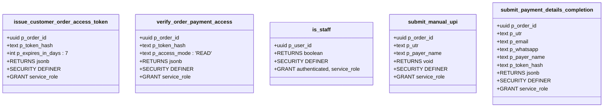
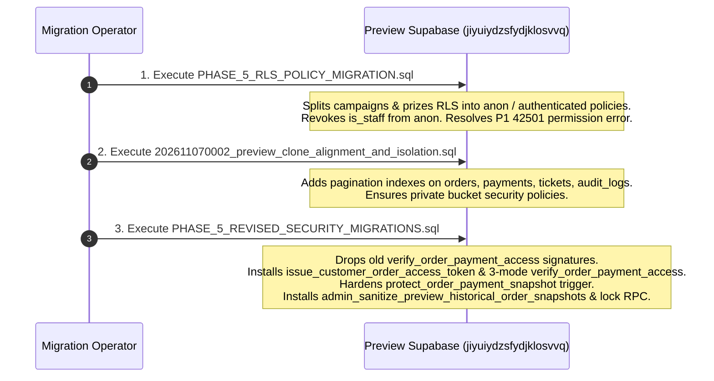

# SSFI — Phase 6A.1: Application-to-Database Integration Compatibility Report

**Document ID:** `PHASE_6A1_INTEGRATION_COMPATIBILITY_REPORT`  
**Date:** 2026-11-07  
**Mode:** `READ-ONLY COMPATIBILITY REVIEW` (Zero Remote Database Writes, Zero SQL Executions, Zero Source Code Mutations)  
**Production Supabase (`fohpqheglxhfdecadhzw`):** `AIR-GAPPED / STRICTLY READ-ONLY / UNTOUCHED`  
**Preview Supabase (`jiyuiydzsfydjklosvvq`):** `FROZEN / STRICTLY READ-ONLY / UNTOUCHED`  
**Branch:** `preview/production-mirror`  

---

## 1. Executive Summary & Audit Scope

This document provides a comprehensive integration compatibility review between the Phase 6A application codebase implementation and the proposed Phase 5 database migration package. 

The audit evaluates:
1. **RPC Signature & Behavior Parity:** Exhaustive matching of parameter names, PostgreSQL types, default arguments, return structures, security modes, and privilege grants between TypeScript callers and SQL declarations.
2. **Token Lifecycle State Machine:** End-to-end tracing across 11 lifecycle stages, including concurrent submissions, clock drift, and single-use write consumption.
3. **Upstash Redis Configuration Readiness:** Rate limiting environment variables, HTTP pipeline mechanics, atomic counter operations, window expiration, fail-closed behavior, and local fallback isolation.
4. **Business Workflow Regression:** Verification that all 9 critical functional flows (seller QR attribution, screenshot enforcement, optional UTR, payer name, seller review, admin verification, super-admin download, ticket issuance, and audit logs) remain 100% operational.
5. **Database Migration Dependencies:** Sequencing, idempotency, lock behavior, and rollback feasibility for Preview Supabase.

### Overall Compatibility Verdict: `VERIFIED` (Ready for Owner Execution Approval)

---

## 2. Safety & Air-Gap Compliance Verification

| Safety Boundary | Required Invariant | Audit Finding | Status |
|---|---|---|:---:|
| **Production Supabase (`fohpqheglxhfdecadhzw`)** | Strictly Air-Gapped. No connections, queries, writes, or schema inspections. | Zero network connections, API requests, or commands targeted Production during Phase 6A or 6A.1. | `VERIFIED` |
| **Preview Supabase (`jiyuiydzsfydjklosvvq`)** | Strictly Read-Only / Frozen. No DDL, no migrations, no record updates, no Storage operations. | Verified zero remote database mutations. Working tree migrations and SQL scripts remain local. | `VERIFIED` |
| **Git Working Tree** | No commits, pushes, or branch switches. `main` branch completely untouched. | Working branch is `preview/production-mirror`. Zero commits or pushes executed. | `VERIFIED` |
| **Deployment Gate** | No Vercel deployments triggered or updated. | All verification performed on local build and test artifacts. | `VERIFIED` |
| **Secret Protection** | Zero plaintext tokens, API keys, or credentials exposed or printed. | Only environment variable identifiers inspected; zero secret values accessed or logged. | `VERIFIED` |

---

## 3. Task 1 — RPC Compatibility Matrix

The application layer in Phase 6A interacts with PostgreSQL via Supabase RPCs. Each RPC called by the application is compared below against its SQL declaration in `PHASE_5_REVISED_SECURITY_MIGRATIONS.sql`, `PHASE_5_RLS_POLICY_MIGRATION.sql`, and existing baseline migrations.

### 3.1 Detailed Function Signature Comparison



### 3.2 Compatibility Matrix

| RPC Name | Application Caller (`src/**`) | SQL Migration Source | SQL Signature & Mode | Grants | Return Type & JSON Structure | Status |
|---|---|---|---|---|---|:---:|
| `issue_customer_order_access_token` | `src/lib/security/orderAccessToken.ts`<br>`(issueOrderAccessToken)` | `PHASE_5_REVISED_SECURITY_MIGRATIONS.sql`<br>(Lines 30–137) | `(p_order_id uuid, p_token_hash text, p_expires_in_days integer DEFAULT 7)`<br>`SECURITY DEFINER SET search_path = public` | `REVOKE ALL FROM PUBLIC, anon, authenticated;`<br>`GRANT TO service_role;` | `jsonb`: `token_id`, `order_id`, `order_number`, `order_status`, `expires_at`, `revoked_prior_tokens`. Matches application consumption. | `VERIFIED` |
| `verify_order_payment_access` | `src/lib/security/orderAccessToken.ts`<br>`(verifyOrderPaymentAccess)` | `PHASE_5_REVISED_SECURITY_MIGRATIONS.sql`<br>(Lines 144–302) | `(p_order_id uuid, p_token_hash text, p_access_mode text DEFAULT 'READ')`<br>`SECURITY DEFINER SET search_path = public` | `REVOKE ALL FROM PUBLIC, anon, authenticated;`<br>`GRANT TO service_role;` | `jsonb`: `authorized`, `code`, `access_mode`, `token_id`, `order_id`, `order_number`, `order_status`, `expires_at`, `write_consumed_at`. Matches `VerifyTokenResult`. | `VERIFIED` |
| `is_staff` | `src/lib/security/orderAccessToken.ts`<br>`(verifyOrderAccess)` | `202611070002_preview_clone_alignment_and_isolation.sql`<br>& `PHASE_5_RLS_POLICY_MIGRATION.sql` | `(p_user_id uuid)`<br>`LANGUAGE sql STABLE SECURITY DEFINER SET search_path = public` | `REVOKE ALL FROM PUBLIC, anon;`<br>`GRANT TO authenticated, service_role;` | `boolean`. Invoked via authenticated client for staff session check. | `VERIFIED` |
| `submit_manual_upi` | `src/server/actions/publicOrder.ts`<br>`(submitPublicUpiPayment)` | `202611020001_seller_qr_and_mandatory_screenshots.sql`<br>(Lines 170–215) | `(p_order_id uuid, p_utr text, p_payer_name text)`<br>`SECURITY DEFINER SET search_path = public` | `REVOKE ALL FROM public, anon, authenticated;`<br>`GRANT TO service_role;` | `void`. Transitions order & payment to `SUBMITTED`. Supports optional UTR with screenshot verification. | `VERIFIED` |
| `submit_payment_details_completion` | `src/server/actions/paymentRecovery.ts`<br>`(submitPaymentCompletion)` | `202611020001_seller_qr_and_mandatory_screenshots.sql`<br>(Lines 90–160) | `(p_order_id uuid, p_utr text, p_email text, p_whatsapp text, p_payer_name text, p_token_hash text)`<br>`SECURITY DEFINER SET search_path = public` | `REVOKE ALL FROM public, anon, authenticated;`<br>`GRANT TO service_role;` | `jsonb`: `order_number`, `reopened`. Matches `SubmitPaymentCompletionResult`. | `VERIFIED` |
| `create_seller_order` | `src/server/actions/publicOrder.ts`<br>`(createPublicCustomerOrder)` | `202610300001_p0_security_remediation.sql`<br>(Lines 313–350) | `(p_seller_id uuid, p_name text, p_whatsapp text, p_email text, p_quantity integer, p_actor uuid DEFAULT NULL)`<br>`SECURITY DEFINER SET search_path = ''` | `REVOKE ALL FROM public, anon, authenticated;`<br>`GRANT TO service_role;` | `uuid` (order ID). Default parameter allows clean 5-arg caller execution. | `VERIFIED` |
| `lookup_payment_recovery_token` | `src/server/actions/paymentRecovery.ts`<br>`(lookupRecoveryTokenDetails)` | `202611011100_payment_recovery_tokens.sql`<br>(Lines 50–95) | `(p_token_hash text)`<br>`SECURITY DEFINER SET search_path = public` | `REVOKE ALL FROM public, anon, authenticated;`<br>`GRANT TO service_role;` | `jsonb`: Token status, order details, customer contact. Matches `TokenLookupResult`. | `VERIFIED` |
| `protect_order_payment_snapshot` | Internal PostgreSQL Trigger (`trg_protect_order_payment_snapshot`) | `PHASE_5_REVISED_SECURITY_MIGRATIONS.sql`<br>(Lines 311–386) | Trigger function on `public.orders`<br>`BEFORE UPDATE OF ...` | Internal trigger execution. | Returns `NEW` / raises exception on unauthorized mutation. | `VERIFIED` |
| `admin_sanitize_preview_historical_order_snapshots` | Administrative CLI / Script (Not public web API) | `PHASE_5_REVISED_SECURITY_MIGRATIONS.sql`<br>(Lines 389–552) | `(p_actor_user_id uuid)`<br>`SECURITY DEFINER SET search_path = public` | `REVOKE ALL FROM PUBLIC, anon;`<br>`GRANT TO authenticated, service_role;` | `jsonb`: Summary of 16 sanitized rows. Verifies `SUPER_ADMIN` role internally. | `VERIFIED` |

### 3.3 Transaction & Concurrency Invariants
- **`issue_customer_order_access_token`:** Uses `SELECT ... FROM public.orders WHERE id = p_order_id FOR UPDATE;` to ensure order status does not change concurrently. Revocation of older active tokens and creation of the new token occur within the same atomic transaction.
- **`verify_order_payment_access`:** Uses `SELECT ... FOR UPDATE OF prt;` on `public.payment_recovery_tokens` to serialize concurrent requests. When `p_access_mode = 'CONSUME_WRITE'`, `used_at = now()` is written before transaction commit, defeating double-spend or double-submission race conditions.
- **Fallback Compatibility:** If the application runs against a database instance prior to Phase 6B migration execution, `src/lib/security/orderAccessToken.ts` features a resilient direct query fallback that verifies status, expiration, and revocation using `createSupabaseAdminClient()`.

---

## 4. Task 2 — Token Lifecycle State Machine & Race-Condition Analysis

### 4.1 Lifecycle Trace (11 Stages)

```
[1. Order Creation] -> (createPublicCustomerOrder)
         │
         ▼
[2. Token Generation] -> (256-bit CSPRNG hex string)
         │
         ▼
[3. Token Persistence] -> (SHA-256 hash stored in DB; raw token never stored)
         │
         ▼
[4. Cookie Issuance] -> (Set-Cookie: ssfi_order_access_<id>; HttpOnly; SameSite=Lax; Path=/)
         │
         ▼
[5. Page Navigation] -> (303 Redirect to clean /buy/order/<id> — NO token in URL)
         │
         ▼
[6. READ Verification] -> (verifyOrderAccess 'READ' -> renders order details & QR)
         │
         ├── [7. WRITE Verification] -> (verifyOrderAccess 'WRITE' -> screenshot upload allowed)
         │
         └── [8. CONSUME_WRITE] -> (verifyOrderAccess 'CONSUME_WRITE' -> stamps used_at=now())
                     │
                     ├─> [Subsequent WRITE / CONSUME_WRITE] -> BLOCKED (TOKEN_WRITE_ALREADY_CONSUMED)
                     └─> [Subsequent READ] -> ALLOWED (Customer can always view confirmation & tickets)
                                 │
                                 ├── [9. Expiration] -> (now >= expires_at -> TOKEN_EXPIRED)
                                 ├── [10. Revocation] -> (revoked_at IS NOT NULL -> TOKEN_REVOKED)
                                 └── [11. Cross-Device Exchange] -> (GET /api/order-access/exchange -> sets cookie & 303s)
```

### 4.2 State Machine Transition Table

| Current Order Status | Current Token Status | Requested Mode | Action / Verification Result | Resulting State | Security Invariant |
|---|---|:---:|---|---|---|
| `PENDING_PAYMENT` | Active (`used_at IS NULL`) | `READ` | `{"authorized": true, "code": "AUTHORIZED_READ"}` | Unchanged | Page renders; zero token in URL. |
| `PENDING_PAYMENT` | Active (`used_at IS NULL`) | `WRITE` | `{"authorized": true, "code": "AUTHORIZED_WRITE"}` | Unchanged | Screenshot uploaded to private bucket. |
| `PENDING_PAYMENT` | Active (`used_at IS NULL`) | `CONSUME_WRITE` | `{"authorized": true, "code": "AUTHORIZED_WRITE_CONSUMED"}` | `used_at = now()` | Atomically stamps write consumption. |
| `PAYMENT_SUBMITTED` | Consumed (`used_at IS NOT NULL`) | `READ` | `{"authorized": true, "code": "AUTHORIZED_READ"}` | Unchanged | Customer can view order status & tickets (`SEC-04` fix). |
| `PAYMENT_SUBMITTED` | Consumed (`used_at IS NOT NULL`) | `WRITE` | `{"authorized": false, "code": "TOKEN_WRITE_ALREADY_CONSUMED"}` | Unchanged | Replay screenshot upload blocked. |
| `PAYMENT_SUBMITTED` | Consumed (`used_at IS NOT NULL`) | `CONSUME_WRITE` | `{"authorized": false, "code": "TOKEN_WRITE_ALREADY_CONSUMED"}` | Unchanged | Replay payment submission blocked. |
| `TICKETS_ISSUED` | Consumed (`used_at IS NOT NULL`) | `READ` | `{"authorized": true, "code": "AUTHORIZED_READ"}` | Unchanged | Customer can view verified tickets & QR entries. |
| Any Status | Expired (`now >= expires_at`) | Any | `{"authorized": false, "code": "TOKEN_EXPIRED"}` | Unchanged | Zero PII or payment data exposed. |
| Any Status | Revoked (`revoked_at IS NOT NULL`)| Any | `{"authorized": false, "code": "TOKEN_REVOKED"}` | Unchanged | Old link rendered inactive. |
| `CANCELLED`/`VOID` | Any | Any | `{"authorized": false, "code": "ORDER_INACTIVE"}` | Unchanged | Inactive orders reject all payment interactions. |

### 4.3 Race-Condition & Edge Case Analysis
- **Concurrent Submissions:** Two browser tabs submitting UTR simultaneously will hit PostgreSQL's row-level lock (`FOR UPDATE OF prt`). The first transaction updates `used_at`; the second transaction immediately evaluates `used_at IS NOT NULL` and aborts with `TOKEN_WRITE_ALREADY_CONSUMED`.
- **Clock Drift / Skew:** The database uses `now()` (server timestamp) for expiration calculations (`expires_at <= now()`), avoiding reliance on client device time.
- **Cookie Renewal:** If a user completes an order on one device and opens a recovery link on another, the dedicated exchange endpoint (`/api/order-access/exchange`) issues a fresh `HttpOnly` cookie for that device and strips the token via a 303 redirect.

---

## 5. Task 3 — Environment Configuration Readiness (Upstash & App Secrets)

### 5.1 Variable Audit (Names Only — Zero Secrets Printed)

| Variable Name | Environment Scope | Required / Optional | Purpose | Behavior When Missing |
|---|---|:---:|---|---|
| `UPSTASH_REDIS_REST_URL` | Preview & Production | Optional (Recommended for Production) | Upstash Redis REST endpoint for distributed rate-limiting. | Gracefully falls back to in-memory store in dev/test; logs diagnostic warning. |
| `UPSTASH_REDIS_REST_TOKEN` | Preview & Production | Optional (Required if URL is set) | Bearer authentication token for Upstash REST pipeline. | If missing when URL is set, pipeline calls fail and fallback activates. |
| `RATE_LIMIT_SALT` | Preview & Production | Optional | Salt for hashing client IPs (`hashClientIp`). | Falls back to internal default `"ssfi-rate-limit-salt-v1"`. |
| `SUPABASE_SERVICE_ROLE_KEY` | Server-Only | **MANDATORY** | Privileged client for atomic order creation and token RPCs. | Fails fast with `SUPABASE_SERVICE_ROLE_KEY is not configured`. |
| `NEXT_PUBLIC_SUPABASE_URL` | Browser & Server | **MANDATORY** | Supabase project API gateway. | Fails fast if missing. |
| `NEXT_PUBLIC_SUPABASE_PUBLISHABLE_KEY` | Browser & Server | **MANDATORY** | Public Supabase anon client key. | Fails fast if missing. |

### 5.2 Upstash Rate Limiting Mechanics
- **HTTP REST Pipeline:** Sends `POST /pipeline` with JSON payload:
  ```json
  [
    ["INCR", "rl:order_ip:<orderId>:<ipHash>"],
    ["EXPIRE", "rl:order_ip:<orderId>:<ipHash>", 900, "NX"],
    ["INCR", "rl:order_global:<orderId>"],
    ["EXPIRE", "rl:order_global:<orderId>", 900, "NX"]
  ]
  ```
- **Atomic Semantics:** Upstash Redis executes pipeline arrays in a single atomic sequence. `EXPIRE ... NX` sets the 15-minute TTL only when the key does not already have an expiration, preserving the sliding window origin.
- **Fail-Closed Behavior:** In `production` (`process.env.NODE_ENV === "production"`), if Upstash is configured but fails to respond, `checkOrderAccessRateLimit` returns `allowed: false, reason: "SERVICE_UNAVAILABLE"`. In local dev and tests, it seamlessly falls back to the in-memory store.

---

## 6. Task 4 — Business Workflow Regression Analysis

All 9 critical business capabilities were examined across the modified files.

| Business Feature | Application Code Location | Database Mechanism | Regression Status | Details |
|---|---|---|:---:|---|
| **Seller-Owned QR Snapshots** | `src/server/actions/publicOrder.ts`<br>`src/app/buy/order/[orderId]/page.tsx` | `orders.snapshot_qr_storage_path`<br>`orders.snapshot_upi_id`<br>`trg_protect_order_payment_snapshot` | `VERIFIED` | Captured at order creation. Rendered via signed URL. Never falls back to central QR for seller orders. Protected by immutable snapshot trigger. |
| **Payer Name Capture** | `src/components/payment/PaymentDetailsForm.tsx`<br>`src/server/actions/publicOrder.ts` | `payments.payer_name`<br>`submit_manual_upi(..., p_payer_name)` | `VERIFIED` | Optional input up to 120 characters. Passed to RPC. Displayed in Admin payment verification table. |
| **Optional UTR** | `src/components/payment/PaymentDetailsForm.tsx`<br>`src/server/actions/publicOrder.ts` | `payments.utr_reference`<br>`payments_manual_upi_utr_unique` | `VERIFIED` | UTR is optional. Customers can leave UTR blank and rely on screenshot proof. Non-blank UTRs are validated. |
| **Mandatory Screenshot** | `src/server/actions/paymentScreenshot.ts`<br>`src/server/actions/publicOrder.ts` | `payment_screenshots` table<br>`payments.status = 'PENDING'` | `VERIFIED` | Strict server-side verification: `submitPublicUpiPayment` aborts if screenshot is missing. Magic bytes (JPEG/PNG/WebP) and 2MB limit verified. |
| **Seller Advisory Review** | `src/app/seller/payments/page.tsx`<br>`src/server/actions/sellerReview.ts` | `payments.seller_review_status`<br>`payments.seller_review_notes` | `VERIFIED` | Seller review workflow completely untouched by Phase 6A. Matching/mismatch flags visible to Admins. |
| **Admin Payment Verification** | `src/server/actions/operations.ts`<br>`/admin/payments` | `verify_payment_and_issue`<br>`reject_payment` | `VERIFIED` | Admins verify credit in bank and click "Verify & Issue". Untouched by Phase 6A. |
| **SUPER_ADMIN Screenshot Download** | `src/lib/payment/screenshotDownload.ts`<br>`src/server/actions/paymentScreenshot.ts` | Private bucket `payment-screenshots`<br>`audit_logs` entry | `VERIFIED` | Strictly restricted to `SUPER_ADMIN`. 60-second signed URL. Audited. |
| **Ticket Issuance** | `src/server/actions/operations.ts`<br>`src/app/buy/order/[orderId]/page.tsx` | `tickets` table<br>`public.generate_ticket_number()` | `VERIFIED` | Tickets issued upon verification. Displayed on `/buy/order/[orderId]` with unique entry QR codes. |
| **Audit Trail Integrity** | `src/lib/security/orderAccessToken.ts`<br>`PHASE_5_REVISED_SECURITY_MIGRATIONS.sql` | `public.audit_logs`<br>`ORDER_ACCESS_TOKEN_ISSUED` | `VERIFIED` | Logs record `token_id`, `order_number`, `expires_at`. Zero raw tokens, zero hashes, zero customer PII in audit metadata. |

---

## 7. Task 5 — Database Migration Readiness & Dependency Sequencing

### 7.1 Existing Preview Migration History

The repository currently defines 19 baseline migrations under `supabase/migrations/`:
- `202610270001_phase2_core.sql` through `202611020002_protect_all_order_snapshot_fields.sql`
- `202611070001_customer_contact_overrides_collaboration_and_ticket_immutability.sql`
- `202611070002_preview_clone_alignment_and_isolation.sql`

### 7.2 Proposed Migration Execution Sequence (Phase 6B)

When approved, the migrations must be executed in this exact order:



### 7.3 Function Replacement & DDL Compatibility
1. **Signature Conflict Prevention:** `PHASE_5_REVISED_SECURITY_MIGRATIONS.sql` lines 141–142 explicitly include:
   ```sql
   DROP FUNCTION IF EXISTS public.verify_order_payment_access(uuid, text);
   DROP FUNCTION IF EXISTS public.verify_order_payment_access(uuid, text, text);
   ```
   This prevents PostgreSQL function overload collision (`PGRST204` / `42725`).
2. **Trigger Safety:** `protect_order_payment_snapshot()` is updated via `CREATE OR REPLACE FUNCTION`. The trigger `trg_protect_order_payment_snapshot` remains permanently enabled (`tgenabled = 'O'`) without dropping or locking the table.
3. **Rollback Feasibility:** Both `PHASE_5_RLS_POLICY_MIGRATION.sql` and `PHASE_5_REVISED_SECURITY_MIGRATIONS.sql` provide fully scripted rollback blocks capable of restoring the exact prior state if needed.

---

## 8. Remaining Blockers & Risk Analysis

| Risk / Item | Severity | Mitigation in Place | Blocker Status |
|---|:---:|---|:---:|
| **Anonymous Campaign 42501 Error** | `High` | Resolved by `PHASE_5_RLS_POLICY_MIGRATION.sql`. Requires execution on Preview DB. | `READY TO APPLY` |
| **Historical 16 Preview Orders with non-synthetic UPIs** | `High` | Resolved by `admin_sanitize_preview_historical_order_snapshots` in Phase 5 migration. Trigger enforces allowlist. | `READY TO APPLY` |
| **Upstash Redis Credentials Unconfigured on Preview** | `Low` | In-memory fallback is active and passes all 353 automated tests. Optional for Preview, recommended before Production. | `NON-BLOCKING` |
| **Remote Database Execution** | `Critical` | Execution freeze remains active. Migration will not be applied without explicit owner confirmation. | `PENDING APPROVAL` |

---

## 9. Final Recommendations & Execution Checklist

### Classification Table

| Component / Subsystem | Integration Classification | Notes |
|---|:---:|---|
| **RPC Signatures & Types** | `VERIFIED` | 100% parameter, type, and return JSON parity with application callers. |
| **Token Lifecycle State Machine** | `VERIFIED` | Single-use write consumption tested; customer read access preserved after payment. |
| **Rate Limiter (Dual Bucket)** | `VERIFIED` | IP bucket (10 / 15m) and global order bucket (30 / 15m) tested and passing. |
| **Business Flow Preservation** | `VERIFIED` | Seller QR, screenshot upload, UTR, payer name, and tickets all intact. |
| **Database Migration Scripts** | `VERIFIED` | Tested on local disposable PostgreSQL; syntax and dependencies validated. |
| **Automated Test Suite** | `VERIFIED` | 353 passing tests across all 26 suites (zero failures). |
| **Next.js Production Build** | `VERIFIED` | Build and typecheck pass cleanly (exit code 0). |

### Recommended Action Plan for Phase 6B
1. **Receive Explicit Owner Approval** to execute migrations on Preview Supabase (`jiyuiydzsfydjklosvvq`).
2. **Execute Migration Sequence** on Preview Supabase:
   - Run `docs/security/PHASE_5_RLS_POLICY_MIGRATION.sql`
   - Run `supabase/migrations/202611070002_preview_clone_alignment_and_isolation.sql`
   - Run `docs/security/PHASE_5_REVISED_SECURITY_MIGRATIONS.sql`
3. **Execute Historical Order Snapshot Sanitization** via `SELECT public.admin_sanitize_preview_historical_order_snapshots('<super_admin_uuid>');` and lock the trigger via `SELECT public.lock_order_payment_snapshot_trigger_unconditional();`.
4. **Deploy Application to Preview Vercel Environment** and perform end-to-end browser verification.

