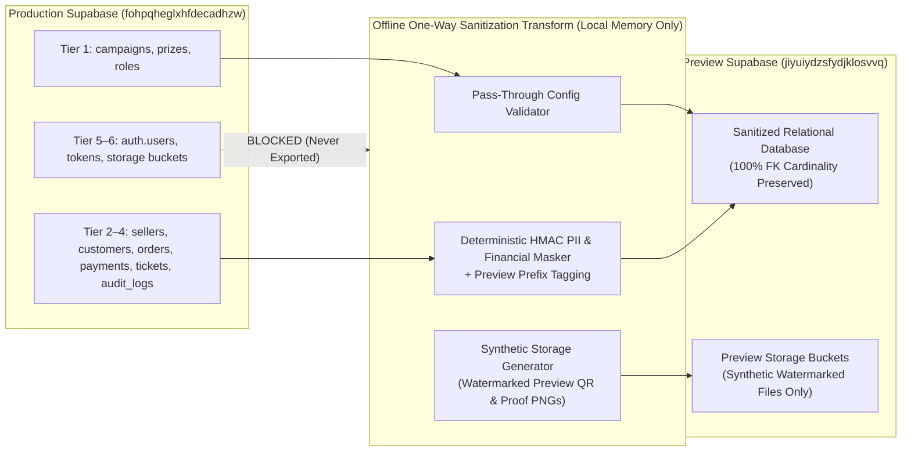

# SSFI Lucky Draw — Full Production Data Mirror: Security Risk Assessment & Migration Plan

- **Document ID:** `SSFI-SEC-2026-11-07-DATA-MIRROR`
- **Target Environments:**
  - **Production Supabase (Source — Strictly Protected):** `fohpqheglxhfdecadhzw` (Branch: `main`)
  - **Preview Supabase (Destination — Isolated Test Environment):** `jiyuiydzsfydjklosvvq` (Branch: `preview/production-mirror`)
- **Assessment Status:** Complete (Design, Risk Assessment & Planning Only)
- **Safety Declaration:** **Zero Production records, customer PII, payment records, storage objects, or credentials were queried, copied, exported, or modified during this assessment.** Production (`fohpqheglxhfdecadhzw`) and the `main` branch remain 100% untouched.

---

## Executive Summary & Go/No-Go Recommendation

The project owner requested an evaluation of making all Production business records visible in the Preview environment (`jiyuiydzsfydjklosvvq`) for comprehensive end-to-end testing.

### Formal Security Recommendation

1. **RAW / UNSANITIZED PRODUCTION DATA COPY TO PREVIEW: `STRICT NO-GO`**
   - Copying raw Production rows (`customers`, `payments`, `payment_screenshots`, `sellers.qr_storage_path`, `tickets`, `auth.users`) into Preview creates **critical operational and legal risks**:
     - **Accidental Real Customer Contact:** Triggering ticket resend or payment approval in Preview could email or WhatsApp real fundraising supporters if any live email/WhatsApp action is invoked.
     - **Real Financial Transfers in Preview:** Displaying real Seller UPI IDs and real Seller QR images in Preview (`/pay/[orderId]`) can cause testers to transfer real money to sellers during Preview tests.
     - **Ticket Counterfeiting / Verification Collision:** Copying raw `tickets` and `order_id` UUIDs allows Preview-generated ticket PDFs/QRs to impersonate or collide with Production `/verify` lookups.
     - **Exposure of Sensitive Banking Proof:** Copying `payment-screenshots` exposes real customer bank account numbers, UPI IDs, and transaction receipts to Preview testers.

2. **CONTROLLED, SANITIZED ONE-WAY SNAPSHOT MIRROR: `CONDITIONAL GO (WITH OWNER APPROVAL)`**
   - Preview can safely mirror **100% of Production's relational cardinalities, order volumes, seller attribution counts, payment status distributions, ticket quantities, and campaign/prize configurations** by executing a **Sanitized One-Way Snapshot Pipeline** where:
     - Every relational foreign key (`campaign_id`, `seller_id`, `customer_id`, `order_id`, `payment_id`, `ticket_id`) is preserved or deterministically mapped.
     - All customer PII (`full_name`, `phone`, `email`, `city`) is deterministically pseudonymized (`@preview-test.invalid`, `90000XXXXX`).
     - All financial identifiers (`utr_reference`, `payer_name`, `upi_id`) and storage objects (`payment-screenshots`, `seller-payment-qrs`) are replaced with watermarked `[PREVIEW TEST]` synthetic artifacts.
     - All authentication secrets (`auth.users`, `payment_access_tokens.token_hash`) are excluded.

---

## Phase 1 — Production & Preview Data Inventory

### 1.1 Provenance & Verification Basis

Per strict security policy, **no live queries were executed against Production (`fohpqheglxhfdecadhzw`)** and **Windows Credential Manager was not accessed**.
- **Inferred Production Schema & Configuration:** Derived from the authoritative version-controlled SQL migrations in `supabase/migrations/` (`202610150001_init_lucky_draw_schema.sql` through `202610290001_seller_qr_and_payment_review.sql` on `main`, plus Preview migrations up to `202611070001_customer_contact_overrides_collaboration_and_ticket_immutability.sql`).
- **Verified Preview Schema State (`jiyuiydzsfydjklosvvq`):** Verified via approved Preview environment credentials during Stage 4 validation.

### 1.2 Comprehensive Data Category Inventory

| # | Data Category | Database Table(s) / Storage Bucket | Provenance Status | Role in SSFI Workflow |
|---|---|---|---|---|
| 1 | **Customers** | `public.customers` | Schema Verified (Migrations) | Stores buyer contact profile (`full_name`, `phone`, `email`, `city`) linked to orders and tickets. |
| 2 | **Sellers** | `public.sellers`, `public.profiles`, `public.profile_roles` | Schema Verified (Migrations) | Stores fundraising seller accounts, referral codes (`SELLER-XXX`), active flags, and personal UPI/QR metadata. |
| 3 | **Orders** | `public.orders`, `public.order_collaboration_notes` | Schema Verified (Migrations) | Stores ticket purchase orders (`order_number`, `quantity`, `unit_price_paise`, `total_amount_paise`, `status`, `seller_id`, `snapshot_seller_id`). |
| 4 | **Payments** | `public.payments`, `public.payment_access_tokens` | Schema Verified (Migrations) | Stores payment reconciliation records (`utr_reference`, `payer_name`, `status`, seller advisory review fields, admin verification timestamps, and snapshot seller QR/UPI fields). |
| 5 | **Tickets** | `public.tickets`, `public.ticket_deliveries`, `public.customer_email_outbox` | Schema Verified (Migrations) | Stores issued lucky draw tickets (`ticket_number`, `status`, buyer contact overrides, void/reissue lineage) and email/WhatsApp delivery logs. |
| 6 | **Campaign Settings** | `public.campaigns`, `public.system_settings` | Schema Verified (Migrations) | Stores campaign slug (`ssfi-2026`), lifecycle status (`DRAFT`/`LIVE`/`PAUSED`/`ENDED`), schedule (`starts_at`, `ends_at`, `draw_at`), YouTube broadcast URL, and email live gates. |
| 7 | **Ticket Pricing** | `public.campaigns.ticket_price_paise`, `public.orders.unit_price_paise` | Inferred from Migration Seed (`50000` paise = ₹500) | Defines per-ticket fundraising price in paise (`ticket_price_paise > 0`). |
| 8 | **Prize Configurations** | `public.prizes`, `public.draw_runs`, `public.draw_results` | Inferred from Migration Seed (Ranks 1–3) | Defines campaign prize tiers (`rank`, `title`, `description`, `quantity`, `value_label`) and draw execution records. |
| 9 | **Audit Logs** | `public.audit_logs` | Schema Verified (Migrations + Preview) | Centralized append-only ledger of Admin, Seller, and System actions with `metadata` JSONB (`old_value`, `new_value`, `reason`). |
| 10 | **Payment Events** | `public.payment_events` | Schema Verified (Migrations + Preview) | Low-level payment state transition and screenshot upload/replacement log. |
| 11 | **Seller QR Configuration** | `public.sellers` (`qr_storage_path`, `upi_id`, `account_name`, `payment_instructions`, `is_qr_active`) | Schema Verified (Migrations) | Controls strict Seller-owned personal QR payment routing (`Option 2`) and Admin QR activation gate. |
| 12 | **Storage Bucket Metadata** | `storage.buckets` / `storage.objects`: `payment-screenshots`, `seller-payment-qrs` | Schema Verified (Migrations) | Private Supabase Storage buckets holding customer payment proof images and seller UPI QR images. |
| 13 | **Authentication Relationships** | `auth.users` → `public.profiles` → `public.profile_roles` (`roles`) → `public.sellers` | Schema Verified (Migrations) | Maps Supabase Auth identities (`UUID`) to staff roles (`SUPER_ADMIN`, `ADMIN`, `FUNDRAISING_MANAGER`) and `SELLER` profiles. |

---

## Phase 2 — Privacy & Security Classification

Every table and field in the SSFI Lucky Draw schema is classified into one of six sensitivity tiers:

| Tier | Classification | Definition | Risk of Copying Unsanitized into Preview |
|---|---|---|---|
| **Tier 1** | **Public Business Configuration** | Publicly visible campaign, pricing, and prize metadata. | **Low Risk:** Safe to synchronize directly after owner verification. |
| **Tier 2** | **Internal Business Information** | Non-PII operational counters, statuses, timestamps, and referral codes. | **Low-Medium Risk:** Safe to mirror if linked PII and financial references are sanitized. |
| **Tier 3** | **Personal Information (PII)** | Customer and Seller names, phone numbers, email addresses, and cities. | **High Risk:** Violates data minimization (India DPDP Act 2023) and risks accidental live email/WhatsApp dispatch to real buyers from Preview. |
| **Tier 4** | **Financial Information** | Bank UTR numbers, payer names, Seller personal UPI IDs, and bank account holder names. | **Critical Risk:** Real Seller UPI IDs in Preview can cause real funds to be sent during test checkouts; real UTRs expose banking audit trails. |
| **Tier 5** | **Authentication & Security Information** | Password hashes, JWTs, refresh tokens, recovery tokens, token hashes, API keys, webhook secrets. | **Critical Risk:** Allows cross-environment credential replay or unauthorized account takeover. **Must NEVER be copied.** |
| **Tier 6** | **Sensitive Operational Evidence** | Customer payment screenshot images (`payment-screenshots`) and Seller personal QR images (`seller-payment-qrs`). | **Critical Risk:** Screenshots contain raw bank account numbers, UPI apps, and personal transaction receipts. **Must NEVER be copied.** |

### Table & Field Classification Matrix

| Table / Bucket | Tier 1 (Public Config) | Tier 2 (Internal Business) | Tier 3 (Personal Info / PII) | Tier 4 (Financial Info) | Tier 5 (Auth / Security) | Tier 6 (Sensitive Evidence) |
|---|---|---|---|---|---|---|
| `public.campaigns` | `slug`, `title`, `description`, `status`, `ticket_price_paise`, `starts_at`, `ends_at`, `draw_at`, `youtube_url`, `max_tickets_per_order` | `id`, `created_at`, `updated_at` | — | — | — | — |
| `public.prizes` | `rank`, `title`, `description`, `quantity`, `value_label` | `id`, `campaign_id`, `created_at` | — | — | — | — |
| `public.roles` & `public.profile_roles` | — | `id`, `name`, `profile_id`, `role_id` | — | — | — | — |
| `public.profiles` | — | `id`, `is_active`, `created_at`, `updated_at` | `full_name`, `email`, `phone` | — | Linked to `auth.users` | — |
| `public.sellers` | `seller_code`, `is_active`, `is_qr_active` | `id`, `profile_id`, `payment_instructions`, `qr_updated_at`, `created_at` | `display_name` | `upi_id`, `account_name`, `qr_storage_path` | — | QR file in `seller-payment-qrs` |
| `public.customers` | — | `id`, `created_at`, `updated_at` | `full_name`, `phone`, `email`, `city` | — | — | — |
| `public.orders` | — | `id`, `order_number`, `campaign_id`, `customer_id`, `seller_id`, `snapshot_seller_id`, `snapshot_seller_code`, `quantity`, `unit_price_paise`, `total_amount_paise`, `currency`, `status`, `expires_at`, `created_at` | `snapshot_seller_name` | — | — | — |
| `public.payments` | — | `id`, `order_id`, `amount_paise`, `currency`, `status`, `provider`, `seller_review_status`, `seller_reviewed_at`, `verified_by`, `verified_at`, `rejection_reason` | `seller_review_note` | `utr_reference`, `payer_name`, `provider_Generate_id`, `snapshot_upi_id`, `snapshot_account_name`, `snapshot_qr_storage_path` | — | — |
| `public.payment_screenshots` | — | `id`, `payment_id`, `content_type`, `file_size_bytes`, `uploaded_at` | — | — | — | `storage_path` (Image in `payment-screenshots`) |
| `public.payment_access_tokens` | — | `id`, `order_id`, `payment_id`, `expires_at`, `used_at`, `revoked_at` | — | — | `token_hash` | — |
| `public.tickets` | — | `id`, `ticket_number`, `campaign_id`, `order_id`, `customer_id`, `seller_id`, `status`, `issued_at`, `void_reason`, `reissued_from_ticket_id`, `reissued_to_ticket_id` | `buyer_full_name`, `buyer_phone`, `buyer_email`, `buyer_city`, `admin_notes` | — | — | — |
| `public.customer_email_outbox` | — | `id`, `idempotency_key`, `order_id`, `customer_id`, `event_type`, `status`, `attempt_count`, `provider`, `sent_at` | `recipient`, `subject`, `body_text`, `body_html`, `metadata` | — | — | — |
| `public.audit_logs` | — | `id`, `actor_user_id`, `action`, `entity_type`, `entity_id`, `created_at` | `metadata.old_value`, `metadata.new_value`, `metadata.reason` (when containing customer contact info) | `metadata` (when containing UTR/UPI) | `metadata` (any tokens — redacted via `sanitizeAuditMetadata`) | — |
| `auth.users` / `auth.*` | — | — | `email`, `phone`, `raw_user_meta_data` | — | `encrypted_password`, `recovery_token`, `confirmation_token`, `refresh_tokens`, `sessions`, `mfa_factors` | — |

---

## Phase 3 — Proposed Data Migration Strategy (Controlled One-Way Sanitized Snapshot)

To give the owner realistic Production volume, order history, seller leaderboards, and edge-case states in Preview **without exposing a single real person's phone/email/bank proof or risking live messages**, we propose a **Deterministic Sanitized Snapshot Architecture**:

### 3.1 Ten Mandatory Security Controls

1. **Deterministic PII Masking (`customers`, `tickets`, `profiles`):**
   - Full Name: `"Preview Buyer #" + Left(HMAC_SHA256(customer.id, PREVIEW_SALT), 6)` (e.g., `[PREVIEW] Buyer #4F9A1C`).
   - Phone: Deterministic 10-digit non-routable test number in the `90000XXXXX` block (`90000` + 5 digits derived from row index) so uniqueness and search filters work without ever dialing a real person on WhatsApp.
   - Email: `buyer.<short_hash>@preview-test.invalid` (RFC 2606 `.invalid` TLD guarantees zero external email delivery even if a mail MTA is misconfigured).
   - City: Preserved at state/metro level or mapped to a fixed list (`Chennai`, `Bengaluru`, `Mumbai`, `Delhi`, `Hyderabad`) to preserve geographic distribution charts without street-level address exposure.

2. **Financial Reference Masking (`payments`, `sellers`):**
   - `payments.utr_reference`: Replaced with `PRVUTR` + 6-digit deterministic sequence (e.g., `PRVUTR000142`), preserving uniqueness for UTR search/duplicate tests while hiding real bank UTR numbers.
   - `payments.payer_name`: Replaced with `[PREVIEW] Payer #<short_hash>`.
   - `sellers.upi_id` & `payments.snapshot_upi_id`: Replaced with `preview.<seller_code>@upi` (e.g., `preview.seller001@upi`), preventing accidental real UPI transfers when scanning or tapping UPI links in Preview.
   - `sellers.account_name` & `payments.snapshot_account_name`: Replaced with `[PREVIEW TEST] <seller_code> Account`.

3. **Secure Storage File Handling (`payment-screenshots`, `seller-payment-qrs`):**
   - **Zero Production Storage Copy:** Raw objects in `payment-screenshots` and `seller-payment-qrs` are **never** downloaded from Production or uploaded to Preview.
   - Instead, `payment_screenshots.storage_path` and `sellers.qr_storage_path` in Preview point to shared, pre-generated synthetic watermarked images in Preview Storage:
     - `preview-fixtures/synthetic-payment-proof.png` (watermarked `"SSFI PREVIEW TEST RECEIPT — NOT VALID FOR REAL PAYMENT"`).
     - `preview-fixtures/synthetic-seller-qr.png` (watermarked `"SSFI PREVIEW TEST QR — DO NOT PAY"`).

4. **Ticket Identity Separation (`tickets`):**
   - Production `ticket_number` values (`SSFI-XXXXX`) are prefixed in Preview as `PRV-SSFI-XXXXX` (or `order_number` prefixed `PRV-SSFI-2026-XXXX`).
   - This guarantees that a screenshot or PDF of a Preview ticket can **never** be presented as a valid winning ticket in Production `/verify`.

5. **Authentication Exclusion (`auth.*`, `payment_access_tokens`):**
   - `auth.users`, `auth.identities`, `auth.sessions`, `auth.refresh_tokens`, `auth.mfa_factors`, and `public.payment_access_tokens` are **completely excluded** from any snapshot.
   - Preview uses its own dedicated Preview Auth accounts (`admin@ssfi.in` / Preview test sellers) mapped by `seller_code` and role.

6. **Audit Metadata Redaction (`audit_logs`, `order_collaboration_notes`):**
   - When mirroring `audit_logs`, `metadata` is passed through `sanitizeAuditMetadata()` plus a PII scrubber that replaces any `old_value` / `new_value` email, phone, full name, or UTR with the corresponding deterministic Preview masked value.

7. **Preview-Only Test Markers:**
   - Every mirrored record includes `"is_preview_mirror": true` in its metadata/notes, and customer/payer names carry the `[PREVIEW]` prefix so Admins can never confuse Preview records with live Production records.

8. **Data Integrity Verification:**
   - Post-load verification checks confirm that row counts per status (`PENDING`, `SUBMITTED`, `VERIFIED`, `REJECTED`, `ISSUED`, `VOIDED`), total paise sums (`SUM(total_amount_paise)`), and per-seller order counts match Production's aggregate totals 1:1.

9. **Snapshot Backup & Restoration:**
   - Before loading a sanitized snapshot into Preview (`jiyuiydzsfydjklosvvq`), the current Preview tables are backed up to a local timestamped JSON/SQL dump in an ignored backup folder so Preview can be rolled back in <60 seconds.

10. **Retention Policy:**
    - Mirrored Preview test datasets have a maximum retention of **14 days** (or until the end of the campaign testing cycle), after which Preview is reset to clean synthetic seed fixtures.

---

## Phase 4 — Integration & Operational Safety Controls

| Integration / Vector | Risk Scenario | Active & Proposed Isolation Controls |
|---|---|---|
| **1. Google Apps Script Email Delivery** | Preview triggers `enqueueCustomerEmail` / `processEmailJob` and dispatches emails to real buyers. | **Triple-Layer Defence:** 1. `outbox.ts` checks `isDev` (`VERCEL_ENV === "preview"`) and forces `SIMULATED` mode unless recipient matches `APPROVED_PREVIEW_TEST_EMAIL`. 2. All mirrored customer emails use `.preview-test.invalid` TLD. 3. `customer_email_outbox` rows are **not** copied from Production, preventing background retry workers from picking up pending jobs. |
| **2. WhatsApp Click-to-Chat Notifications** | Admin or Seller clicks "Send via WhatsApp" in Preview and messages a real buyer. | All mirrored customer and ticket phone numbers in Preview are mapped to the non-routable `90000XXXXX` range (`+91 90000 XXXXX`), making accidental real WhatsApp contact impossible. |
| **3. Preview Seller UPI QR Payments** | A tester scans a QR code on `/pay/[orderId]` in Preview and sends real money to a seller. | Seller `qr_storage_path` in Preview points exclusively to a watermarked synthetic QR (`SSFI PREVIEW TEST QR — DO NOT PAY`), and `upi_id` is replaced with `preview.<seller_code>@upi`. |
| **4. Preview Admin Actions Mutating Production** | An Admin logged into the Preview URL approves/rejects a payment thinking it affects Production, or Preview connects to Production DB. | Preview Vercel environment variables (`NEXT_PUBLIC_SUPABASE_URL`, `SUPABASE_SERVICE_ROLE_KEY`) point strictly to `jiyuiydzsfydjklosvvq`. Zero network path exists from Preview to `fohpqheglxhfdecadhzw`. |
| **5. Public Preview URLs Exposing Private Data** | `/verify` or `/pay/[orderId]` on Preview URL is guessed or accessed externally. | All Preview records contain only pseudonymized `[PREVIEW]` names and synthetic `.invalid` emails; `payment-screenshots` and `seller-payment-qrs` buckets remain private (`public = false`) with RLS blocking anonymous reads. |
| **6. Duplicate Ticket Identities** | A ticket issued in Preview shares a `ticket_number` (`SSFI-00105`) and `order_id` with Production. | Mirrored and newly issued Preview tickets use the `PRV-` prefix or exist only in `jiyuiydzsfydjklosvvq`, while Production `/verify` queries only `fohpqheglxhfdecadhzw`. |
| **7. Duplicate Payment Verification** | Re-verifying a payment in Preview triggers duplicate external side effects. | Preview runs in `SIMULATED` email outbox mode and isolated database transactions (`verify_payment_and_issue` on `jiyuiydzsfydjklosvvq`). |

---

## Phase 5 — Table-by-Table & Field-Level Migration Plan

### 5.1 Topological Dependency Order & Table Migration Matrix

To satisfy all PostgreSQL foreign-key constraints without disabling triggers or integrity checks, tables must be populated in the following strict topological order:

| Step | Table / Bucket | Action | Foreign-Key Mapping Strategy | Row Volume Policy |
|---|---|---|---|---|
| **1** | `public.roles` | Verify existing (`SUPER_ADMIN`, `ADMIN`, `FUNDRAISING_MANAGER`, `SELLER`) | Match by `roles.name` | Exact match (4 rows) |
| **2** | `public.campaigns` | Upsert non-sensitive configuration | Preserve `campaigns.id` or map by `slug = 'ssfi-2026'` | Full copy (Tier 1 Public Config) |
| **3** | `public.prizes` | Upsert prize tiers for campaign | Map `campaign_id` | Full copy (Tier 1 Public Config) |
| **4** | `public.system_settings` | Upsert non-secret keys (`customer_email_events`); force `customer_email_live_enabled = false` in Preview | Key-based upsert | Sanitized copy (Live email forced `false`) |
| **5** | `public.profiles` & `public.sellers` | Map existing Preview Auth users for Admin/Sellers; insert sanitized placeholder profiles for additional seller codes | Preserve `seller_code` (`SELLER-001`..`SELLER-NNN`); map `profile_id` to Preview Auth UUIDs | Sanitize `display_name`, `email`, `phone`, `upi_id`, `account_name`, `qr_storage_path` |
| **6** | `public.customers` | Insert pseudonymized customer records | Preserve `customers.id` (or deterministic UUID v5) | 100% cardinality preserved; all PII masked |
| **7** | `public.orders` | Insert orders with preserved status, quantities, and seller attribution | Preserve `orders.id`, `customer_id`, `seller_id`, `snapshot_seller_id` | 100% cardinality preserved; prefix `order_number` with `PRV-` |
| **8** | `public.payments` | Insert payments with masked financial fields | Preserve `payments.id`, `order_id`; map `verified_by` / `seller_reviewed_by` to Preview Admin/Seller profile UUIDs | 100% cardinality preserved; mask `utr_reference`, `payer_name`, `snapshot_upi_id` |
| **9** | `public.payment_screenshots` | Insert metadata rows pointing to synthetic watermarked Preview image | Preserve `id`, `payment_id` | Replace `storage_path` with `preview-fixtures/synthetic-payment-proof.png` |
| **10** | `public.tickets` | Insert tickets with masked buyer contact overrides | Preserve `id`, `order_id`, `customer_id`, `seller_id` | Prefix `ticket_number` with `PRV-`; mask `buyer_full_name`, `buyer_phone`, `buyer_email` |
| **11** | `public.order_collaboration_notes` | Insert sanitized internal notes | Preserve `id`, `order_id`; map `author_user_id` to Preview profile UUID | Scrub any inline phone/email/UTR strings in `note_body` |
| **12** | `public.payment_events` & `public.audit_logs` | Insert sanitized event timeline | Preserve `id`, `entity_id`; map `actor_user_id` to Preview profile UUID | Scrub PII/tokens in `metadata` via `sanitizeAuditMetadata()` |
| **—** | `public.payment_access_tokens`, `public.customer_email_outbox`, `auth.*` | **DO NOT COPY** | Excluded | **0 rows copied** (Prevents token replay and accidental email dispatch) |

### 5.2 Field-Level Sanitization Matrix

| Table.Column | Source Classification | Transformation Rule for Preview | Example Preview Output |
|---|---|---|---|
| `customers.full_name` | Tier 3 (PII) | `"[PREVIEW] Buyer #" \|\| Upper(Left( md5(id::text), 6 ))` | `[PREVIEW] Buyer #8A3F19` |
| `customers.phone` | Tier 3 (PII) | `"90000" \|\| LPAD((row_num % 100000)::text, 5, '0')` | `9000000142` |
| `customers.email` | Tier 3 (PII) | `"buyer." \|\| Left(md5(id::text), 8) \|\| "@preview-test.invalid"` | `buyer.8a3f19c2@preview-test.invalid` |
| `customers.city` | Tier 3 (PII) | Keep state/city only if in top-20 metro list, else `"Chennai (Preview)"` | `Chennai (Preview)` |
| `sellers.display_name` | Tier 3 (PII) | `"[PREVIEW] Seller " \|\| seller_code` | `[PREVIEW] Seller SELLER-001` |
| `sellers.upi_id` | Tier 4 (Financial) | `"preview." \|\| lower(replace(seller_code, '-', '')) \|\| "@upi"` | `preview.seller001@upi` |
| `sellers.account_name` | Tier 4 (Financial) | `"[PREVIEW TEST] " \|\| seller_code \|\| " Account"` | `[PREVIEW TEST] SELLER-001 Account` |
| `sellers.qr_storage_path` | Tier 6 (Evidence) | Replace with synthetic watermarked QR path | `preview-fixtures/synthetic-seller-qr.png` |
| `orders.order_number` | Tier 2 (Internal) | `"PRV-" \|\| order_number` | `PRV-SSFI-2026-00142` |
| `orders.snapshot_seller_name` | Tier 3 (PII) | `"[PREVIEW] Seller " \|\| COALESCE(snapshot_seller_code, 'Assigned')` | `[PREVIEW] Seller SELLER-001` |
| `payments.utr_reference` | Tier 4 (Financial) | `"PRVUTR" \|\| LPAD((row_num)::text, 6, '0')` | `PRVUTR000142` |
| `payments.payer_name` | Tier 4 (Financial) | `"[PREVIEW] Payer #" \|\| Upper(Left(md5(id::text), 6))` | `[PREVIEW] Payer #2C91B4` |
| `payments.snapshot_upi_id` | Tier 4 (Financial) | `"preview.snapshot@upi"` | `preview.snapshot@upi` |
| `payments.snapshot_account_name` | Tier 4 (Financial) | `"[PREVIEW TEST] Snapshot Seller Account"` | `[PREVIEW TEST] Snapshot Seller Account` |
| `payments.snapshot_qr_storage_path` | Tier 6 (Evidence) | `"preview-fixtures/synthetic-seller-qr.png"` | `preview-fixtures/synthetic-seller-qr.png` |
| `payment_screenshots.storage_path` | Tier 6 (Evidence) | `"preview-fixtures/synthetic-payment-proof.png"` | `preview-fixtures/synthetic-payment-proof.png` |
| `tickets.ticket_number` | Tier 2 (Internal) | `"PRV-" \|\| ticket_number` | `PRV-SSFI-00289` |
| `tickets.buyer_full_name` | Tier 3 (PII) | Masked to match `customers.full_name` (or `"[PREVIEW OVERRIDE] Buyer"`) | `[PREVIEW OVERRIDE] Buyer #8A3F19` |
| `tickets.buyer_phone` | Tier 3 (PII) | Masked to `90000XXXXX` | `9000000142` |
| `tickets.buyer_email` | Tier 3 (PII) | Masked to `*.@preview-test.invalid` | `override.8a3f19c2@preview-test.invalid` |
| `audit_logs.metadata` | Tier 3/4/5 | Pass through `sanitizeAuditMetadata()` + replace PII/UTR fields | Secrets `[REDACTED]`, PII masked |

### 5.3 Validation & Rollback Procedures

1. **Pre-Migration Backup:**
   - Export current Preview (`jiyuiydzsfydjklosvvq`) public tables (`campaigns`, `prizes`, `sellers`, `customers`, `orders`, `payments`, `payment_screenshots`, `tickets`, `audit_logs`) to a local restore point before any snapshot load.
2. **Post-Migration Validation Checks:**
   - Verify zero `.com` / `.in` real customer emails exist in Preview `customers`, `tickets`, or `customer_email_outbox` (`SELECT count(*) FROM public.customers WHERE email NOT LIKE '%@preview-test.invalid' AND email NOT LIKE '%@example.com'`).
   - Verify zero real Seller UPI IDs exist in Preview `sellers` or `payments` (`SELECT count(*) FROM public.sellers WHERE upi_id IS NOT NULL AND upi_id NOT LIKE 'preview.%@upi'`).
   - Verify `system_settings.customer_email_live_enabled` is `false` in Preview.
   - Verify `orders <-> sellers` and `payments <-> orders` joins return zero `PGRST201` errors across `/admin/orders`, `/admin/payments`, and `/admin/audit-logs`.
3. **Emergency Rollback Procedure:**
   - Truncate the mirrored Preview business tables (`orders`, `payments`, `payment_screenshots`, `tickets`, `customers`) on `jiyuiydzsfydjklosvvq` and restore the pre-migration Preview snapshot backup. Production (`fohpqheglxhfdecadhzw`) is never touched during migration or rollback.

---

## Phase 6 — Required Owner Approvals Checklist

Before any sanitized snapshot script is executed, the project owner must explicitly review and approve the following decisions:

- [ ] **Approval 1 (Sanitized vs. Raw Data):** Confirm acceptance of the **Sanitized One-Way Snapshot** (where customer names, phones, emails, UTRs, and Seller UPI/QRs are masked with `[PREVIEW]` test values while preserving 100% of order/payment/ticket counts and relationships) instead of copying raw PII/financial data.
- [ ] **Approval 2 (Read-Only Production Export Mechanism):** Provide an approved, temporary read-only export mechanism (or run the read-only sanitization query directly in the Supabase SQL Editor on `fohpqheglxhfdecadhzw` and save the already-sanitized JSON output) so no Production credentials or raw PII ever enter the development workspace.
- [ ] **Approval 3 (Preview Retention Window):** Confirm the 14-day retention policy for mirrored test data in Preview (`jiyuiydzsfydjklosvvq`).

