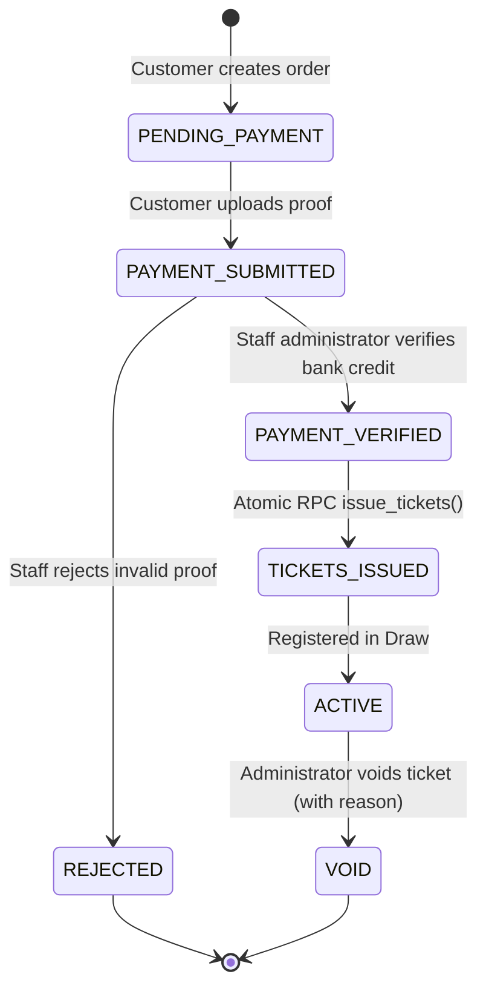

# SSFI Lucky Draw Management System — Ticket Issuance & Public Verification Architecture

**Document Version:** 2.0.0
**Target Platform:** Next.js 16 App Router &bull; PostgreSQL Sequence &bull; Public Verification Portal
**Reference Code:** `src/app/verify/[ticketNumber]/page.tsx`, `src/lib/ticket/qr.ts`, `supabase/migrations/202610270001_phase2_core.sql`

---

## 1. Official Ticket Numbering Specification

All official SSFI Lucky Draw tickets are authoritatively generated through a central PostgreSQL database sequence.

### 1.1 Numbering Format
- **Format:** `SSFI-######` (e.g., `SSFI-000001`, `SSFI-000002`, `SSFI-000042`)
- **Padding:** 6-digit zero-padded representation generated via PostgreSQL `lpad(v_number::text, 6, '0')`.
- **Database Sequence:** `public.ssfi_ticket_number_sequence`
  - Start value: `1`
  - Increment: `1`
  - Maximum value: `999,999`
- **Uniqueness Guarantee:** The `tickets.ticket_number` column enforces a strict PostgreSQL `UNIQUE` constraint, backed by atomic sequence allocation inside an isolated row-level transaction lock (`SELECT ... FOR UPDATE`).

---

## 2. Authorized Ticket Issuance Lifecycle

Tickets are **never** issued automatically upon customer order submission. Ticket issuance is strictly gated behind staff payment verification.



### 2.1 Preconditions for Ticket Allocation
The database stored procedure `issue_tickets(p_order_id)` strictly enforces:
1. **Verified Payment:** A corresponding record in `payments` must have `status = 'VERIFIED'` and `amount_paise = orders.total_amount_paise`.
2. **Order Eligibility:** The order status must be `PAYMENT_VERIFIED`.
3. **Active Campaign:** The associated campaign must be `status = 'ACTIVE'`.
4. **Quota Availability:** `sold_ticket_count + order.quantity <= total_ticket_limit`.
5. **Caller Isolation:** Execution is revoked from `public`, `anon`, and `authenticated`, granted strictly to `service_role`.

---

## 3. Public Ticket Verification Portal (`/verify/[ticketNumber]`)

The public verification portal allows customers, organizers, and draw auditors to verify the authentic registration status of any lucky draw ticket.

- **Canonical Verification URL Pattern:**
  `https://ssfiticket.vercel.app/verify/[ticketNumber]`
  *(e.g., `https://ssfiticket.vercel.app/verify/SSFI-000001`)*

### 3.1 Verification Lookup Mechanism
1. The route parses and normalizes the URL parameter:
   ```ts
   const cleanNumber = decodeURIComponent(ticketNumber).trim().toUpperCase();
   ```
2. Queries the database using the privileged administrative client:
   ```ts
   const { data: ticket } = await db
     .from("tickets")
     .select("ticket_number, status, issued_at, void_reason, campaigns(name)")
     .eq("ticket_number", cleanNumber)
     .maybeSingle();
   ```
3. Evaluates ticket authenticity across three distinct states:

| Display State | Criteria | Displayed Information |
| :--- | :--- | :--- |
| **Official Registered Ticket** | `status === 'ISSUED'` or `status === 'ACTIVE'` | Green badge, ticket number, QR code, issued date, campaign name, confirmation of draw eligibility. |
| **Ticket Entry Voided** | `status === 'VOID'` | Red badge, strikethrough ticket number, void reason, notification that the ticket is ineligible for prizes. |
| **Record Pending or Not Found** | Ticket not found or order pending | Amber warning badge, explanation that the ticket record does not exist or payment is still pending staff review. |

### 3.2 QR Code Verification Architecture
- **Look-up Destination:** Each ticket certificate generates a QR code embedding the ticket's direct public verification URL (`https://ssfiticket.vercel.app/verify/[ticketNumber]`).
- **Nature of Verification:** The verification mechanism is an **authoritative live database registry lookup**. When scanned by a phone camera, it directs the user directly to the official SSFI verification portal.
- **Accuracy Note:** The QR code represents a direct URL resolver; it is not an offline cryptographic signature. Authenticity is guaranteed by live database query against the authoritative PostgreSQL registry.

---

## 4. Digital Ticket Confirmation & Delivery Outbox

Upon successful ticket issuance:
1. **Customer Order Page (`/buy/order/[orderId]`):** Updates in real-time to display issued ticket numbers and personalized verification QR codes.
2. **WhatsApp Direct Delivery:** Generates pre-formatted WhatsApp share links via the `WhatsAppTicketDeliveryButton` component, allowing buyers and sellers to forward official ticket certificates to the buyer's registered phone number.
3. **Automated Transactional Email:** Enqueues outbox records in `ticket_deliveries` to dispatch official HTML ticket confirmation receipts containing sequential ticket numbers and direct verification links.
